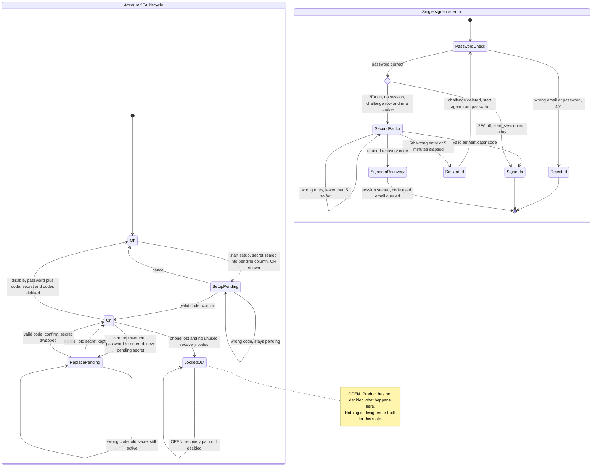
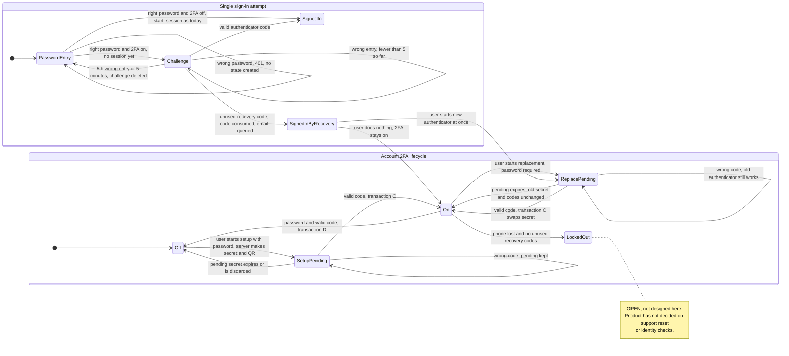

# Pair 02

Which document would a smart engineer who does not know this project understand faster and more correctly?

---

# Document A

# Two-factor sign-in with an authenticator app: lifecycle and sign-in attempt

This adds optional two-factor authentication (2FA) to the existing email-and-password login, using TOTP. TOTP is the standard behind Google Authenticator and 1Password. The user's app and the server share a secret. Every 30 seconds both compute the same 6-digit code from that secret and the current time. Each 30-second period is a "time step".

The design reuses what exists today: `seal`/`unseal` (AES-GCM encryption for secrets at rest), `enqueue_email` (background email queue), `start_session` and the `sid` session cookie. The password check in `login()` is unchanged. The only change to `login()` is what happens after a correct password: if the user has 2FA on, no session is created yet.

## Terms

- **Active secret**: the secret that sign-in checks.
- **Pending secret**: a newly generated secret that the user has not yet proved they can use. Sign-in ignores it.
- **Recovery code**: a single-use code the user types instead of an authenticator code when the phone is lost.
- **Challenge**: the in-between sign-in step after a correct password and before the second factor. It is short-lived and creates no session.

## Where the new state lives

| State | Location | Notes |
|---|---|---|
| Active secret | `users.totp_secret_sealed bytea NULL` | Written with `seal()`. Sign-in reads only this column. |
| Pending secret | `users.totp_pending_sealed bytea NULL` | Written with `seal()`. Sign-in ignores it. |
| 2FA on | `users.totp_enabled boolean NOT NULL DEFAULT false` | Becomes true only when a valid code from the pending secret is submitted. |
| Last accepted time step | `users.totp_last_step bigint NOT NULL DEFAULT 0` | Replay guard (see Code checking). |
| Recovery codes | New table `recovery_codes (user_id, code_hash bytea, used_at timestamptz NULL)`, one row per code | Only hashes are stored. The raw codes are shown once, in the confirm response. |
| Challenge | New table `login_challenges (token_hash bytea PK, user_id, expires_at, attempts int)` | `expires_at` is creation time plus 5 minutes. The browser holds the raw token in a new `mfa` cookie (httponly, secure, Lax), separate from `sid`. Only the token's hash is stored, as with sessions. |

- **Recovery code hashing.** Codes are random with about 50 bits or more of entropy (for example 10 base32 characters), so a fast `sha256` is enough, as it is for session tokens. Lookups compare hashes.
- **Never stored.** The server never stores a plaintext secret or recovery code. The `sessions` table is unchanged.

## Diagram

The first block is the account's 2FA lifecycle. The second is one sign-in attempt. They are independent: sign-in reads the lifecycle only through `totp_enabled`.

## Code checking

Every authenticator code is checked the same way, whether it is against the active secret (sign-in, disable) or the pending secret (confirming setup or replacement).

- **Window.** RFC 6238, 6 digits, 30-second steps. The server accepts the current step and the steps either side (-1, 0, +1) to allow for clock drift.
- **Replay.** A step is accepted only if it is greater than `totp_last_step`. The accept is atomic: `UPDATE users SET totp_last_step = %s WHERE id = %s AND totp_last_step < %s`. If no row is updated, the code is rejected as already used.
- **Concurrency.** Because of that atomic update, two concurrent requests with the same code cannot both succeed.
- **Edge case.** After a replacement, a code from the new secret is rejected if its step is not above the old `totp_last_step`. It works again once the clock reaches a later step, at most about 30 seconds later. This is acceptable.
- **Code type.** An entry that matches the format of a recovery code is checked as a recovery code. Anything else is checked as a TOTP code.

## Transitions: triggers, effects and failures

### Account lifecycle

All of these are POST requests made from Security settings by a signed-in user.

- **Off to SetupPending (start setup).**
  - The server generates a 160-bit secret and writes `seal(secret)` to `totp_pending_sealed`.
  - It returns an `otpauth://` QR code. The page also shows the secret once, for manual entry.
  - Starting again overwrites the pending secret.
  - Sign-in is unaffected, because `totp_enabled` stays false.
  - Cancel clears the pending column and returns to Off.
- **SetupPending to On (confirm).**
  - The user submits a code from their app. The server checks it against the unsealed pending secret, using the rules in Code checking.
  - In one transaction the server:
    - moves the pending secret into `totp_secret_sealed` and clears the pending column;
    - sets `totp_enabled = true`;
    - sets `totp_last_step` to the accepted step;
    - deletes all old `recovery_codes` rows and inserts 10 new hashes;
    - signs out every other session with `DELETE FROM sessions WHERE user_id = %s AND token_hash <> sha256(current sid)`. The current session stays.
  - The 10 raw recovery codes are returned in this response only and can never be retrieved again.
  - **Failure.** A wrong code returns an error and the state stays SetupPending. Nothing else changes.
  - Submissions are rate limited per user (`rate_limit`, keyed by user), so a stolen signed-in session cannot guess codes freely.
- **On to ReplacePending (start replacement).**
  - The user must re-enter their current password. A user who signed in with a recovery code may have no working authenticator, so the password is the proof used here.
  - This is how "set up a new authenticator straight away" works. After a recovery-code sign-in the user opens Security settings, enters their password and scans the new QR code.
  - The new secret goes into the pending column. The old secret and old recovery codes stay active until confirmation.
  - **Failure.** A wrong password returns 401 and nothing changes.
- **ReplacePending to On (confirm).**
  - This runs the same transaction as first-time confirm. It swaps in the new secret, replaces all recovery codes with 10 new ones (every old code stops working) and signs out all other sessions.
  - **Failure.** A wrong code leaves the old secret and old codes active.
  - Cancel clears the pending column and returns to On.
- **On to Off (disable).**
  - The user sends the password plus a valid authenticator code or unused recovery code. The password is checked first.
  - In one transaction the server nulls both secret columns, deletes all recovery codes, sets `totp_enabled = false` and resets `totp_last_step` to 0.
  - Other sessions are not signed out, because the requirements do not ask for it.
  - **Failure.** A wrong password or code returns 401 and 2FA stays on.
- **On to LockedOut (OPEN).**
  - This is a user who lost their phone and has no unused recovery codes.
  - Product has not decided whether support can reset 2FA, or how they would verify the person.
  - No path out of this state is designed or built. Today that user cannot sign in.

### Single sign-in attempt

- **PasswordCheck.**
  - This is the existing `login()` code, including the 401 on a wrong email or password and the per-IP `rate_limit`.
  - A wrong password never creates a challenge.
- **PasswordCheck to SignedIn (2FA off).** `start_session(user.id)` runs exactly as it does today.
- **PasswordCheck to SecondFactor (2FA on).**
  - `login()` does not call `start_session` and does not set `sid`. A correct password alone creates no session.
  - It inserts a `login_challenges` row with `attempts = 0` and an expiry 5 minutes ahead.
  - It sets the `mfa` cookie and renders the code entry page.
  - The challenge grants nothing else. Every other route still requires `sid`.
- **SecondFactor, one entry (new `POST /login/2fa`).**
  - The server looks up the challenge by the hash of the `mfa` cookie. If the row is missing or expired, it redirects to `/login`.
  - Otherwise it checks the entry as an authenticator code or an unused recovery code.
  - **Wrong entry.** This includes a replayed or out-of-window code, and a recovery code that is unknown or already used.
    - The attempt is counted with an atomic `attempts = attempts + 1`.
    - If the count is now 5, the row is deleted and the user is sent to `/login`. This is Discarded.
    - Otherwise the user sees an error and stays at the second factor.
  - **Valid entry.**
    - The challenge row is deleted, so it can be used only once.
    - The `mfa` cookie is cleared.
    - `start_session` creates the session and sets `sid`.
- **Timeout.** A challenge older than 5 minutes is rejected when used, and expired rows are purged periodically. The user starts again from the password.
- **SignedInRecovery.**
  - The code is consumed atomically: `UPDATE recovery_codes SET used_at = now() WHERE user_id = %s AND code_hash = %s AND used_at IS NULL`. If no row is updated, the entry counts as a wrong entry.
  - If it succeeds, the server reads how many unused codes remain and creates the session.
  - Once that work is committed, `enqueue_email(user_id, "recovery_code_used", {remaining: n})` queues the notice. The queue retries in the background, so a mail failure never delays or fails sign-in.
  - The session is a normal 30-day `sid` session. It can start a replacement by entering the password (see above).

## Failure summary

| Failure | Result |
|---|---|
| Wrong password at sign-in | 401, existing message, no challenge |
| Wrong second-factor entry, 1st to 4th | Error, same challenge, counter up |
| 5th wrong entry or 5 minutes elapsed | Challenge deleted, back to `/login` |
| Replayed or out-of-window code | Counts as a wrong entry |
| Wrong code during setup or replacement | Error, stays pending, old state unchanged |
| Wrong password or code on disable | 401, 2FA stays on |
| Email send failure after a recovery sign-in | Retried in the background, sign-in unaffected |

## Open

- **Lost phone with no unused recovery codes.**
  - The LockedOut state has no exit.
  - Product still has to decide whether support may reset 2FA and how the person's identity would be checked.
  - No reset flow, support tool, or "contact support" copy is specified here.

---

# Document B

# Two-factor sign-in with an authenticator app: state design

## Summary

Today a correct email and password calls `start_session`, which creates a `sessions` row and sets the `sid` cookie. This design adds optional TOTP two-factor sign-in (Google Authenticator, 1Password and similar apps). For a user with 2FA on, a correct password creates no session. It creates a short-lived "challenge" instead, and the session is created only after the user enters a valid authenticator code or an unused recovery code. The design is shaped so that an unfinished sign-in can never authenticate, and so that setting up or replacing an authenticator can never weaken the one that works today.

Two things are tracked: the account's long-lived 2FA lifecycle (stored per user) and one sign-in attempt (stored for at most 5 minutes). The only link between them is that a recovery-code sign-in can go straight to setting up a new authenticator.

## Terms

- **Time step**: TOTP (RFC 6238) cuts time into 30-second steps. The step number is Unix time divided by 30, rounded down. The app and the server each turn the shared secret and the step number into a 6-digit code. To check a typed code, the server computes the codes for the current step, the one before and the one after ("within ±1 step") and accepts a match.
- **`seal()` / `unseal()`**: existing helpers that encrypt and decrypt a secret with AES-GCM. The app key is held in the KMS (key service), not in the database.
- **Recovery code**: a random 10-character code (about 50 bits), shaped like `abcde-fghij`. It is never 6 digits, so the server can tell it from an authenticator code. To check one, the server lowercases the input, removes dashes and spaces, takes the SHA-256 and compares it with `code_hash` (stored the same way). So capitals and a missing dash do not matter. With 50 bits of randomness, plain SHA-256 is enough, and codes are shown only once.
- **Challenge**: the in-between state after a right password and before a second factor. It is a `login_challenges` row, deliberately not a `sessions` row.
- **QR code content**: a standard `otpauth://totp/...` link holding the base32 secret, the account email and the app name, with the usual defaults (6 digits, 30 seconds). The authenticator app reads it to learn the secret.
- **`enqueue_email`**: existing helper that puts an email on a queue. A background worker sends it and retries failures, so it never blocks or fails the request that queued it.

## Diagram

## Where each piece of new state lives

All secrets and codes live in new tables. `sessions` and `start_session` are unchanged. Today `start_session` inserts a `sessions` row (SHA-256 of a new random token, 30-day expiry), sets the `sid` cookie (HttpOnly, Secure, SameSite=Lax, 30 days) and redirects to `/home`.

| State | Location | Notes |
|---|---|---|
| Active TOTP secret | `user_totp.secret_sealed` | Written with `seal()`, read with `unseal()`. 2FA is on only when `confirmed_at` is not null. |
| Pending secret | `user_totp.pending_secret_sealed`, `pending_expires_at` | Sealed. First setup and replacement use the same columns. During a replacement the old secret stays untouched in `secret_sealed`, so a replacement attempt never weakens or disables the current authenticator. Sign-in never reads the pending secret. Assumed lifetime 30 minutes (product to confirm). |
| Replay guard | `user_totp.last_step` (bigint) | The highest time step already accepted for the user. 0 before the first confirmation. |
| Recovery codes | `recovery_codes(user_id, code_hash, used_at)` | Hashes only. |
| Sign-in challenge | `login_challenges(token_hash, user_id, expires_at, failures)` | The raw token is in a short-lived `mfa` cookie (HttpOnly, Secure, SameSite=Lax, max-age 5 minutes). Only its hash is stored, like `sid`. Each password success makes its own challenge. If a user signs in twice, the older challenge stays valid until it expires, and each browser holds only its own cookie. |
| Wrong-entry log | one small table, one row per wrong second-factor entry | Drives the per-user limit (see "Limit across challenges"). |
| Session | `sessions`, unchanged | Created only by `start_session` after a second factor succeeds. |

Expiry is checked when a row is used: an expired pending secret counts as absent and an expired challenge is rejected. A periodic cleanup job deletes expired challenges and clears expired pending secrets, only to keep the tables small.

## What triggers each transition, and what happens on failure

**Pages.** Security settings is one page. When 2FA is off it offers "set up". When 2FA is on it offers "replace authenticator" and "turn off". Set-up and replace lead to the same "set up a new authenticator" page, which asks for the password and then shows the QR code.

**Turning 2FA on (`Off` to `SetupPending` to `On`)**
- Trigger: a signed-in user chooses "set up" and types the password. The server checks it with `bcrypt_check` before creating anything. A wrong password shows an error, creates no pending secret and counts toward the per-user limit. The password is asked so that a stolen session cannot turn on 2FA with the thief's authenticator and lock the owner out. This is my addition to the brief, for product to confirm.
- The server generates a secret and stores it as pending. If one already exists, it is overwritten and its expiry restarts, so the earlier QR code stops working. The QR code and secret are shown once. A user who closes the page starts setup again, which makes a new secret.
- Trigger: the user types a code. The server reads the pending secret from that user's own `user_totp` row. The code must be valid within ±1 step and its step must be greater than `last_step`.
- Success (transaction C), one database transaction. It is the same for first setup and replacement:
  - Moves the pending secret to the active secret and sets `confirmed_at` to now (on a replacement, the time of the latest confirmation). This applies only if the pending secret is still present and unexpired. So if two tabs confirm at once, the second finds none and sees "Setup already finished or expired, start again".
  - Deletes all old recovery codes and inserts 10 new hashed ones, so all previous codes stop working.
  - Sets `last_step` to the accepted step.
  - Deletes every other session of the user (`DELETE FROM sessions WHERE user_id=? AND token_hash<>current`). The current session stays. Challenges open in other browsers are not sessions and are untouched. If that person then enters a valid code, they get a new session as in any sign-in.
  - Returns the 10 plaintext codes in that one response and never stores them. If the user closes the page without saving them, they cannot be shown again. The only way to a new set is to replace the authenticator. There is no separate "regenerate codes" action.
- Failure: a wrong code or replayed step leaves the state as `SetupPending`, shows an error and counts toward the per-user limit. That limit is the only cap here, and no challenge is touched, because setup happens in a signed-in session. Sign-in still ignores the pending secret. If the pending secret expires, the state returns to `Off` with nothing else changed. If the transaction fails, nothing changes, including sessions and codes.

**Replacing the authenticator (`On` to `ReplacePending` to `On`)**
- Trigger: the user chooses "replace authenticator". This works in any signed-in session, including one that came from a recovery code, so a user with a lost phone can do it at once.
- The password is asked again, exactly as in first setup (same page, `bcrypt_check` before anything is created, wrong password counts toward the per-user limit). This applies even right after a recovery-code sign-in: one rule for every session, with no flag to remember where the session came from. It does not need the old authenticator, so it does not block the lost-phone case. Starting again while a pending secret exists overwrites it.
- The new secret's first code is checked against the same `last_step`, which still holds the step last accepted for the old secret. A code from that very same 30-second step is rejected, and the user waits for the next code.
- Success: transaction C. The old secret is replaced, a fresh set of 10 recovery codes replaces all earlier ones, and other sessions are signed out.
- Failure: wrong codes leave the old authenticator and old recovery codes working. An expired or abandoned replacement changes nothing. If the user types a code after the pending secret expired, the server treats the secret as absent and shows "Setup expired, start again". The old authenticator keeps working, and the user enters the password again for a new QR code.

**Signing in (single attempt)**
- Wrong password: the response is unchanged (401 "Wrong email or password") and nothing is created. The existing IP rate limit still applies. A right password is never counted or blocked by the per-user limit, which counts only wrong second-factor entries.
- Right password, 2FA off: `start_session` runs as today.
- Right password, 2FA on: no session and no `sid` cookie. The server inserts a `login_challenges` row (expiry now + 5 minutes, `failures` = 0), sets the `mfa` cookie and sends the user to the code page.
- Entering a code: the code page has one text field. Exactly 6 digits is an authenticator code, and anything else is a recovery code. Checks run in this order:
  1. Challenge: hash the `mfa` cookie and load the row. Its `user_id` says whose entry this is. If the cookie is missing (for example the code page was opened in another browser), or the challenge is expired or gone, the user returns to the password screen with the message below.
  2. Per-user limit: if already hit, the page shows "Too many attempts, try again later" without checking the code, and `failures` is not incremented. The only way forward is to wait. The challenge expires after 5 minutes, the password screen shows the timed-out message, and a new code page keeps showing the limit message until old entries age out of the hour.
  3. Code. An authenticator code must match within ±1 step and its step must be greater than `last_step`. The step is recorded with a guarded `UPDATE ... WHERE last_step < step`, so two simultaneous submissions cannot both pass. A recovery code is claimed with `UPDATE ... SET used_at=now() WHERE code_hash=? AND used_at IS NULL`, which must affect one row.
- Success deletes the challenge, clears the `mfa` cookie and calls `start_session`. The guarded update, the challenge delete and `start_session` are meant to be one transaction, so a failure before commit leaves the code unused (or the step unrecorded) and the challenge intact. Only the email comes after the commit. If `start_session` cannot join the transaction, see the open questions. For an authenticator code that costs little: the user waits for the next code.
- Recovery-code success also calls `enqueue_email(user_id, "recovery_code_used", {remaining})` after the commit. The email goes to `users.email` and says that a recovery code was used and how many remain (`remaining` is the count of the user's codes with `used_at` still null). It is the only notice the owner gets. Sign-in does not wait for the email and a send failure cannot fail it. If the enqueue call itself raises (queue down), the server logs the error and signs the user in anyway, and that notice is lost.
- After a recovery-code sign-in the session already exists. The server redirects to the "set up a new authenticator" page instead of `/home`, with a message that the phone may be lost. Nothing is forced and no flag is stored. The user can leave, and the session works normally.
- Any wrong entry (a bad code, an unknown recovery code, a replayed step) does two things in the same step: adds a row to the wrong-entry log and increments the challenge's `failures` atomically. On the fifth wrong entry, or once 5 minutes pass, the challenge row and cookie are deleted and the user returns to the password screen with: "Your sign-in timed out or had too many wrong codes. Enter your password again." A new challenge starts with a fresh count.
- Limit across challenges: restarting gives a fresh count, so the per-challenge limit alone does not stop an attacker who knows the password. One per-user limit therefore counts wrong second-factor entries across all challenges and all endpoints (sign-in code page, setup, replacement, turn-off). It is assumed to be 20 per hour, rolling, product to confirm. A correct entry does not reset it. When the limit is hit, those endpoints refuse further entries for that user, correct codes included, until old entries age out, and show "Too many attempts, try again later". It sits on top of the IP rate limit, which a spread-out attacker can avoid. Accepted trade-off: an attacker who knows the password can keep the owner out of the code step for up to an hour. The alternative is unlimited guessing.

**Turning 2FA off (`On` to `Off`)**
- Trigger: the user submits the password plus a valid authenticator code or an unused recovery code, in one form. The code field works as on the sign-in page.
- Checks run in this order: per-user limit, then password with `bcrypt_check`, then the code, checked as at sign-in (±1 step with the `last_step` guard, or the guarded recovery claim).
- Success (transaction D): in one transaction the server claims the code, deletes the `user_totp` row (active and pending secrets) and deletes all of the user's recovery codes. Other sessions stay signed in, since turning 2FA off already needs the password and a second factor.
- Failure: a wrong password, wrong code or replayed step leaves 2FA on, shows an error and counts toward the per-user limit. Nothing is deleted.

## Open questions

- Lost phone and no recovery codes (`LockedOut`): the state is deliberately a dead end. Product has not decided whether support may reset 2FA, or how they would check the person's identity. This plan does not design that path. Until it is decided, a user in that state cannot sign in. Someone must decide before launch, because every design here assumes the owner always holds a phone or a recovery code.
- Per-user limit: the 20 per hour figure and the rolling window are assumptions. It is not known whether the existing `rate_limit` helper can key on a user id. If it can, it could replace the wrong-entry table.
- Pending secret lifetime (30 minutes) and the password prompt on first setup and replacement are assumptions for product to confirm.
- Whether `start_session` can run inside the same transaction as the recovery-code claim or the `last_step` update is not known. If it cannot, a failure after the claim would use up a recovery code without signing the user in, and the user would enter the password again and use another code.
- The wording of the `recovery_code_used` email template is not specified here.
