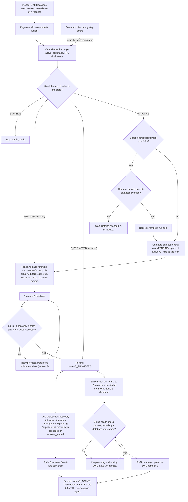
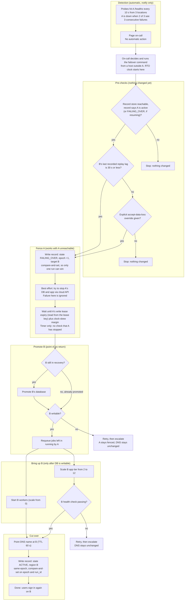

# Pair 10

Which document would a smart engineer who does not know this project understand faster and more correctly?

---

# Document A

# Failover plan: Region A to Region B

This plan covers a person-started failover from detection to traffic on B. Normally region A serves all traffic and region B is a warm standby: a small, always-running copy of the stack that is scaled up when needed. The one hard rule is that two writable databases must never exist at once.

In short: monitoring pages on-call, and on-call runs one command. The command locks the run in a small external record, waits for A to fence itself, promotes B's database, then recovers jobs and scales up B's app in parallel. When B is healthy, it moves DNS to B. The plan rests on one new component, the active-region record, described in section 1.

Terms used below:
- **RPO** (recovery point objective): the most data we accept losing, here 30 s.
- **RTO** (recovery time objective): the longest we accept being down, here 15 min, counted from when on-call starts the failover.
- **WAL**: PostgreSQL's write-ahead log, the stream of changes that B's replica receives from A's primary.
- **Replay lag**: how far the replica's replay trails A. B records it each time it receives WAL from A.
- **Fencing**: making sure A's database can no longer accept writes.
- **Compare-and-set (CAS)**: an update that succeeds only if the record still holds the value the writer last read. A writer with stale data fails and must re-read.
- **Lease**: a permission that expires after a fixed time (its TTL) unless the holder renews it.
- **Epoch**: a counter that rises on every change to the active-region record.

## 1. The active-region record

This is a small, strongly consistent key-value store that supports compare-and-set and expiring leases. It lives **outside both regions**, in a third region or provider. It does not exist today and has to be added. Neither region's database, Redis or DNS can hold it. If it lived in A, it would be lost with A, and A's fence would then depend on A being reachable.

It holds one document:

| Field | Meaning |
|---|---|
| `active` | `A` or `B`, the region allowed to hold the writable database |
| `epoch` | Integer, incremented on every transition. A writer holding an old epoch loses its compare-and-set. |
| `state` | `A_ACTIVE`, `FENCING`, `B_PROMOTED`, `B_ACTIVE` |
| `run` | Run id, start time, operator, whether the data-loss override was used, and progress flags (`requeued`, `workers_started`) |

The record does three jobs.

1. **Lock.** The command changes the record with compare-and-set, so two people running the command cannot both proceed.
2. **Fence.** See section 2.
3. **Resume point.** Every step reads the record to learn what is already done. This is how an interrupted run continues (section 5).

## 2. How A is fenced when A is unreachable

The command cannot rely on reaching A's API or network, so A fences itself.

- A's database host runs a lease agent. While the record says `active=A`, the agent renews a write lease every 10 s. Each lease lasts 30 s (the TTL).
- If the agent cannot renew, or reads a higher `epoch` or `active=B`, it sets the primary read-only and then stops Postgres. A local watchdog stops Postgres if the agent itself hangs.
- A restarted A database comes up read-only. It takes writes only after it reads `active=A` from the record.
- The command first moves the record to `FENCING` (with `active=B`), which ends all renewals. It then waits for the TTL plus a 5 s clock-skew margin, 35 s in all. After that wait, A is fenced whether it is partitioned, hung or healthy. In parallel, the command makes a best-effort stop through A's cloud API. Its failure is logged and ignored.
- Only after that wait does the command promote B.

The fence holds because a partitioned A cannot reach the record, so it cannot renew its lease, and its database stops itself when the lease runs out. This is why promotion waits for lease expiry and does not just call A's API.

## 3. Flowchart

How to read it: the top path is detection and the human decision. The middle is the lock, fence and promotion. After promotion the flow splits in two: job recovery on one branch, app scale-up and the DNS move on the other. Both must finish before the run is done. If a run dies, rerunning the command re-enters at the top, and the record sends it to the right step.

What triggers each step:

| Step | Trigger |
|---|---|
| Page | The probe rule, automatic. It pages and does nothing else. |
| Everything from the command onward | A person running the command. Nothing after it needs another human action, except the override prompt and escalations. |
| Lag check | The command's first action, before any change. It runs only on a fresh run (`A_ACTIVE`), not on a resume. |
| Fence | The compare-and-set to `FENCING` succeeding. |
| Promote | The fence wait finishing. |
| Requeue and workers | `B_PROMOTED` recorded, which means the database is verified writable. |
| App scale-up | `B_PROMOTED` recorded. It runs in parallel with the job steps. |
| DNS | The B health check passing. |

## 4. Jobs running in A at failover

Jobs are rows in the `jobs` table. A worker marks a row `running` while it works on it.

- Rows that were `running` in A are copied to B's database as `running`, because the replica knows nothing about A's workers. Those workers are fenced and gone, so nothing is actually working on those rows.
- The requeue step sets all `running` rows to `pending` in one transaction. It runs after promotion and **before** B's workers start, so no worker sees a stale `running` row. The command records `requeued` after the transaction commits, and `workers_started` just before it starts the workers. A rerun skips the requeue once either flag is set, because by then a `running` row may be real work on B. If the command dies after the transaction but before the `requeued` flag is written, the rerun requeues again, which is harmless because no worker has started.
- Jobs are therefore at-least-once. A job that finished its side effect in A just before the loss, or whose completion was not replicated, will run again. Job handlers that send email, charge a card or call external systems need idempotency keys. This is a requirement on the job code, not something the failover can provide.
- Jobs enqueued or completed in A within the final unreplicated WAL are gone. This is the RPO window. After failover, reconcile from the invoice records and customer-visible state.

## 5. Failed or interrupted runs

The command is idempotent. Rerunning it reads the record and resumes at the first incomplete step.

| Interrupted at | State | Handling |
|---|---|---|
| Before the compare-and-set | `A_ACTIVE` | Nothing changed. Rerun or abandon. |
| Lag over 30 s, no override | `A_ACTIVE` | Stops cleanly. Rerunning with the override is the only way forward. |
| During fence wait | `FENCING` | A is already fenced or will be within the TTL. Rerun, which waits the fence period again. Never promote before the wait ends. |
| Promote fails or hangs | `FENCING` | Retry. If B's database cannot be made writable, no region is writable, but A's data is intact. Only a human can decide to reactivate A, by deliberately moving the record back to `active=A` with a new epoch. The command never does this on its own. |
| After promote verified | `B_PROMOTED` | Roll forward only. The command never demotes B. Rerun to finish requeue, workers, scale-up and DNS. |
| Health check never passes | `B_PROMOTED` | DNS stays unchanged. Fix B or scale further, then rerun. Users see A's outage, but no second writer exists. |
| DNS update fails | `B_PROMOTED` | Retry. The update is idempotent. |
| Two operators run it at once | any | The second one loses compare-and-set and attaches to the run in progress. |

Once the record leaves `A_ACTIVE`, a returning A cannot take writes. It stays read-only until it is rebuilt as a replica of B. A's old database is never reused as primary. Failing back is a separate planned switchover, with its own plan.

## 6. Time budget

These are estimates to confirm in a rehearsal, not measurements. The budget starts when on-call runs the command. The app scale-up path is the longest, so the job steps, which run alongside it, add nothing to the total.

| Step | Estimate |
|---|---|
| Preflight, lag check, compare-and-set | about 10 s |
| Fence wait | 35 s |
| Promote and verify | 30 to 60 s |
| App scale 2 to 12 and health check | 3 to 6 min |
| DNS change and TTL expiry | about 90 s |
| **Total** | **about 6 to 10 min, against a 15 min RTO** |
| (in parallel with scale-up) Requeue and workers | about 1 min |

Scale-up is the largest item and the main risk to the RTO. Keeping B at 2 instances is a cost choice that the RTO depends on, so rehearse it.

## 7. Caveats

- **The lag value understates data loss.** B records its lag when it last received WAL from A, so the value freezes when A dies. It says nothing about transactions A committed after that moment. Passing the 30 s check does not prove the RPO was met. Have the command print the time of the last WAL receipt, so on-call can see how stale the number is. Treat a pass as "no known violation", not as a guarantee.
- **The record store is a new dependency.** If the command cannot reach it, failover cannot proceed. This is deliberate, because proceeding without it would give up the fence. Run it with its own redundancy.
- **Sessions.** B's Redis starts empty, so every signed-in user must sign in again. Expect a login spike right after DNS moves, and size B's app and auth path for it.
- **Lease TTL trade-off.** A shorter TTL speeds up failover but makes A fence itself on brief blips of the record store. A 30 s TTL with a 10 s renewal interval tolerates two missed renewals.

---

# Document B

# Failover plan: Region A to Region B

## Summary

Today the invoicing SaaS runs active-passive across two cloud regions. Region A serves all traffic. Region B is a warm standby. A has 12 web/API instances behind a regional load balancer and a PostgreSQL primary. B has 2 instances behind its own load balancer and an asynchronous streaming replica of A's database. Background jobs are rows in a `jobs` table in that database. B's job workers are scaled to zero. Sessions live in a Redis cluster in each region, not replicated. Users reach the app through one DNS name, managed by a global traffic manager, with a 60 s TTL.

This plan fails over from A to B when A is lost, without ever having two writable databases. Probes only page on-call. A person then runs one failover command. The command writes a "failing over" record to a store outside both regions, waits for A to stop itself, promotes B's database, starts B's workers and app, and finally moves DNS. A partitioned A cannot be told to stop, so A stops itself: it may take writes only while it keeps renewing a short lease, and the command's record write makes renewal impossible.

Targets: RPO 30 s. RTO 15 min, measured from when on-call starts the failover. No automatic failover and no automatic failback.

## Terms

- **Active-region record.** A small key in a strongly consistent store outside both regions. Fields: `{active_region, epoch, state, step, run_id}`. States used here: A active, FAILING_OVER, ACTIVE (on B).
- **Epoch.** A number in the record that rises when a failover starts. Every record write is a compare-and-set on it.
- **Compare-and-set.** A write that succeeds only if the record still holds the values the writer last read. It is why two runs cannot both win.
- **Write lease.** A separate key in the same store with an expiry time. A's primary may take writes only while the lease is kept alive.
- **Watchdog.** A small process on A's primary host. It renews the lease about every 5 s, which extends the expiry to about 15 s after the renewal. It stops A's database when it cannot renew. These numbers are proposals to tune.
- **Fencing.** Making sure A can no longer take writes before B is promoted.
- **Replay lag.** How far B's replica trails A. B records it each time it receives WAL (PostgreSQL's change log) from A, typically under 5 s. The command reads the last recorded value from B's database. It is not stored in the record store.
- **Traffic manager.** The global service that serves the one user-facing DNS name. Before failover it points at A's load balancer.

## Flowchart

Workers need only a writable database, so they start in parallel with the app scale-up. DNS waits for the health check and for the worker group to be running.

## Steps

The failover command runs from a host outside Region A, such as on-call's workstation or a small runner in B or a third location. It needs to reach the record store, B's database, B's cloud API and the traffic manager. It does not need A. It prints the name of each step as it starts, and a countdown during the fence wait. The accept-data-loss override is a flag (for example `--accept-data-loss`). Resuming uses another flag (for example `--resume`).

1. **Detect and page.** Trigger: automatic. Probes call A's `/healthz` every 10 s from three locations. A is down when 2 of 3 see 3 consecutive failures. This only pages on-call. It is the only automatic step.
2. **Start the command.** Trigger: a person's decision. Nothing else starts it. The RTO clock starts here.
3. **Pre-checks.** The command reads the record (state, epoch) and B's last recorded replay lag. It stops with nothing changed if the store is unreachable, if the record does not say A is active (a FAILING_OVER record refuses a new run unless `--resume` is given), or if the lag is over 30 s and no accept-data-loss override was given. It does not check that A is actually down: a person can fail over a healthy A, and the effect is the same as a real failure (A stops itself, A's users get errors until DNS moves, writes after the last WAL receipt are lost, everyone signs in again). This is a deliberate human decision.
4. **Write FAILING_OVER.** Trigger: pre-checks passed. The command raises the epoch by 1 and sets state FAILING_OVER, target B and a new `run_id`, by compare-and-set against what it read in step 3. If that fails, someone else changed the record first. The command prints the state it now finds and exits, changing nothing more. The person decides what to do.
5. **Fence A.**
   - A's next lease renewal is refused. If the store is unreachable instead, renewal fails too. The watchdog counts from its last successful renewal on its own monotonic clock. About 15 s after it, the watchdog stops A's PostgreSQL with a fast shutdown, which rolls back in-flight transactions. A's app tier is not touched and starts getting database errors. Stopping the database, not just making it read-only, also ends open transactions.
   - The command tries to stop A's database and app through A's cloud API as a best effort. Failure is ignored.
   - After step 4 no renewal can succeed, so the lease key's expiry is final. The command reads it and waits until the store's clock passes it plus the clock-skew margin. This is at most about 15 s plus margin after step 4. The margin covers A's watchdog clock running slow. It is applied by the command only, as a fixed setting owned by the plan's owner. A proposed starting value is 5 s.
   - The wait is a timer. The command does not check that A's database stopped, because A may be unreachable. A frozen watchdog is the residual risk (see Limits).
   - If the command is resumed during the wait, it reads the expiry again and waits for what is left, or not at all if it has passed.
6. **Promote B.** Trigger: fence wait finished. The command runs `pg_is_in_recovery()` on B's database. If true, it calls `pg_promote()`. "Writable" means `pg_is_in_recovery()` now returns false. It never promotes twice. This is the point of no return: from here the run only goes forward. If promotion fails or times out, the command checks `pg_is_in_recovery()` again before retrying, then retries and escalates (see "Retries and resuming"). A stays fenced and DNS stays on A.
7. **Requeue jobs.** Trigger: B's database is writable. B's `jobs` table is A's as of the last WAL received, so rows A was working on show as `running`, but their workers are gone. Before any worker starts, the command resets every `running` row to `queued`. B has no workers yet, so every such row is an orphan. The reset is idempotent, so an interrupted requeue is simply rerun. Then the command prints a summary: the time of the last WAL receipt, the recorded replay lag, the number of jobs requeued, and a statement that anything A committed after the last WAL receipt, including jobs enqueued only then, is not on B. It cannot list lost jobs, because A is unreachable and B never saw them.
   - **Jobs can run twice.** A job may have finished in A, with side effects (an email sent, a card charged), while the completion row never reached B. Requeued jobs re-run, so handlers must be idempotent and side effects need idempotency keys. This is a precondition to check per job type.
   - A stale worker in A cannot mark anything done after promotion, because A's database is stopped.
8. **Start workers.** Trigger: B's database is writable. The command scales B's worker group from 0 through B's cloud API and waits until the group reports its full desired count running. It does not check that workers are polling. If the count is not reached, retry then escalate, and DNS does not move.
9. **Scale the app and check health.** Trigger: B's database is writable (the app needs it). The command scales B's app group from 2 to 12 through the cloud API. It then calls `/healthz` (the same endpoint the probes use) on B's load balancer. It passes when the call succeeds and all 12 instances report healthy. If it never passes, retry then escalate. DNS does not move. Users see errors either way, so fixing B is the only path. No app configuration changes: B's app and workers already use B's own database server, the replica that promotion makes writable, so its address does not change (an assumption, see Open questions).
10. **Move DNS.** Trigger: B's app is scaled up and passing health, and B's workers are running. The command calls the traffic manager's API to point the name at B's load balancer. The call is idempotent, so a failure is retried. Resolvers may serve A's address for up to 60 s afterwards.
11. **Write ACTIVE.** Trigger: DNS updated. The command sets state ACTIVE, region B, with the same epoch, by compare-and-set on epoch and `run_id`. If this write fails, retry. Until it succeeds the record still says FAILING_OVER, so no failback or second failover can start. Users signed in at failover time sign in again on B, because B's Redis starts empty. This is accepted and needs no step.

### Retries and resuming

- "Retry, then escalate" means the command retries the failing step about 3 times with a short wait (a proposal to tune). If it still fails, it exits with an error naming the step. The on-call person then calls the secondary on-call per the team's usual runbook, and after the fix reruns the command with `--resume`.
- Each step writes its name to `step` in the record. To resume, the person confirms the earlier command is no longer running and reruns with `--resume`, from any host. The command sees FAILING_OVER, takes `run_id` from the record and continues from the recorded step.
- `step` says where to start. The real state of B, the cloud API and DNS decides what each step does. If they disagree (for example `step` says "promote" but B is already writable), the real state wins and the step is skipped.
- Overlapping resumes are safe: each step checks real state first, promotion is never repeated, and only one final ACTIVE write can succeed.
- Before the FAILING_OVER write, a stop changes nothing, so just start again later. After it, backing out is a manual human decision, because A will have stopped itself and needs un-fencing. Otherwise resume forward.

## Where the active-region record lives

It sits in a third location or provider, because inside A it would be lost with A, and inside B a partition would leave A unable to reach it. The store needs compare-and-set and multi-key transactions, such as a three-node consensus store or a managed consistent key-value service.

- **Why the lease is a separate key.** Renewals every 5 s would otherwise change the record's version and break the command's compare-and-set. Each renewal is one transaction: extend the lease only if the record still says A is active with the epoch the watchdog holds.
- **The cost is a new dependency.** If the store is unreachable for longer than the lease, a healthy A stops its own database although no failover was started. That is intended, because A cannot tell a store outage from a partition. So the store must be highly available across zones. A store outage and any missed lease renewal should page on-call.
- **This is new to build.** Nothing today provides a lease or watchdog. Without it, the requirement that a partitioned A that is still running must not keep taking writes cannot be met.
- **B takes no lease.** After cut-over nothing renews a lease on B and B's database takes writes without one. That is enough here, because only A could be written to by mistake, and A cannot renew. A watchdog on B is needed before any failback and belongs to that separate plan.
- **DNS is not the source of truth.** DNS is changed only after the record says B.

## Limits and decisions

- **The lag check does not guarantee RPO.** The recorded lag is from the last WAL receipt and does not grow while A is down. It says nothing about commits A made after that. The command prints the time of the last WAL receipt, so on-call can judge the unmeasured gap against when A failed.
- **Time budget.** The fence wait is at most about 15 s plus margin, and DNS propagation adds up to 60 s. Both fit in the 15 min RTO. The slow parts are scaling the app from 2 to 12 instances and the health check, so budget those.
- **Fencing assumes bounded clock skew and a working watchdog.** The margin covers skew. A paused process (such as a VM freeze) is the residual risk. Alert on a missed lease renewal.

## When A returns

1. A's lease has expired and the record says B is active with a higher epoch, so A's database stays stopped and the watchdog cannot renew.
2. Rebuild A's database as a replica of B, with a fresh base backup or `pg_rewind`. A's old database is never reused as primary.
3. Moving back to A is a separate, planned switchover with its own plan. There is no automatic failback.

## Open questions

- The lease length, renewal interval, clock-skew margin (proposed 5 s) and retry count are proposals and need tuning.
- The record store product is not chosen. It must offer compare-and-set and multi-key transactions.
- What B's `/healthz` checks (for example whether it touches the database) is not known, so "passing" is only as strong as that endpoint.
- The plan assumes B's app and workers already point at B's own database server. This needs confirming against the real setup.
- Who owns the DNS name and the traffic manager, which product it is and which API call changes its target are not known. The command needs credentials for it.
- B has no write lease after cut-over. Whether that is acceptable until a failback plan exists is the plan owner's call.
