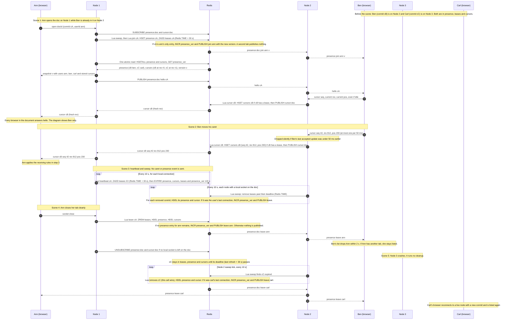
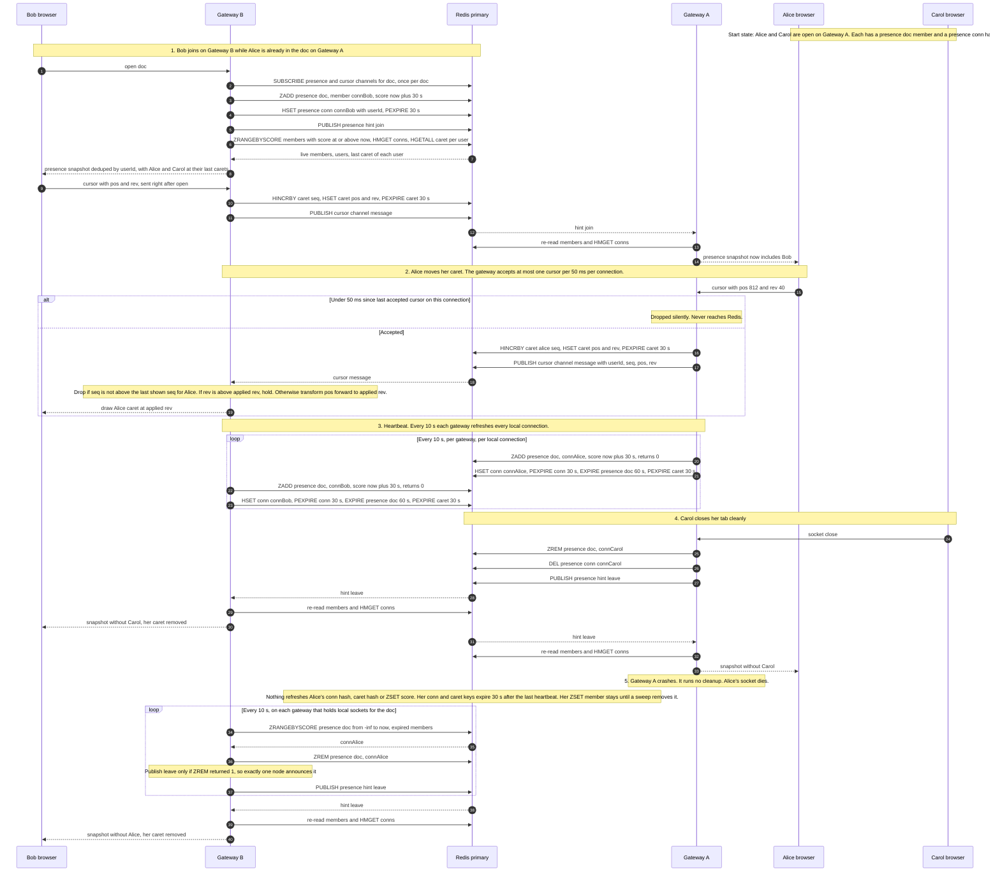

# Pair 13

Which document would a smart engineer who does not know this project understand faster and more correctly?

---

# Document A

# Live cursors and presence: sequence design

Presence (who is in a document) and cursors (where each person's caret is) are shared between gateway nodes through Redis, a shared store. Today the presence list is a Postgres table, written on open and close and polled by browsers every 30 s, and users of a crashed node stay listed until a nightly job removes them. This design replaces that polling. A user joins by writing a presence entry and a lease. Each connection refreshes its lease every 10 s, and any node removes expired leases, so a crashed node's users disappear within 40 s. Cursors are never stored durably: each one carries the revision it belongs to and goes away with its connection. The edit path, the document service, Postgres and the load balancer are not changed, and cursors never reach them.

## Terms

- **Gateway node**: one of the six servers that hold browsers' WebSocket connections. A WebSocket is a connection that stays open so the server can push messages. People in one document are usually on different nodes.
- **connId**: a random id for one WebSocket connection. A user with two tabs has two connIds.
- **userId**: the user's id, taken from the session.
- **Redis**: a shared in-memory store that all nodes can reach. The edit path already uses it.
- **Pub/sub**: Redis sends a published message to every node subscribed to that channel at that moment. It stores nothing.
- **Lua script**: a short program that Redis runs as one step. No other Redis command runs in the middle, so its reads and writes act as one atomic step.
- **Redis TIME**: the Redis server's clock. Lease deadlines use it, so the nodes' own clocks do not matter.
- **Key expiry**: Redis deletes a key once its time limit passes.
- **Document keys**: four Redis keys per document, named with its id. The diagram writes them as presence:doc and similar.
  - **presence**: maps connId to user.
  - **leases**: maps connId to its deadline.
  - **cursors**: maps connId to its last cursor.
  - **presence_ver**: a counter (see below).
- **Lease**: a connection's deadline in leases. Each heartbeat moves it 30 s ahead. When it passes, the connection counts as gone.
- **presence_ver**: a per-document counter. It goes up by one for each join or leave that is published, and for nothing else. Each presence event and snapshot carries its value.
- **Presence event**: a join or leave message published on presence:doc.
- **Snapshot**: the full current presence list, stored cursors and presence_ver, sent by a node to one browser.
- **hello**: a message that asks every browser in the document to send its current caret.
- **rev**: the revision number the document service gives each applied edit.
- **appliedRev**: the last revision the editor has applied. It only moves forward. The edit path sets it, and this design only reads it.
- **transformPosition(pos, fromRev, toRev)**: an editor function that moves a character position from an older revision to a newer one. It throws HistoryGone if fromRev is older than the last 500 revisions the editor keeps. The caller then drops the position.
- **seq**: a counter that the sending browser keeps for each connection. It starts when the connection opens and goes up by one for each cursor update.

## Diagram

Notes on the diagram: each scene shows one kind of event. The rules for what a browser does with each message are in the steps below, not in the diagram notes. Every browser in the document answers hello, not only the ones shown.

## Steps

1. **Join.** Trigger: a browser opens the document. The node subscribes to presence:doc and cursor:doc first, so no event is missed. It then runs the sweep (step 5). The join script writes cA to presence and its lease to leases. In the same script it counts this user's presence entries. If cA is the only one, the script raises presence_ver and publishes join with the new value. If not, it publishes nothing. Because the count and the write are one script, two tabs that join at the same moment still give one join. The node then reads presence, the stored cursors and presence_ver in one atomic read and sends the browser a snapshot. It forwards presence and cursor events to that browser only after the snapshot.
   - An event can arrive that the snapshot already includes. The browser ignores any presence event whose version is at or below the snapshot's version, and applies the rest in order.
   - If the next event skips a number (for example v10 then v12), the browser missed one. It asks its node for a new snapshot.
   - A snapshot always sets the browser's version, even when that is lower, because presence_ver can expire.
   - Every snapshot replaces the browser's list, stored cursors and version, and drops its held and shown carets. The hello that follows brings the carets back.
   - If Redis is down, the join fails and the node closes the socket. The browser reconnects and joins again.
2. **Answer hello.** Trigger: hello. Every browser in the document sends its own cursor with its current rev and position, even if the user is idle. Stored cursors may be old or dropped, so these answers give the current positions. Every snapshot is followed by hello, so a join, a version gap, a rejoin or a resubscribe all bring the carets back.
3. **Move a caret.** Trigger: the local caret moves. The browser sends at most one cursor update per 50 ms, with seq, rev and pos. If the caret moves again inside that window, the browser keeps only the latest position and sends it when the window ends, so the last position is not lost.
   - The node keeps the time of the last accepted update for each connId in its memory. It drops an update silently if it accepted one less than 50 ms earlier. The browser never learns of the drop.
   - Otherwise a Lua script stores the cursor and publishes it, but only if the connId still has a lease. A late update after a leave therefore cannot bring a cursor back.
   - Pub/sub keeps publish order, so a user's join reaches a browser before that user's cursors.

   A receiving browser applies these rules in order:
   - a. Drop the cursor if its connId is not in the browser's list. It is then older than the snapshot or late after a leave.
   - b. Drop the cursor if its seq is not above the last seq shown for that connId. This stops backward jumps, even when messages arrive out of order. A reconnect gets a new connId and counter, so an old seq never blocks it.
   - c. If its rev is above appliedRev, hold it. A newer seq from the same connId replaces the held cursor, so an older one can never be drawn after a newer one. Draw it when that rev is applied, if its seq is still above the last one shown.
   - d. Otherwise move pos with transformPosition(pos, rev, appliedRev). If that throws HistoryGone, drop the cursor until the next update from that connection. If not, draw it.

   Stored cursors in a snapshot go through the same rules.
4. **Heartbeat.** Trigger: every 10 s, for each local connection. The node runs the Lua heartbeat. ZADD with XX moves the lease 30 s ahead. XX means it only updates a lease that already exists. The same script sets presence, cursors, leases and presence_ver to expire in 120 s, so they clear if no node is left alive. If the lease is missing, because it expired during a stall or a Redis outage, the node runs the join steps again for that connection (step 1). That sends a new snapshot and hello, so the browsers' lists and carets are rebuilt.
5. **Sweep.** Trigger: every 10 s on each node with a local socket on the document, and before each join. The Lua sweep removes leases whose deadline has passed, using Redis TIME. For each removed connId, it removes the presence and cursor entries. If that was the user's last connection, it raises presence_ver and publishes leave. The script is atomic, so when two nodes sweep at once, only the call that removes a connId continues. If no node has a socket on the document, nothing sweeps. Nobody is viewing it, and the next join sweeps first.
6. **Clean leave.** Trigger: the socket closes. The node runs the leave script. It removes the lease, presence entry and cursor. If the user has no presence entries left, the script raises presence_ver and publishes leave. Other users see the leave within 2 s. Then the node unsubscribes from presence:doc and cursor:doc if no local socket remains on the document.
7. **Node crash.** A dead node does nothing. Its leases stop being refreshed. Each lease was last refreshed at or before the crash, so it ends at most 30 s after the crash. The next sweep on a surviving node runs every 10 s and removes it, so removal comes at most 40 s after the crash. That is within the 45 s limit. Browsers reconnect to a live node with a new connId. If no node survives, key expiry clears the keys, so nothing stays in Redis for good.

## Where state lives

| State | Where | Written by | Refreshed by | Removed by |
|---|---|---|---|---|
| Presence entry (connId to user) | Redis presence | join | heartbeat | leave, sweep, or key expiry |
| Lease (connId to deadline) | Redis leases | join | heartbeat every 10 s | leave, sweep, or key expiry |
| Cursor (connId to last cursor) | Redis cursors | cursor update | heartbeat | leave, sweep, or key expiry |
| presence_ver | Redis counter | join, leave, sweep, each time one is published | heartbeat | key expiry only |
| Node subscription | node memory | node | none | node unsubscribes when its last local socket leaves |
| Snapshot list | browser memory | node | each new snapshot | each snapshot replaces it; leave and join events change it |
| Held or shown caret | browser memory | receiving browser | next cursor update | leave, a newer seq, or a new snapshot |
| appliedRev | editor | the edit path (unchanged) | the edit path | never removed |

Nothing in this table is written to Postgres or the document service. Key expiry (120 s after the last heartbeat) removes whatever is left when no node is alive.

## When things fail

| What fails | What happens | Recovery |
|---|---|---|
| Redis is down when a browser opens the document | The join fails and the node closes the socket | The browser reconnects and joins again |
| Redis is down, or a live node stalls for more than 30 s | Its leases expire. Other nodes remove its users within 40 s, and its own browsers see the leave too. This is deliberate: a stall over 30 s has to drop the lease | The next heartbeat (within 10 s) finds the lease missing and rejoins, sending a new snapshot and hello. Until then the user is missing from every list |
| A node loses its Redis subscription | It may miss presence events | The Redis client reports the drop and reconnects. The node then resubscribes, sends its local sockets a fresh snapshot and publishes hello |
| A browser misses a presence event (version gap) | Its list may be wrong | It asks its node for a new snapshot, which is followed by hello |
| A cursor update is lost | That caret is stale | The next move or hello fixes it. Cursors are not replayed |
| A stored cursor is older than the kept history (HistoryGone) | Its caret is hidden. A snapshot does not bring it back | It is drawn again from the next update from that connection, such as the answer to hello |
| A held cursor's rev never gets applied | Its caret stays hidden | It is drawn when that rev is applied, unless a newer seq is shown first |
| Node dies and no other node has a socket on the document | Nothing sweeps the stale entries | The next join sweeps first. If nobody joins, key expiry removes them |

## Open questions

- Where the colour for avatars and carets comes from is not decided.
- Carets are keyed by connection, so one user with two tabs may show two carets. It is not decided whether a user should show one caret.
- Which Redis client event reports a lost subscription has not been checked against the gateway code. The resubscribe rule in the failure table depends on it.

---

# Document B

# Live cursors and presence: sequence design

## What this adds

The document editor gets two live features, like Google Docs:

- **Presence list:** the avatars of everyone currently in a document.
- **Carets:** a coloured text cursor for every other user in the document.

Both update live. The design uses Redis, the shared in-memory store that the gateway servers already use. It adds no new service and does not change the edit path or the load balancer. The Postgres presence table is removed, along with the 30-second client polling of it and the nightly cleanup job.

## Background terms

- **Gateway node:** a server process that holds WebSocket connections from browsers. A WebSocket is a connection that stays open, so the server can push messages to the browser at any time. There are six nodes today, and the count changes with load.
- **Load balancer:** the front door that gives each new connection to a node, in turn. Two people in the same document are therefore usually on different nodes. This is why shared state must live in Redis, not in one node's memory.
- **Connection (connId):** one WebSocket, usually one browser tab. Each connection gets a random ID. A user with two tabs has two connections.
- **Presence:** who is in the document. It is tracked per user, not per tab.
- **Revision (rev):** the document's version number. Each applied change moves it forward. A caret position only has meaning at the revision it was measured at, because text before the caret may have changed since.
- **Lease:** a membership entry with an expiry time (a deadline). It is stored as a score in a sorted set. It stays valid only while something keeps extending it.
- **Heartbeat:** every 10 seconds, each node extends the leases and expiry times of its own connections.
- **TTL (time to live):** an expiry time on a Redis key. If nothing refreshes it in time, Redis deletes the key by itself.
- **Pub/sub:** Redis broadcast. A message reaches only the servers subscribed at that moment. Redis stores nothing.
- **Hint:** a pub/sub message that says "something changed, read the state again." It carries no data to trust.
- **seq:** a per-user counter that goes up on every accepted caret update. It puts a user's carets in order when they arrive out of order.
- **transformPosition:** the editor function that moves a character offset from an older revision to a newer one. It throws `HistoryGone` if the old revision is older than the last 500 kept.

### The Redis parts used

- **Sorted set:** a list of unique members, each with a number (the score). Used for membership. The score is the lease deadline.
- **Hash:** a small map of named fields under one key. Used for each connection's identity and each user's caret.
- **Commands:**
  - `ZADD` adds a member or updates its score. It returns 1 if the member was new and 0 if it already existed.
  - `ZREM` removes a member. It returns 1 if it removed one.
  - `ZRANGEBYSCORE` lists members whose score falls in a range.
  - `HSET`, `HMGET`, `HGETALL` and `HINCRBY` write, read or increment hash fields.
  - `DEL` deletes a key.
  - `PEXPIRE` and `EXPIRE` set a key's TTL, in milliseconds and seconds.
  - `PUBLISH` and `SUBSCRIBE` send and receive pub/sub messages.

## How it works in brief

- Redis holds all presence state. Pub/sub only tells nodes to read it again.
- Every key has a TTL, so a crash cannot leave data behind for good.
- Each node refreshes state only for its own connections. A dead node refreshes nothing, so its state expires on its own.

The diagram shows five things:

1. Bob joins on Gateway B while Alice is already in the document on Gateway A.
2. Alice moves her caret.
3. The heartbeat keeps live state alive.
4. Carol closes her tab cleanly.
5. Gateway A crashes, and the surviving nodes clean up after it.

### What each step shows

- **Join (step 1).** Bob's browser connects to Gateway B. The first time Gateway B has a local user in this document, it subscribes to the two pub/sub channels for it, one for presence hints and one for carets. Then it adds Bob's connection to the sorted set and writes his identity (userId) to a small hash. It reads the full current state from Redis, not from pub/sub history, so it cannot miss a join that happened earlier. It sends that snapshot to Bob and publishes a join hint so other nodes re-read the state. Bob's first caret is sent right after open, so others can see it even if he never moves.
- **Cursor move (step 2).** The gateway accepts at most one cursor per 50 ms per connection and drops the rest silently. An accepted cursor is written to Redis and published. Each receiving node applies the seq, revision and transform rules below before it draws anything.
- **Heartbeat (step 3).** Every 10 s each node extends every local connection, and the caret of every local user. An idle user therefore keeps their caret.
- **Clean leave (step 4).** The closing node removes the connection at once and publishes a leave hint. The other nodes re-read the state at once.
- **Crash (step 5).** The dead node runs nothing. Its entries stop being extended and expire. Any surviving node with a local socket on the document sweeps the sorted set every 10 s and removes expired entries. For each expired member, only the node whose removal succeeds (`ZREM` returns 1) publishes the leave hint, so exactly one announcement goes out. Reads already ignore members whose lease has passed. Clients change only when a hint arrives, so the list changes at the sweep.

## Where state lives

| State | Where it lives | Written by | Kept alive by | Removed by |
|---|---|---|---|---|
| Membership: one entry per connection | Redis sorted set `presence:doc:{docId}`. Member is the connId. Score is the lease deadline in milliseconds. | The node, on open, on each heartbeat, and on clean close | Each heartbeat sets the score to now plus 30 s. The key's TTL is 60 s, and the heartbeat refreshes it. | Clean close: `ZREM`. Crash: a surviving node with local sockets on the document removes members whose score has passed. |
| Identity per connection (userId, name, colour) | Redis hash `presence:conn:{connId}`, TTL 30 s | The node, on open | Heartbeat rewrites the identity fields and resets the TTL | Clean close: `DEL`. Crash: TTL expiry. |
| Caret per user (seq, pos, rev) | Redis hash `presence:caret:{docId}:{userId}`, TTL 30 s | The node, on each accepted cursor. Every client sends an initial cursor on open. | Heartbeat, for local users | TTL expiry. Clients draw only users who are in the current list. |
| Change hints | Pub/sub channels `presence:doc:{docId}` and `cursor:doc:{docId}` | Nodes | Not stored | Not stored. A node subscribes only while it has local sockets on the document. |
| Rate limit | Node memory: the last accepted time per connId | The node | Each accepted cursor | Connection close |
| Client view | The presence list, the last seq per userId, and held carets | The client | Snapshots and cursor messages | A snapshot that omits the user |

Nothing stays in Redis for good. Every key has a TTL. A document with no live connections has its sorted set expire after 60 s.

When a snapshot finds a member whose identity hash has already expired, the reader skips that member. The identity hash and the lease both run out about 30 s after the last heartbeat, so this can happen briefly.

## Timing budgets

- **Clean leave:** the close handler runs `ZREM` and `PUBLISH`, and the other nodes re-read at once. This is well under the 2 s budget.
- **Node crash:** the last heartbeat happened at most 10 s before the crash, and it set the deadline 30 s after itself. So the lease deadline is at most 30 s after the crash. The next sweep runs at most 10 s after that deadline. The worst case is 40 s, inside the 45 s budget.
- **Join:** the snapshot comes from Redis on the joining node, not from pub/sub history, so no join is missed.
- **Stall:** if a node stalls past a deadline and a sweep removes its member, the next heartbeat's `ZADD` returns 1 instead of 0, because the member is new again. The node then publishes a join hint again. A stalled node causes a brief flicker in the list, not a leak.

## Client rules

These rules decide what a client draws. They handle messages that arrive out of order or too early. The client tracks `appliedRev`, the last revision it has applied.

- **Ordering (seq).** Drop any caret whose seq is not above the last seq shown for that user. A caret never jumps backwards, even when messages arrive out of order. Because seq is per user, it is ordered across that user's tabs.
- **Held carets.** The client must never draw a caret at a revision it has not applied yet. If a caret's rev is above `appliedRev`, hold it. For each user, keep only the held caret with the highest seq. Draw it when `appliedRev` reaches its rev.
- **Transform.** If a caret's rev is at or below `appliedRev`, call `transformPosition(pos, rev, appliedRev)`. If it throws `HistoryGone`, drop the position and hide that caret until the user's next update. After each applied batch, move each shown caret to the current `appliedRev` by calling `transformPosition` again, then store the new position with the new revision. After that, the original revision is never needed again.
- **Presence list.** Draw a caret only for users in the current presence list. When a user leaves the list, their caret goes with them.

## Other notes

- **Client coalescing.** The gateway silently drops any cursor within 50 ms of the last accepted one. The client must keep the latest pending caret and send it when the window opens. Otherwise the final move in a burst is lost, and the caret stays wrong until the next move.
- **One user, two tabs.** The snapshot is deduplicated by userId, so the user appears once. The user stays listed until the lease on their last connection ends. There is one caret and one seq per user, so tabs cannot conflict.
- **Hints, not events.** Receivers re-read Redis on every hint rather than trusting the message body. Out-of-order or duplicate hints therefore cannot leave a wrong list.
- **Lost pub/sub messages.** A missed cursor message is harmless, because the next move corrects the caret. A missed join is also harmless, because joins read state from Redis.
- **Primary reads.** Presence reads go to the Redis primary, not the replica, so a fresh join is not hidden by replica lag. After a failover, heartbeats rebuild lost state within 10 s.
- **Unchanged.** The edit path, the load balancer and the document service are untouched. Postgres loses only the presence table.

## Open gap

`seq` lives in the caret hash. If that hash is lost while the user is still listed, seq restarts at 1. Receivers then drop the user's new carets until seq climbs past the old value, which can take a long time. The caret hash can be lost in two ways:

- A failover that loses recent Redis writes.
- Every node holding the user's connections dies, and the caret TTL runs out before the user reconnects.

The design does not fix this yet. The options are to keep seq in a key with a longer TTL, or to store it with the identity hash. **A decision is needed.**
