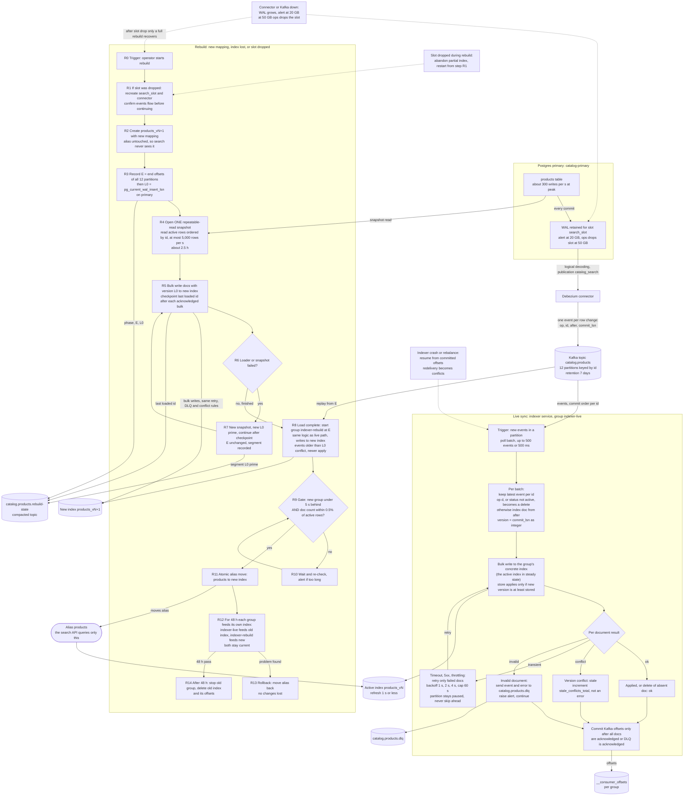
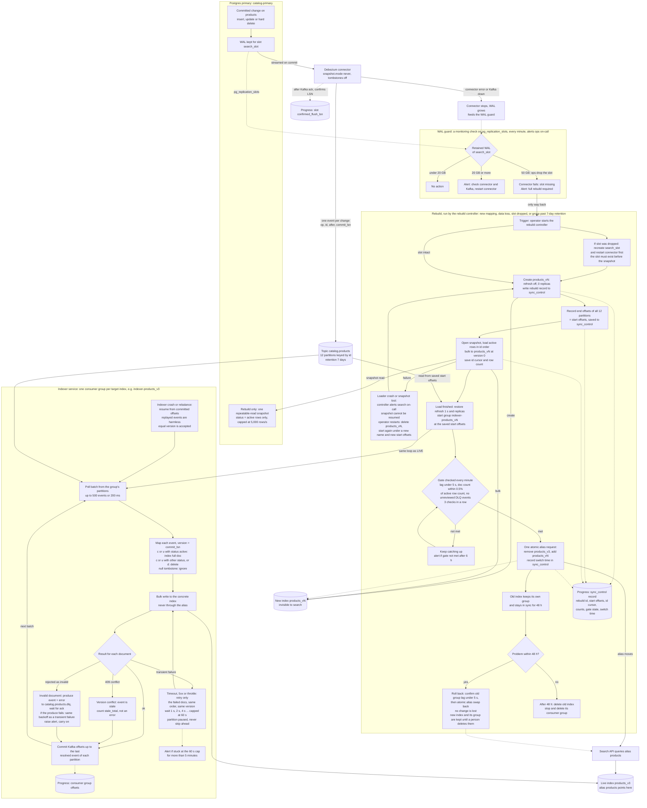

# Pair 14

Which document would a smart engineer who does not know this project understand faster and more correctly?

---

# Document A

# Search sync: change data capture plan

This plan replaces the 15-minute cron job with a stream of every committed change to `products`. It also covers rebuilding the index from scratch without search ever going down.

In short:

- **Live path.** Postgres writes each committed change to its log. Debezium copies the change into Kafka. A new indexer service reads Kafka and writes to the search index. Each write carries a version, so a stale write can never overwrite newer data.
- **Rebuild.** Load a snapshot of the table into a new, hidden index. Replay the Kafka events that arrived during the load. When the new index has caught up, move the alias `products` to it. The old index stays for 48 hours as a rollback.

## Terms used below

- **CDC (change data capture):** reading a database's committed changes as a stream of events. Here the tool is Debezium, a connector that reads Postgres and writes to Kafka.
- **WAL:** Postgres's write-ahead log, the ordered record of every committed change.
- **Replication slot (`search_slot`):** a marker that makes Postgres keep WAL until the connector has read it. If the connector stops, WAL piles up on the primary's disk.
- **LSN:** a position in the WAL. A larger LSN means committed later. Each event carries `commit_lsn`, the LSN of its transaction's commit.
- **Topic, partition, offset:** Kafka stores events in topics. A topic is split into partitions, each an ordered log. An offset is an event's position in its partition. `catalog.products` has 12 partitions, keyed by product id, so all changes to one product are in one partition in commit order.
- **Consumer group:** a named set of Kafka consumers that share a stored read position (an offset) per partition. Kafka keeps these in `__consumer_offsets`. "Committing offsets" means saving that position.
- **Version:** a number sent with each index write. The search store applies the write only if the new version is at least the stored version. Otherwise it returns a **version conflict** for that document.
- **Alias and active index:** the search API queries only the alias `products`. The alias points at one concrete index (for example `products_v4`), the **active index**. Moving the alias is atomic, so a query goes to the old index or the new one, never neither.
- **Repeatable-read snapshot:** a Postgres transaction that sees the data exactly as it was when it began, however long it runs.
- **Compacted topic:** a Kafka topic that keeps only the latest message per key, so it works as a small key-value store.
- **DLQ (dead-letter queue):** a topic, `catalog.products.dlq`, that holds events the index refused.

## Live path

1. Debezium reads `search_slot` and writes one event per row change to `catalog.products`. Each event is `{op, id, after, commit_lsn}`. `op` is `c`, `u` or `d` (create, update, delete). `after` is the full row, or null for a delete.
2. The new indexer service consumes the topic as group `indexer-live`. It polls a batch (up to 500 events or 500 ms) and keeps only the highest-LSN event per id.
3. For each remaining event:
   - If `op = d` or `after.status` is not `active`, it sends a delete. Only active rows may appear in search. This also fixes hard deletes, which the cron never handled.
   - Otherwise it indexes a document built from `after`, with the same field mapping as `to_doc` in the cron script.
4. The document version is `commit_lsn` as an integer: `(hi << 32) | lo`, where `hi` and `lo` are the two hex parts either side of the `/`. Each indexer group writes to one fixed concrete index, never to the alias. For `indexer-live` in steady state, that is the active index. Because of the version rule and per-partition order, an older write can no longer overwrite newer data.
5. A version conflict means the change is stale. The indexer increments `stale_conflicts_total` and carries on. It is not an error.
6. The indexer commits Kafka offsets only after the index has acknowledged every write those offsets cover. After a crash, redelivered events are harmless, because replays become conflicts.

## Failure handling (live path and rebuild)

The rebuild writes to the new index with the same rules. Failures specific to the loader are in R6 and R7 below.

| Failure | Response |
|---|---|
| Timeout, 5xx, throttling | Retry only the failed documents. Backoff is 1 s, 2 s, 4 s and so on, capped at 60 s. The partition stays paused and never skips ahead. No offset is committed until the batch is acknowledged. |
| Index refuses a document as invalid | Produce the event and the error to `catalog.products.dlq` and wait for that produce to be acknowledged. Raise an alert, then continue. If the DLQ produce fails, retry it with the same backoff. |
| Version conflict | Count it as stale. Not an error. |
| Indexer crash or rebalance | Resume from the committed offsets. Redelivered events are applied again or conflict. |
| Kafka or connector down | Postgres keeps the WAL for the slot. Alert at 20 GB retained. At 50 GB ops drops the slot, and only a full rebuild recovers. |

## Freshness target (95% within 5 s)

Rough budget, in seconds: 1 from commit to topic, 0.5 batch window, 1 bulk write, 1 index refresh. That totals 3.5 s, leaving 1.5 s of margin. Set the index's refresh interval to 1 s or less.

## Rebuild

Use a rebuild for a new mapping, for index loss, or after the slot is dropped. Step labels R0 to R14 match the nodes in the diagram.

Two values are recorded at the start. **E** is the end offset of each of the 12 partitions at that moment. **L0** is the primary's current WAL position at that moment. They split history into "in the snapshot" and "in the topic from E onward".

- **R0. Trigger.** An operator starts the rebuild.
- **R1. Slot check.** If the slot was dropped, recreate `search_slot` and the connector first. Confirm events are flowing before anything else.
- **R2. New index.** Create the new index with the new mapping. The alias is untouched, so search never sees it.
- **R3. Mark the start.** In this order:
  1. Record `E`.
  2. Read `L0 = pg_current_wal_insert_lsn()` on the primary.
  3. Open the one repeatable-read snapshot (R4).

  This order guarantees that everything committed before `L0` is in the snapshot, and everything committed after `L0` is in the topic at or after `E`. Some changes appear in both, which is safe.
- **R4. Snapshot read.** The loader reads `status = 'active'` rows ordered by id, at no more than 5,000 rows/s (about 2.5 hours). This is the one long snapshot the DBA allows.
- **R5. Bulk load.** The loader bulk-writes the rows to the new index with version `L0`. After each acknowledged bulk it checkpoints the last loaded id.
- **R6 and R7. Loader crash or lost snapshot.** Take a new snapshot (R7) and continue after the last checkpoint with a new `L0'`. Keep the original `E`. Rows from the first segment keep version `L0`. Events between `L0` and `L0'` are replayed for them and converge, because per-key order is kept and the last event wins. Rows from the second segment ignore events older than `L0'`.
- **R8. Catch up.** The consumer group for the new index, `indexer-rebuild`, stays paused during the load. If it ran early, a delete could reach the new index before the loader inserted that row, and the loader would then bring back a deleted product. When the load finishes, the group starts at `E` and runs the same logic as the live path. Events older than `L0` conflict and are counted. Newer events apply.
- **R9 and R10. Switch gate.** Switch only when both hold: the new group is less than 5 s behind, and the new index's document count is within 0.5% of the active row count. Otherwise keep waiting (R10), and alert if it takes too long.
- **R11. Switch.** Move the alias atomically to the new index.
- **R12. Keep the old index for 48 hours.** Each group keeps feeding its own index: `indexer-live` feeds the old one and `indexer-rebuild` feeds the new one, so both stay current. 48 hours fits inside the 7-day topic retention.
- **R13. Rollback.** Switching back is another alias move and loses nothing.
- **R14. Cleanup.** After 48 hours, stop `indexer-live`, delete the old index and delete that group's offsets. `indexer-rebuild` is now the live sync. The next rebuild must use a fresh group name, because this one is in use.
- **Slot dropped during a rebuild.** Events after the drop are lost, so `E` is no longer valid. Abandon the partial new index and restart from R1.

## Where progress is stored

- Kafka offsets for each group: `__consumer_offsets`.
- Rebuild state (phase, `E`, each segment's `L0`, the loader's last-id checkpoint): a new compacted topic, `catalog.products.rebuild-state`.

## Flowchart

Solid arrows carry data or control. Dotted arrows show failures and their effects. Labels starting "Trigger" show what starts each path.

## Assumptions and open items

- **Freshness metric.** Events have no commit timestamp, so the 5 s target (and the "under 5 s behind" switch gate) cannot be measured in time. Either enable Debezium's source timestamp on the connector, or add a canary row.
- **Deletes and stale writes.** The plan assumes a delete keeps its version, so a stale write arriving after a delete cannot bring the document back. If the store forgets versions of deleted documents, a redelivered batch can briefly resurrect a deleted product. The same ordered batch then replays the delete and removes it again. Confirm this behavior with the store.
- **Active row count for the gate.** Run one `count(*)` of active rows on the primary at gate time. The DBA must approve this. The fallback is the loader's own row count at the snapshot. The gate is only a sanity check: 0.5% of 40 million rows is about 200,000 documents.
- **LSN versions.** The store must accept a 64-bit integer version.
- **State topic.** `catalog.products.rebuild-state` is new, and the Kafka team must create it on the shared brokers. Keeping this state in the search cluster would not survive the "index lost" case.
- **First migration.** The first rebuild, into `products_v4`, replaces the cron. Never mix cron writes (unversioned) and indexer writes in one index. The cron keeps writing to `products_v3` for 48 hours after the first switch, so a rollback loses nothing. Then remove it. In this first rebuild, the old index is fed by the cron, not by `indexer-live`.
- **Rollback after a slot loss.** If the rebuild followed a slot drop, the old index missed every change made while there was no slot. Rolling back to it loses data. The 48-hour lossless rollback holds only when the old index was fed continuously.
- **Two indexer versions.** If the new mapping needs a different document shape, `indexer-live` must keep running the old build for the old index while `indexer-rebuild` runs the new build.
- **Primary cost.** The long snapshot holds back vacuum on the primary for about 2.5 hours. The DBA has allowed this.

---

# Document B

# Search sync: change data capture plan

**Today:** a cron job (`existing/indexer_cron.py`) polls `products` every 15 minutes and writes straight to the index `products_v3`. It misses hard deletes, overlapping runs can write older data last, and changes take up to 15 minutes to appear.

**This plan:** Debezium reads every committed change from Postgres and publishes it to the Kafka topic `catalog.products`. A new indexer service reads the topic and writes each change to the search index, using the change's `commit_lsn` as the document version, so older data can never overwrite newer data. The cron job is retired. A separate rebuild controller builds a new index beside the live one, replays the topic into it, and moves the alias `products` to it in one atomic step. Target: 95% of committed changes searchable within 5 seconds.

## Terms

- **WAL**: Postgres's log of committed changes. A replication slot (`search_slot`) makes Postgres keep the WAL until the slot's reader has confirmed it.
- **Debezium (the CDC connector)**: reads the slot and writes one event per row change to `catalog.products`: 12 partitions, keyed by product id, so all changes to one product are in one partition in commit order, retention 7 days. Event: `{op: c|u|d, id, after: full row or null for d, commit_lsn}`.
- **`commit_lsn`**: the WAL position of the committing transaction. Larger means committed later. It is used as the document version (converted to a 64-bit integer).
- **Version rule**: the search store applies a write only if its version is at least the stored version. Otherwise it returns a version-conflict error for that document. Here a conflict means the change is stale.
- **Alias**: the name `products`, which the search API queries. It points at one concrete index (`products_v3`, later `products_vN`). Moving it is atomic: a query goes to the old index or the new one, never neither.
- **Consumer group**: Kafka's record of how far one reader has read the topic (its committed offsets). The indexer runs one group per target index, e.g. `indexer-products_v3`. Groups are independent and all run all the time. Debezium and the topic know nothing about groups.
- **DLQ**: the topic `catalog.products.dlq`, where events the index refuses as invalid are parked with their error.
- **Rebuild controller**: a small program, separate from the indexer, that the operator starts. It runs the rebuild. The indexer only consumes events.
- **`sync_control`**: a small control index in the search cluster. It holds the rebuild's progress.
- **Gate**: the conditions that must hold before the alias moves (see Rebuild).
- **Canary**: one dedicated `active` product row used to measure delay end to end.

## Flowchart

## Notes: how the system runs

### Live path

1. **Change captured.** A commit on `products` goes to the WAL, then Debezium, then `catalog.products`. Debezium confirms its position to the slot only after Kafka acknowledges. If the connector or Kafka fails, the connector stops and WAL grows. Restarting it resumes from the slot's confirmed position, so nothing is lost.
2. **Batch read.** The indexer polls up to 500 events or 200 ms. Progress is kept in the group's committed offsets.
3. **Mapping.** The document id is the event's `id`, which every event carries, so a delete (where `after` is null) still knows what to remove.
   - Create or update with status `active`: index the full document.
   - Create or update with any other status, or a hard delete (`op = d`): delete the document. This keeps the search rule that only `active` rows appear.
   - A null-value tombstone record is ignored.
   - Each write carries `commit_lsn` as its version, deletes included. Events for one product arrive in commit order, so the last event wins. For example, active, inactive, active gives index, delete, index with rising versions, and the product ends in the index.
4. **Bulk write** to the concrete index, never the alias.
5. **Result handling.** Per document:
   - Written: done.
   - Version conflict: the change is stale. Count it in `stale_total` and move on. This is not an error.
   - Transient failure (timeout, 5xx, throttling): retry only the failed documents, same order, same versions, waiting 1 s, 2 s, 4 s and so on, capped at 60 s. The partition stays paused and the indexer never skips ahead. Alert if stuck at the cap for more than 5 minutes.
   - Refused as invalid: produce the original event and the error to the DLQ, wait for the ack, alert the search on-call and carry on. A later valid change to the same product is still applied. If producing to the DLQ fails (for example Kafka is down), treat it as a transient failure: same backoff, partition paused, offsets not committed.
6. **Offset commit.** Offsets are committed only after every document up to them is acknowledged: written, stale, or confirmed in the DLQ.
7. **Crash or rebalance.** The indexer resumes from the committed offsets. Replays are harmless because an equal version is accepted and older versions conflict. A replay may briefly bring a document back and then delete it again. The end state is correct.

The DLQ keeps the original event and its `commit_lsn`. After the cause is fixed, a person can replay it by hand. If a newer change was already applied, the replay is just stale.

### The 5-second target

Budget for 95% of changes: capture and Kafka about 1 s; indexer batch wait 0.2 s; bulk write under 1 s; index refresh 1 s (set `refresh_interval` to 1 s on every live index). That leaves about 1.5 s of slack.

Measure it end to end with the canary: a probe updates a counter in the canary row's description in Postgres every 30 s, then polls the alias `products` until it sees the counter and records the delay. It alerts the search on-call if the 95th percentile goes above 5 s, or if one update is not visible after 30 s. The canary needs an owner and has to be excluded from real results.

### Rebuild

The operator starts the rebuild controller. It runs steps 1 to 4, then checks the gate and moves the alias. Triggers: a new mapping, data loss, a dropped slot, or a group that was down longer than the 7-day retention.

1. **Create** `products_vN` with refresh off and no replicas, and write a rebuild record to `sync_control`. If the slot was dropped, first recreate `search_slot` and restart the connector: the slot must exist before the snapshot so everything after it is retained.
2. **Record** the end offsets of all 12 partitions. These are the start offsets. Save them in `sync_control`.
3. **Load.** Open one repeatable-read snapshot on the primary and load the `active` rows in id order into `products_vN` at version 0. The DBA's read cap is 5,000 rows/s, about 2.5 hours for the active rows. Save the id cursor and row count. The long snapshot opens no second replication slot, so it adds no WAL risk, but it delays vacuum on the primary. Watch for bloat during the load.
4. **Catch up.** When the load finishes, restore refresh to 1 s and the replicas. Start the group `indexer-products_vN` at the saved start offsets. It uses the live loop above.
5. **Gate**, checked every minute. All must hold on 3 checks in a row:
   - Lag under 5 s. Lag is the time between the commit of the newest event the new group has applied and the commit of the newest event now in the topic. The controller reads both from Kafka. A group at the end of every partition has zero lag.
   - Doc count of `products_vN`, read from the search store, within 0.5% of the active row count. The active row count is the snapshot count plus created minus deleted from the bulk results. This avoids a second heavy read on the primary. If the DBA allows a short `count(*)`, add it as a cross-check.
   - No events in `catalog.products.dlq` from this group since its start offsets, unless a person marked them reviewed in `sync_control`.
   
   Alert if the gate is not met after 6 h. A person approves the first switch. After that the controller can switch on its own.
6. **Switch.** One atomic alias request removes `products_v3` and adds `products_vN`. Record the switch time in `sync_control`.
7. **Hold 48 h.** The old index keeps its own group and stays in sync. Rollback is an atomic alias swap back, after checking that the old group is under 5 s behind. Users see the old index or the new one, never neither. After a rollback the new index and its group stay running for inspection until a person deletes them. After 48 h without a rollback, delete the old index and its group.

The live index is not touched during the build. It keeps serving search and, after the first go-live, is kept current by its own group. Before the first go-live it is still fed by cron, as today.

**Why this order is safe**
- Offsets are read before the snapshot opens, so any change committed after the snapshot is at or after the saved offsets.
- Events committed before the snapshot that get replayed carry the same or older state, and ordering within a key means the last event wins. This includes changes between recording the offsets and opening the snapshot: the snapshot already has them and the replay applies them again in order.
- A replayed delete for a document never loaded (deleted before the snapshot) does nothing. A replayed delete for a loaded row removes it.
- Version 0 for snapshot rows means any replayed event can overwrite them.
- Replay starts only after the load finishes, so a delete is never applied before a snapshot row that would then wrongly be kept.
- Catch-up is cheap: 2.5 h at 300 writes/s peak is about 2.7M events.

## Failure handling

| What fails | What happens |
|---|---|
| Connector crash or Kafka outage | Connector stops, WAL grows. WAL guard alerts at 20 GB. Fix Kafka first if it is still down, then restart the connector. It resumes from the slot position with no loss. |
| Retained WAL reaches 50 GB | Ops drop the slot. The connector fails. A full rebuild is the only way back. Updates between the drop and the new slot are lost, so the old index is not a clean rollback target for that gap. |
| Index transient failure | Backoff retry, partition paused, never skip ahead (see Live path, step 5). |
| Invalid document | DLQ, alert, carry on. |
| Indexer crash or rebalance | Resume from committed offsets. |
| Group down longer than 7-day retention | Full rebuild. |
| Snapshot loader crash or snapshot lost | The snapshot cannot be resumed, because a partial index could hold rows deleted since. The controller alerts the search on-call. The operator restarts the rebuild: delete `products_vN`, start again under a new name with new start offsets. A person decides when, because a restart costs another 2.5 h of reads on the primary. The cursor in `sync_control` is for visibility, not resuming. |
| Gate not met | Keep catching up. Alert after 6 h. |
| Problem within 48 h of the switch | Roll back as in Rebuild step 7. |

## Notes: how it is built and rolled out

**First go-live (retiring cron)**
1. Deploy the connector and the indexer.
2. Run a rebuild to create `products_v4`.
3. At the switch, stop the cron job and start the group `indexer-products_v3` for `products_v3` at the same saved start offsets. This keeps `products_v3` in sync only so that a rollback within 48 h loses no change.
4. The fallback still has its old gaps, such as ghost hard-deleted rows.

**Settings to confirm**
- Debezium `snapshot.mode` must not snapshot the 40M rows into the topic. Turn tombstones off. If they stay on, the indexer ignores null-value records.
- Update events must carry the full `description`. By default Postgres omits unchanged large (TOAST) columns and Debezium emits a placeholder. If so, set `REPLICA IDENTITY FULL` on `products`. This increases WAL volume, so re-check the 20 GB alert level.
- The brief says the load takes about 2.5 h. 40M rows at 5,000/s is about 2.2 h. Treat 2.5 h as a conservative budget.
- The Kafka cluster (3 brokers) is shared with other teams. Agree quotas and the topic and DLQ settings with them.

## Open questions

- A rebuild for a new mapping needs one indexer build that can write both the old and new document shapes during the 48 h hold, because the document mapping is per target index.
- How long does the search store remember the version of a deleted document? The plan relies on in-order replay and does not need it, but a longer memory gives extra protection.
- Documents written by cron into `products_v3` carry no version. Confirm the store treats an unversioned document as older than any `commit_lsn`.
- Not decided: who is on the search on-call rota, and which alerting system the WAL guard, DLQ and canary alerts use.
- Not decided: who watches `stale_total` and what level means something is wrong. A high count is normal while a new group replays, so any alert level must allow for that.
- Not decided: how the canary product is excluded from real search results (for example a filter in the search API).
