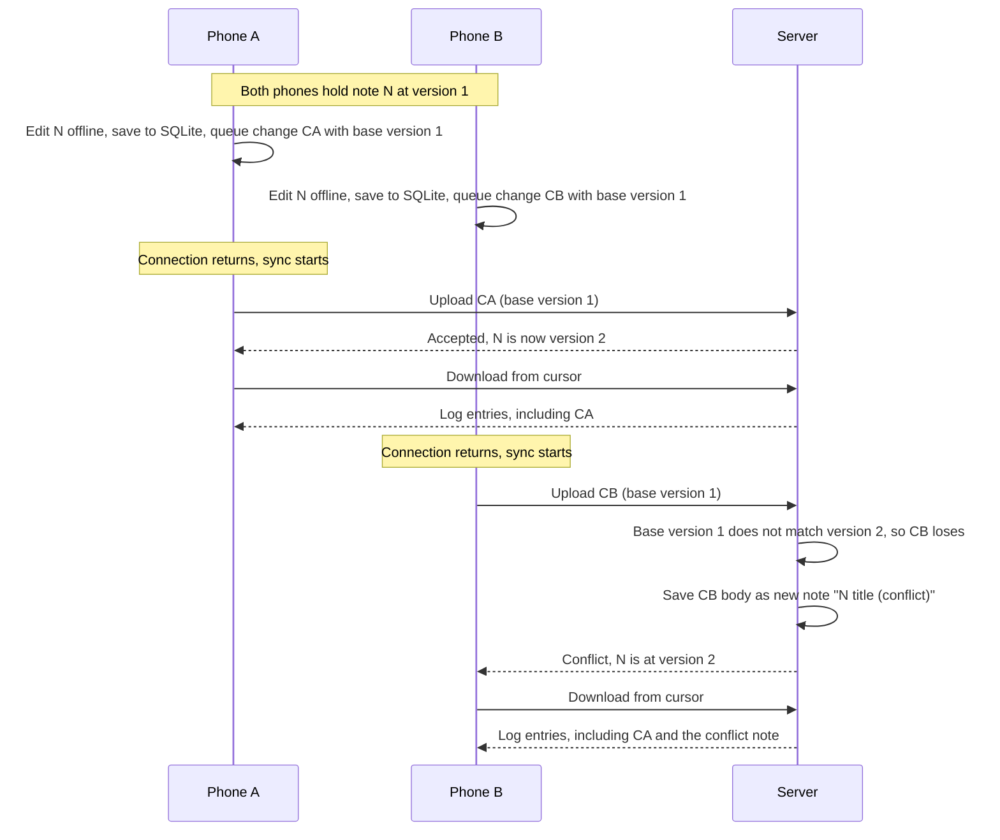
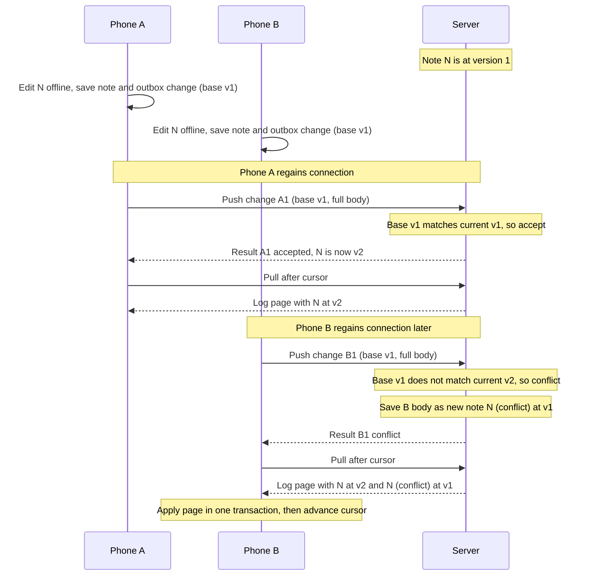

# Pair 15

Which document would a smart engineer who does not know this project understand faster and more correctly?

---

# Document A

## Notes sync

This document describes how the notes app will keep notes in step across several phones. Each phone works fully offline. The server is the single source of truth: when phones disagree, the server decides.

### The short version

- Each phone keeps its own full copy of the notes in a local SQLite database (a database file stored on the phone). Reading and editing never wait for the network.
- Every edit is also added to an **outbox**: a list of changes that still need to be sent to the server.
- The server keeps each note's current text and version number. It also keeps a **change log**, a numbered list of every accepted write, and a record of every upload it has handled.
- A sync has two steps, always in this order: **upload first, then download**. A sync starts when the phone gets its connection back, when the app comes to the foreground, and every 60 seconds while the phone is online.

### Terms

- **Version**: a whole number on each note. A new note starts at version 1. The server adds 1 each time it accepts a write to that note.
- **Base version**: the version of a note that an edit started from. If you edit version 1 of a note, the change's base version is 1.
- **Change ID**: a unique ID the phone creates once for each queued change. The server uses it to recognise a change it has already handled, so a retried upload is never applied twice.
- **Outbox**: the phone's queue of changes the server has not yet confirmed. Each entry holds a change ID, a note ID, a base version and the full note body.
- **Change log**: the server's ordered list of accepted writes. Each entry has a sequence number that only goes up.
- **Cursor**: the phone's record of the last change log entry it has fully applied. It tells the phone where to resume reading the log.
- **Conflict note**: a new note the server creates to keep the text of a losing edit.

### How two phones edit the same note

In the diagram below, both phones hold note N at version 1. Both go offline and edit it. Phone A syncs first and wins. Phone B syncs second and loses. B's text is kept as a new conflict note, and both phones receive it.

Reading the diagram:

- Phone A's upload is accepted, so N moves to version 2 with A's text.
- Phone B's upload is rejected because it started from version 1, and the server is already at version 2. The server does not merge the two texts. It keeps B's text as a new note.
- When B downloads, its copy of N is replaced with the winning text from A. B's own edit survives only in the conflict note.

### Where state lives

- **Phone**: the local SQLite database holds three things. The notes table holds the text each note shows now. The outbox holds changes not yet confirmed by the server. The cursor is stored in the same database as the notes, so the two can be updated together.
- **Server**: the notes table holds each note's current text and version. The change log holds every accepted write. A table of processed change IDs holds the saved result of every upload the server has handled, including conflicts.

### Editing on the phone

- An edit is written to SQLite first. The screen updates from that local write, so no network call is needed.
- A change stores the whole note body, not a diff (a list of differences between versions).
- If you edit the same note several times before its change uploads, the edits overwrite one another inside one outbox entry. That entry keeps the base version of the first edit, because that is the version the server must compare against.
- Once a change has been sent to the server, its contents are fixed. Any later edit goes into a new outbox entry.

### Uploading

Each sync sends up to 100 changes per batch, in outbox order. For each change, the server does one of three things:

1. **Already seen.** If the change ID is in the processed table, the server returns the saved result and changes nothing.
2. **Accepted.** If the base version matches the note's current version, the server saves the body, adds 1 to the version, adds an entry to the change log, and records the change ID with an "accepted" result.
3. **Conflict.** If the base version does not match, the server does not merge text and does not change the note. It saves the losing body as a new note titled with the original title plus " (conflict)", records the change ID with a "conflict" result, and adds the new note's creation to the change log.

The phone removes a change from the outbox only after it receives a result for that change ID.

### Downloading

- The phone asks the server for change log entries after its cursor. The server returns up to 500 entries per page. The phone keeps asking until a page comes back empty.
- The phone applies a page's entries and moves its cursor forward in one local database transaction. Either both happen or neither does, so the cursor never moves past entries that were not applied.
- Each log entry names a note and the version it produced. Applying the same entry twice gives the same result, so downloading a page again is harmless.

### Failures and retries

- **Connection drops before the phone hears back about an upload.** The change stays in the outbox. The phone sends it again later with the same change ID. If the server already accepted or rejected it, the server returns the saved result and does nothing else. The change is never applied twice.
- **Connection drops during a download.** The cursor did not move, so the next sync starts from the same place. Nothing is skipped or lost.
- **Conflicts.** The first write to reach the server wins. The losing text is kept as a conflict note, not discarded. Every phone receives that note on its next download, because creating it is a change log entry.

### Out of scope

Deletes, attachments, sharing between users, and authentication are not covered by this design.

---

# Document B

# Notes sync

Phones keep notes in SQLite and never wait for the network to edit them. Each edit is saved on the phone at once and queued in an outbox. A sync later pushes the queued changes to the server, then pulls the server's change log, which is how each phone catches up. The server is the source of truth: it decides conflicts by version, and it keeps a losing edit as a conflict note, so no text is lost.

Today the app is local-only: notes live in SQLite on the phone, and there is no sync server yet.

Out of scope: deletes, attachments, sharing between users, auth.

## Terms

- **Note version**: an integer on each note, set only by the server. It goes up by one on every accepted write.
- **Change log**: the server's ordered list of accepted writes. Each entry has a sequence number that only goes up, and the full note (ID, title, body, version) as it is after that write.
- **Outbox**: a table on the phone that holds edits the server has not yet answered.
- **Change**: one queued edit, stored as an outbox row. It holds a change ID, the note ID, the full note body (no diffs) and the base version.
- **Base version**: the note version that the edit started from.
- **Change ID**: a unique ID the phone makes when it creates a change. Every retry sends the same ID.
- **Sent change**: a change whose push has started but has no result yet. A sent change is never edited, so a retry sends exactly the same change.
- **Cursor**: the sequence number of the last change-log entry the phone has applied. It starts at 0, so a new phone's first pull reads the whole log, in pages of 500.
- **Conflict note**: a new note the server creates from a losing edit. Its title is the original title plus " (conflict)". After it is created it is an ordinary note: its later edits are pushed like any other note's, with the base version the phone holds.

Where state lives:
- **Phone (SQLite)**: notes, the outbox and the cursor.
- **Server**: notes with versions, the change log, and each change ID it has processed, with the result it returned.

## Diagram

Notes on the diagram:
- Both phones' edits stay on their phones until a sync runs.
- The server writes A's change first, so A's body wins. B's body is not lost: the server saves it as the conflict note.
- B had never seen the conflict note. Its pull inserts it from the log entry.

## Steps

1. **Edit (any time, online or offline).** Trigger: the user edits a note. The phone writes the new body to the note row and the change to the outbox in one local transaction, so both live in SQLite. The UI reads from SQLite, so it shows the edit at once, with no network round trip. If the note already has an unsent change in the outbox, the edits collapse into that one change: its body is replaced, and it keeps the base version of the first edit. If the note's change is already sent, the edit becomes a new outbox change. It waits until the sent change has a result (step 3). Data kept: phone SQLite. On failure: if the transaction does not commit, nothing is written and the UI keeps the old text.

2. **Sync (triggers).** Triggers: the connection comes back, the app comes to the foreground, or every 60 seconds while online. Each sync pushes first, then pulls. Syncs never overlap: a trigger that fires during a sync is skipped, and the 60-second timer sends any edit that missed it, at most 60 seconds later while online. On failure: the pull is skipped if the push fails (step 3).

3. **Push.** Trigger: a sync. The phone sends up to 100 unsent changes, oldest first. Each has its change ID, full body and base version. The server handles them one at a time, in order. For each change, it records the result under the change ID in the same write as the change itself:
   - If it has already processed this change ID, it returns the stored result and writes nothing.
   - If the note's current version equals the base version, it saves the body, sets the version one higher, adds a log entry, and returns accepted with the new version.
   - Otherwise it is a conflict. The server saves the losing body as a new conflict note at version 1, adds one log entry for that conflict note, leaves the existing note unchanged, and returns conflict with no version. Nothing is merged or overwritten.

   The phone handles each result in one local transaction. It deletes a change only when it has a result for that change ID, so a retry sends exactly the same change.
   - Accepted: it sets the note's version to the new version and deletes the change. It sets only the version, not the body.
   - Conflict: it deletes the change and leaves the note row alone. The user still sees their own text until the pull in the same sync replaces it.

   A waiting change (step 1) uses the version from its sent change's accepted result as its base. After a conflict there is no new version, so a waiting change keeps the base it already has. The server then decides it again, and its body becomes another conflict note. One edit sequence can therefore produce two conflict notes.

   If more changes wait, the phone sends the next batch in the same sync, until the outbox is empty or a batch fails. Data kept: the outbox and notes, in phone SQLite; the processed change IDs and their results, on the server. On failure: a batch fails when its request errors, times out, or the connection drops before all its results arrive. A conflict result is not a failure. The sync stops and does not pull. Results already received stay applied, and unanswered changes stay in the outbox for the next sync.

4. **Pull.** Trigger: a push that finished with no failure. The phone asks for log entries after its cursor. The server returns up to 500 entries in sequence order, plus the sequence number of the last one. Each entry carries the full note, so the phone needs no second fetch. The phone applies the page in one local transaction:
   - If it has no row for the note, it inserts the note from the entry. This is how a phone gets a conflict note it has never seen.
   - If it has the row, it sets the title, body and version only when the entry's version is newer than the local one. An entry for a version the phone already has, such as its own accepted write, changes nothing.
   - The cursor moves to the page's last sequence number in the same transaction.

   The phone repeats until a page comes back empty. Data kept: notes and cursor, in phone SQLite. On failure: if the connection drops during a page, nothing is applied and the cursor does not move, so the next pull reads the same page again. Applying a page twice changes nothing, so a repeated page cannot skip or miss a change.

## What happens when things fail

| Failure | What is kept | What happens next |
| --- | --- | --- |
| Local save does not commit | Nothing is written | The UI keeps the old text. The edit is not shown as saved. |
| Connection drops, or the server stops, during a push, before the phone gets a result | The change stays in the outbox with the same change ID. Results already received stay applied. | The sync stops without pulling. The next sync resends the change. The server returns the stored result if it already processed the change. |
| Connection drops after the server accepted a change, before the phone got the result | Same as above | Same as above. The change is applied once. |
| Server stops in the middle of a batch | Each change is recorded on its own, in order | The phone resends the whole batch. Changes already processed return their stored results. |
| Connection drops during a pull page | Nothing from the page is applied, and the cursor does not move | The next pull reads the same page again. |
| Conflict | The losing body is saved as a conflict note on the server | The phone deletes its change. It gets the winning note and the conflict note on its next completed pull. |
| Conflict, then the pull fails | The user's text stays on screen, and the server holds the losing body | The text is replaced by a later sync that completes its pull. Nothing is lost. |

## Open questions

- **Pull over an unsent change.** The brief does not say what happens when a pull brings a newer version of a note that still has an unsent change. As step 4 is written, the pull overwrites the local body, so the screen shows the server's text. The user's edit stays in the outbox and becomes a conflict note on the next push. But if the user edits that note again before that push, the new edit replaces the outbox body and the first edit's text is lost. The push drains the outbox before the pull, so this happens only when the user edits the note while a pull runs. No rule here avoids it without a new mechanism.
- **New notes.** The brief does not say how a phone creates a new note, or what base version the first change of a new note carries. This document covers edits to notes the server already has.
