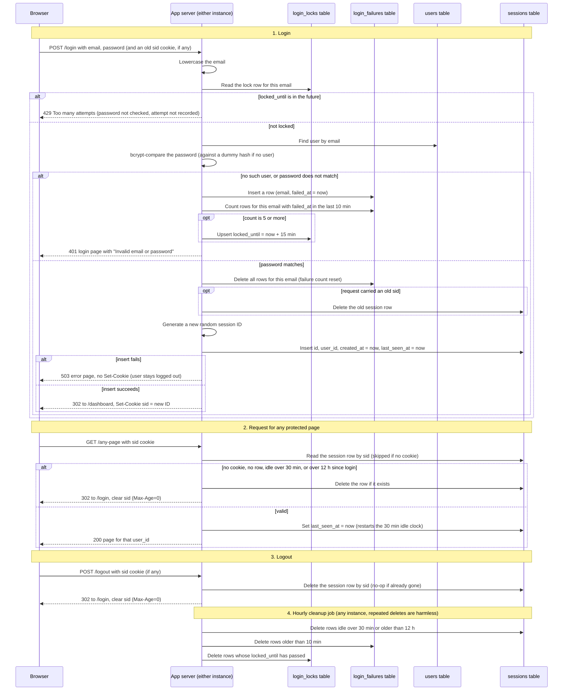

## Login, sessions and logout

**Where state lives.** Everything is in the existing Postgres database, which both app instances share. Nothing is held in process memory, so no new infrastructure (no Redis) is needed.

| Where | What it holds | Who writes it |
|---|---|---|
| `users` (existing) | id, email (lowercase, unique), password_hash (bcrypt) | sign-up (out of scope) |
| `sessions` (new) | id (32 random bytes, base64url, primary key), user_id, created_at, last_seen_at | inserted at login. Each valid request updates last_seen_at. Deleted at logout, when found expired, and by the cleanup job |
| `login_failures` (new) | one row per failed attempt: email (lowercase), failed_at. Indexed on (email, failed_at) | inserted by each failed login. A successful login deletes that email's rows. The cleanup job deletes rows older than 10 min |
| `login_locks` (new) | email (lowercase, primary key), locked_until | written when a failure brings the email's 10-minute count to 5. Deleted by the cleanup job once locked_until has passed |
| Browser cookie `sid` | the session ID only, no user data. HttpOnly, Secure, SameSite=Lax, Path=/, Max-Age=43200 (12 h) | set at login. Cleared (Max-Age=0) at logout or when the session is invalid |

**Rules used in the diagram**
- **Counting failures (sliding window).** Every failed attempt adds one `login_failures` row. The server then counts that email's rows whose `failed_at` falls in the 10 minutes ending now. There is no stored window start and nothing resets the count on a timer: each failure simply stops counting once it is more than 10 minutes old. When the count is 5 or more, `login_locks.locked_until` is set to now + 15 min. That fifth attempt still gets the normal 401. Attempts made during the lock get 429 and add no row, so they cannot extend the lock. By the time the lock ends, the failures that caused it have all aged out of the 10-minute window.
- **Unknown emails.** The server still runs a bcrypt compare against a fixed dummy hash and records the failure. Response time and lockout therefore behave the same whether or not the account exists.
- **A session is valid** when a row exists for the cookie's ID, `now - last_seen_at` is at most 30 min, and `now - created_at` is at most 12 h.
- **Storage failures fail safe.** At login: 503, no cookie. On a protected page: 503, the page is not served. At logout: 503, and the cookie is left in place so the user can retry, because clearing it would hide a session that is still live.
