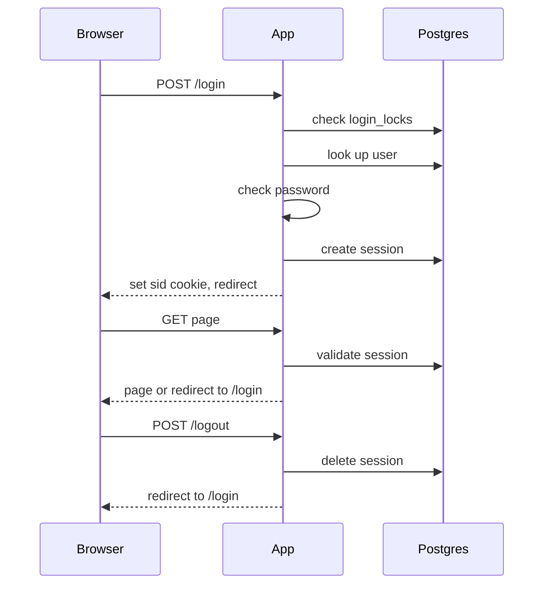

## Auth plan

Server-side sessions in Postgres, cookie `sid`. Tables: users, sessions, login_failures, login_locks.

Notes:
- Lockout: 5 fails / 10 min, 15 min lock.
- Cookie flags: HttpOnly, Secure, SameSite=Lax.
- Timeouts: 30 min idle, 12 h max.
- Bad login goes back to the login page with an error.
- New session ID on each login.
- Cleanup job for expired rows.
- Handle DB errors.
