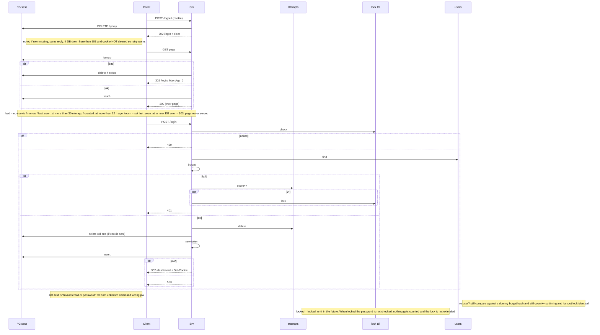

**auth / sessions**

The token (session key, the sid value) is 32 random bytes base64url and is the primary key of the sess table, which also has user_id, created_at and last_seen_at, and the cookie (named sid, HttpOnly, Secure, SameSite=Lax, Path=/, Max-Age=43200 which is 12 h) only ever holds that key and never any user data, and there's a cleanup thing every hour that removes sess rows idle more than 30 min or older than 12 h and also removes attempt rows older than 10 min and lock rows whose locked_until is past, and it can run on either app box (or both) since deleting twice doesn't hurt. Everything lives in Postgres, including the users table that already exists (id, email lowercase unique, password_hash bcrypt), and nothing is in process memory because there are two instances, so no Redis.

count++ means: insert a row with the email and failed_at = now into attempts (PG2 in the picture, login_failures really, one row per failure, not a counter column), then count how many of that email's rows have failed_at in the last 10 min, and there's no window start to reset, old rows just fall out of the count once they're more than 10 min old, and if the count is 5 or more that's the lock arrow, which writes locked_until = now + 15 min into login_locks (the lock tbl, keyed by the lowercased email), but that 5th one still gets the 401, not the 429. The email gets lowercased before any of this happens. When the session store insert fails after a good password (ok2 not ok) the user gets a 503 and no Set-Cookie and just isn't logged in (the old session would already be gone by then), and insert puts now into both created_at and last_seen_at. On a good login all of that email's attempt rows are deleted, which is the reset. The login token is fresh every time and never reuses whatever key the browser came in with.
