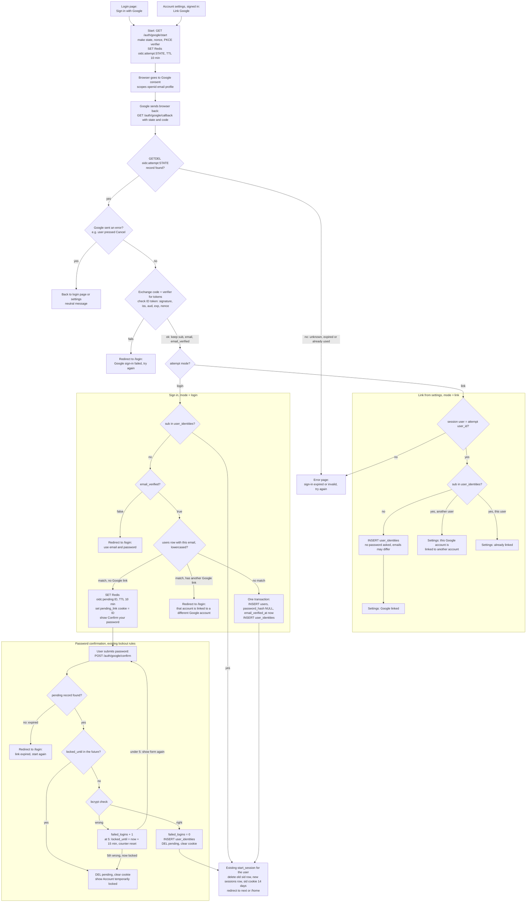

# Sign in with Google: flow and state

## State this adds

- **`oidc:attempt:<state>`** (Redis, TTL 10 min). The start step writes it. It holds `mode` (`login` or `link`), `user_id` (link mode only), `nonce`, the PKCE `code_verifier` and `next`. The callback deletes it with an atomic GETDEL as its very first step, so only the first callback for a given `state` can use it. An unused one expires.
- **`oidc:pending:<id>`** (Redis, TTL 10 min). Written when a Google sign-in matches an existing password account. It holds `user_id`, `google_sub`, `google_email` and `next`. The browser holds only the random `<id>`, in an HttpOnly, Secure `pending_link` cookie. It is deleted when the link succeeds or the account locks, and otherwise expires.
- **`user_identities`** (new PostgreSQL table): `user_id, provider='google', subject (= Google sub), email_at_link, linked_at`.
  - `UNIQUE(provider, subject)` means a Google account links to only one user.
  - `UNIQUE(user_id, provider)` means a user has only one Google account. Settings shows "Link Google" only when the user has none.
- **`users.password_hash`** becomes nullable. NULL means a Google-only account. For such an account the password form returns its usual generic error.
- **Google tokens.** The access and refresh tokens from the code exchange are dropped at once. Only the ID token's `sub`, `email` and `email_verified` are read.

**Matching rule:** by `sub` only. Email is checked only when the `sub` is not linked. A linked user whose Gmail address has changed still lands in the same account. Google never changes our `users.email`.

## Flow

## Failure rules

- **Error exits write nothing.** Every error exit leaves no user, no link and no session.
- **Code exchange or ID-token check fails.** This covers a Google error or timeout, a bad signature, a wrong `iss` or `aud`, an expired token and a nonce mismatch. The exchange is not retried, because the code is single-use and the attempt record is already gone. The user starts again from the button.
- **Signature keys.** ID-token signatures are checked against Google's published keys (JWKS), cached for as long as Google's Cache-Control allows.
- **Wrong passwords during confirmation.** Confirmation uses the existing counters on `users` (`failed_logins`, `locked_until`). The 5th wrong password locks the account for 15 minutes and deletes the pending link. The user must start Google sign-in again after the lock.
- **Unlink (settings).** Allowed only if `password_hash` is not NULL. Otherwise the page tells the user to set a password with the existing reset email first. Unlinking deletes the `user_identities` row. Current sessions are kept.

## Session

Every success ends in the existing `start_session(user_id)`:

1. Delete the sessions row for any `sid` the browser already had.
2. Insert a new `sessions` row and set the `sid` cookie (HttpOnly, Secure, SameSite=Lax, 14 days, slid forward on use).
3. Redirect to `next` if it is a relative path on our site, otherwise to `/home`.
