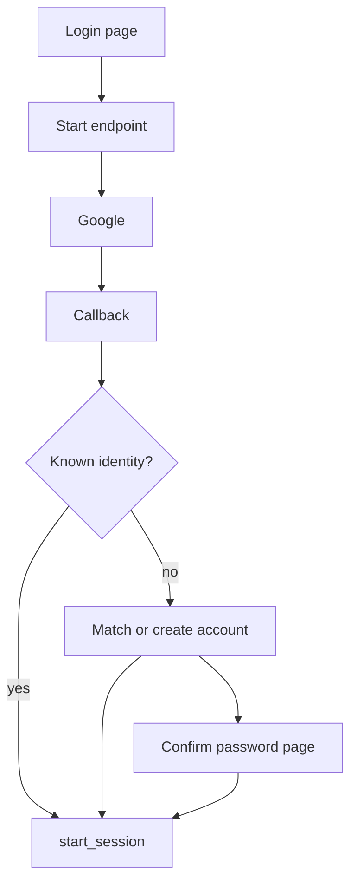

# Google sign-in

Adds Google OIDC (code flow + PKCE) to login and settings. New pieces: a start endpoint, a callback, a confirm-password page, a `user_identities` table, some Redis entries, and `password_hash` made nullable.

Notes:
- The start endpoint saves state, nonce and the PKCE verifier. The callback checks them and exchanges the code.
- Existing accounts are linked after a password confirmation, and the usual lockout applies.
- Google-only users have no password.
- Settings has its own Link Google button that goes through the same start endpoint and callback. Settings can also unlink, which needs a password.
- `user_identities` stores the Google link.
- Errors show a message and change nothing.
- Uses the normal session.
