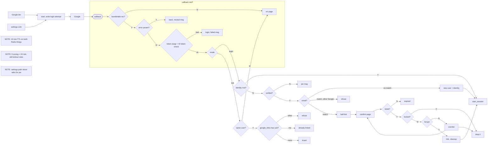

Google SSO / OIDC plan

The way it works is that the button (the login page one, or the settings one if you're signed in and want to attach Google) hits the start endpoint, which makes state + nonce + PKCE verifier and puts the handshake record in Redis under oidc:attempt:<state> with the mode (login/link), user_id if it's a link, the nonce, the code_verifier and next, TTL 10 min, then off to Google (openid email profile), and when Google sends the browser back the callback GETDELs the login attempt (atomically, first thing, so a replay or a second hit finds nothing; unused ones just expire) and if it isn't there (unknown, expired, already used) that's the "sign-in expired or invalid, try again" page, and if Google put an error in the redirect (Cancel etc.) we go back to login or settings with a neutral message, and then we swap the code (+ verifier) for tokens and check the ID token (signature vs Google's JWKS, cached per their Cache-Control, iss, aud, exp, and nonce vs the OIDC session's nonce) and if any of that blows up, Google 5xx/timeout included, it's /login with "Google sign-in failed, try again" and no retry because codes are single-use and the attempt row is gone already. Access/refresh tokens get thrown away right there; we only read sub, email, email_verified.

NOTE (sessions): all the good paths end in start_session from the existing code. It kills any old sid session, inserts a sessions row, sets the sid cookie (HttpOnly, Secure, SameSite=Lax) for 14 days slid forward on use, then goes to next if it's a relative path on our site, otherwise /home.

NOTE: errors never write anything (no user, no link, no session).

Linking from settings is the link-mode path: the callback checks that the signed-in session's user is the attempt's user_id (else the same error page), then if the sub is in google identities for someone else → refuse ("this Google account is linked to another account"), for this user → "already linked", otherwise insert and show "Google linked". No password prompt here, and the Google email doesn't have to match ours. The Link button only shows when there's no Google identity yet, and the UNIQUE(user_id, provider) backs that up.

Storage: user_identities in Postgres (user_id, provider='google', subject = the sub, email_at_link, linked_at), UNIQUE(provider, subject) so one Google account → one user. users.password_hash goes nullable, NULL meaning Google-only; the password form just gives the usual generic error for those. The new-user path (sub unknown, email verified, no match on the lowercased email) is one transaction: a users row with NULL password_hash and email_verified_at = now, plus the identity row, then the session. Unverified email with an unknown sub → refuse, tell them to use email+password, nothing created. If the email matches someone who already has a different Google linked → refuse ("that account is linked to a different Google account").

The half-link (a.k.a. link ticket, pending record): oidc:pending:<id> in Redis, user_id + google_sub + google_email + next, TTL 10 min, and the pending_link cookie (HttpOnly, Secure) carries just the id. The confirm page POSTs to /auth/google/confirm. Ticket gone → "link expired, start again". Already locked (locked_until in the future) → drop the ticket, clear the cookie, "Account temporarily locked". Wrong password → failed_logins + 1 and the form again, but the 5th one sets locked_until = now + 15 min (counter reset) and drops the ticket, and then they have to start Google sign-in over after the lock. Right → failed_logins = 0, insert the identity, delete the pending record, clear the cookie, start_session.

Unlink: only with a password (password_hash not NULL), else "set a password first" via the reset email; it deletes the identity row, sessions stay.

Oh, and we only ever match on sub (email only gets looked at when the sub isn't linked), so someone whose Gmail changed still gets their same account, and we never overwrite users.email from Google.
