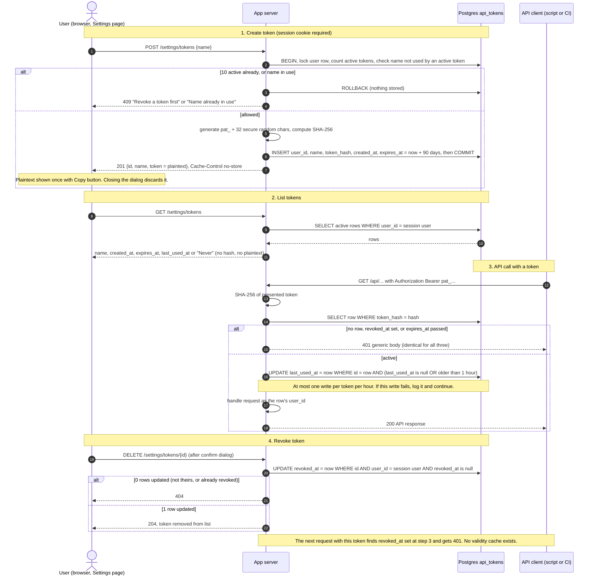

**State.** One new Postgres table, `api_tokens`, holds every token. Each row has: `id`, `user_id`, `name`, `token_hash` (SHA-256 hex, unique index), `created_at`, `expires_at` (`created_at` + 90 days), `last_used_at` (null until first use) and `revoked_at` (null while not revoked). A token is **active** when `revoked_at` is null and `expires_at` is later than now. The plaintext token exists only in server memory during the create request and in the create response body. It is never written to the table or the logs.

**Failure notes**

- **Lost create response.** If the 201 never reaches the browser, the row is already committed. It shows up in the list with last used "Never". The user revokes it and creates another token. There is no endpoint that returns a plaintext again.
- **Limit race.** The count, the name check and the insert run in one transaction that holds a lock on the user's row. Two concurrent creates therefore cannot push the user past 10 active tokens.
- **Expiry** needs no job. Rows past `expires_at` stop authenticating and drop out of the list, and they also stop counting toward the limit.
