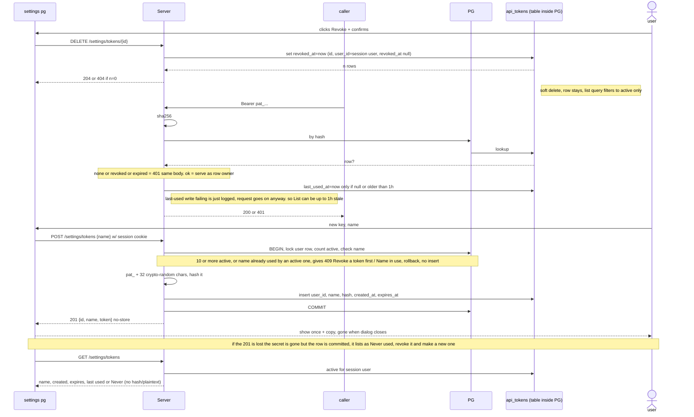

Notes: so the PAT (key / credential / secret, all the same thing) is checked by the backend: it takes the SHA-256 of whatever comes in the Bearer header and looks it up by hash, which only works because we never keep the plaintext. The key only lives in memory while the create request runs and in the 201 body, which goes out with Cache-Control no-store and is never logged. If the credential row has revoked_at set, or expires_at (created_at plus 90 days) is in the past, or there's no row, the caller gets a 401, and it's the same generic body whichever it was. Also, on revoke we don't delete the row, we just stamp revoked_at, scoped to user_id and revoked_at null, so somebody else's id or an already-revoked one gives 404. Because there's no validity cache, the next call with that secret is a 401. Last used is touched hourly-ish, see the diagram, and the table has id, user_id, name, token_hash (unique), created_at, expires_at, last_used_at, revoked_at, and active means not revoked and not expired.

Expired ones need no cleanup job: they stop authing, vanish from the list and don't count toward the 10, and the lock on the user row is what stops two parallel creates from going over.
