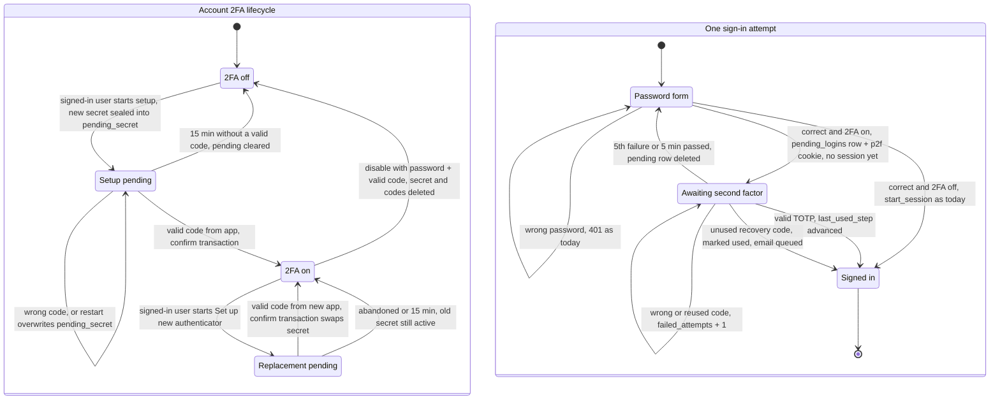

## Two-factor sign-in (TOTP): state model

**Builds on (unchanged):** `POST /login` with the bcrypt check and the IP rate limit; the `sessions` table (sha256 of the token, 30-day expiry) and the `sid` cookie set by `start_session()`; `seal()`/`unseal()` for secrets at rest; and `enqueue_email()`, which queues mail, retries in the background and never blocks a request.

**New state (all in Postgres)**

| Store | Holds | Removed when |
|---|---|---|
| `user_totp` (1 row per user) | `active_secret` (sealed), `last_used_step`, `pending_secret` (sealed), `pending_expires_at` | pending: on confirm, overwritten on restart, or 15 min after start. Whole row: on disable |
| `recovery_codes` | `user_id`, `code_hash`, `used_at` | all of the user's rows replaced on every confirm; deleted on disable |
| `pending_logins` | `token_hash`, `user_id`, `failed_attempts`, `expires_at` (now + 5 min). The browser holds the raw token in cookie `p2f` (httpOnly, Secure, max-age 5 min) | on success, on the 5th failure, or at expiry |

2FA is **on** for a user exactly when `user_totp.active_secret` is not null. Sign-in never reads `pending_secret`.

**Checking a code (in "Awaiting second factor")**
1. Look up the `pending_logins` row by sha256 of the `p2f` cookie. If it is missing or expired, delete it, clear the cookie and return to the password form.
2. **6 digits: TOTP.** Try steps T-1, T and T+1 (30 s each) against the unsealed `active_secret`. Accept only if the matching step is greater than `last_used_step`, then set `last_used_step` to that step.
3. **Anything else: recovery code.** Hash it and find an unused row for this user. If found, set `used_at = now()`.
4. **Success:** delete the pending row, clear `p2f`, and call `start_session()` (a normal 30-day session). For a recovery code, also call `enqueue_email(user, "recovery_code_used", {remaining})` without waiting for it, and show a banner linking to "Set up new authenticator".
5. **Failure** (wrong TOTP, replayed step, wrong or already-used recovery code): increment `failed_attempts` on the same row. Both kinds share this counter. At 5, delete the row and send the user back to the password form.

**Confirming an authenticator (first setup or replacement)** runs as one transaction: move `pending_secret` to `active_secret`, set `last_used_step` to the confirming code's step, delete all of the user's `recovery_codes`, insert 10 new hashes, and delete all of the user's `sessions` except the current one. After commit, show the 10 codes once; they can never be retrieved again. If the transaction fails, nothing changes: the old secret and codes still apply, the pending secret is still there, and the user can retry.

**Lost phone:** password, then an unused recovery code, then the banner, then "Set up new authenticator", then a code from the new phone. Until that code is confirmed, the old secret and the remaining recovery codes keep protecting sign-in. Confirming signs out every other session, including any session left on the lost device.

**Disable:** requires the password plus a valid TOTP or recovery code. Deletes the `user_totp` row and all of the user's `recovery_codes`.

**OPEN QUESTION (product to decide):** a user who has lost the phone and has no unused recovery codes. Whether support may reset 2FA, and the identity check that would need, are not designed here. Until this is decided, this plan gives such a user no way to finish signing in.
