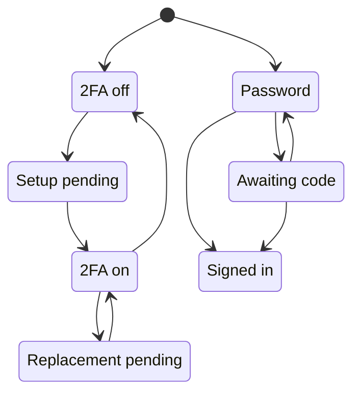

## TOTP 2FA plan

New tables: `user_totp`, `recovery_codes`, `pending_logins`. New cookie `p2f`. Reuses `seal()`, `enqueue_email()` and `start_session()`.

Notes:
- Codes are 6-digit TOTP with drift tolerance and replay protection.
- Recovery codes: 10, single use, hashed, regenerated on confirm.
- Attempts are limited and pending logins expire.
- Lost phone: use a recovery code, then set up a new authenticator.
- The user gets an email when a recovery code is used.
- Other sessions are handled when 2FA is enabled.
- Disable needs re-authentication.
- Support reset for users with no phone and no codes: TBD.
