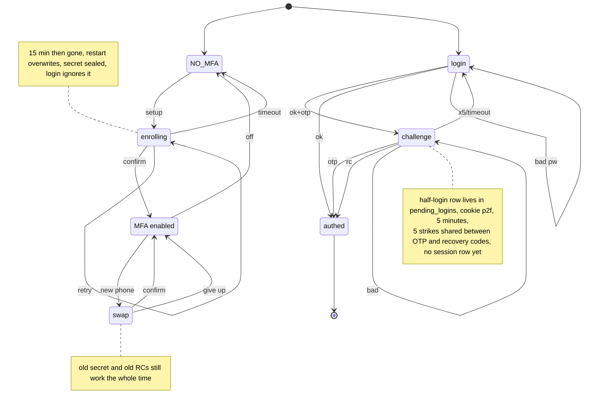

# 2FA / MFA / OTP plan

Notes, in no particular order. The recovery thing: when someone logs in with an RC, `used_at` gets stamped in recovery_codes (we only keep the hash, code_hash, per user) and enqueue_email fires a recovery_code_used mail with the remaining count. That mail is queued and retried in the background, so the login never waits on it. Then they get a banner pointing at Set up new authenticator, which is the swap state below. By the way, when the swap or the first enrolment is confirmed it's all one transaction: pending_secret becomes active_secret, last_used_step gets the step of the code they just typed, every old recovery_codes row for that user is deleted and 10 new hashes are inserted (shown to them once, never again), and every sessions row of theirs except the one they're using is deleted (which also kills a session on a lost phone). If that transaction blows up nothing changes: the old secret and old codes still apply, the pending one is still there, and they can just retry.

The challenge step. The half-login state is pending_logins (token_hash, user_id, failed_attempts, expires_at = now + 5 min), and the browser has the raw token in cookie p2f (httpOnly, Secure, max-age 5 min). Look it up by sha256(p2f); if it is missing or expired, delete it, clear the cookie and go back to the password form. If the input is 6 digits treat it as an OTP, otherwise as a recovery code. OTP: RFC 6238, 30 s step, T-1/T/T+1 against the unsealed active_secret, and the step has to be bigger than last_used_step, then last_used_step = that step. A wrong OTP, a replayed step, a wrong RC and an already-used RC all do failed_attempts + 1 on the same row; at 5 the row is deleted and they go back to the password. On success, delete the pending row, clear p2f and call start_session() like today (30 days, sid cookie, sessions table).

user_totp: one row per user, columns active_secret (sealed via seal()), last_used_step, pending_secret (sealed) and pending_expires_at. MFA is on iff active_secret is not null. The pending secret (enrolling or swap) is never looked at by login. It is cleared on confirm, overwritten on restart and dropped 15 min after start. In a swap, the old active_secret and old codes keep protecting login until the new app's code confirms; giving up or hitting 15 min just leaves the old one. Starting setup or a swap needs a fully signed-in session. Disabling takes the password plus a valid OTP or RC, and deletes the user_totp row and all recovery_codes. A wrong password is a 401 with the IP rate limit, as today. A user without 2FA gets start_session straight after the password, like today.

Lost phone: password, then RC, then banner, then swap, then confirm with the new phone.

Also open: someone with no phone and no unused RCs. Product hasn't decided (a support reset? how would they verify the person?). Not designed; this plan gives them no way to finish signing in.
