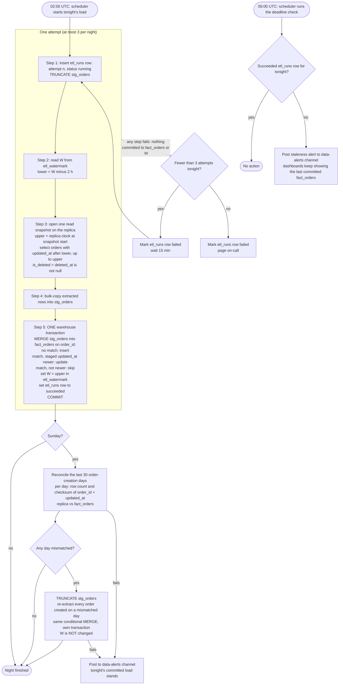

## Nightly orders ETL: app replica to warehouse

**Where state lives.** Everything is in the warehouse. The app database is read-only to us.
- `etl_watermark`: one row holding W, the extract upper bound of the last successful attempt.
- `etl_runs`: one row per attempt, holding the night, attempt number, lower bound, upper bound and status.
- `stg_orders`: scratch copy of one extract. It is emptied at the start of every attempt and every reconciliation reload. Dashboards never read it.
- `fact_orders`: one row per `order_id`, holding the latest version plus `is_deleted`. It is the only table dashboards read.

**Notes**
- **Late rows.** Bulk imports hold transactions open for up to 90 min, and `updated_at` is stamped at write time, not at commit. A bulk-imported row can therefore appear on the replica up to 90 min after its `updated_at`. Each night starts at W minus 2 h, so it re-reads the last 2 h of the previous night's window and picks such rows up. A row that becomes visible too late even for that lookback (for example while the replica is behind) is not picked up by any nightly extract unless the order is written again. If that order was created in the last 30 days, the next Sunday reconciliation finds the mismatch on its creation day and reloads that day. Orders created earlier are not checked.
- **Updates after export.** Every app write bumps `updated_at`. Deletes are always soft: the app sets `deleted_at`, which is also a write, and never hard-deletes a row. The next night extracts the changed row again, and the MERGE replaces the older version. Soft deletes arrive as `is_deleted = true`. No row is ever removed from `fact_orders`.
- **Why overlap and retries are safe.** They bring back copies that are already loaded. The MERGE skips any copy that is not newer, so each `order_id` still has exactly one row.
- **Failure.** Step 5 is a single transaction, so a failed attempt leaves `fact_orders` and W unchanged. The next attempt empties `stg_orders`, reads the same W, takes a fresh upper bound and re-extracts. A night gets three attempts in total, 15 min apart. After the third failure, on-call is paged.
- **06:00 deadline.** Dashboards refresh at 06:00 UTC regardless of the load. Step 5 commits everything at once, so they see either all of tonight's changes or none of them. If `etl_runs` has no succeeded row for tonight, a staleness alert goes to #data-alerts. A load that commits after 06:00 is kept.
- **Reconciliation** runs only after Sunday's load succeeds. It reuses `stg_orders` and the same conditional MERGE, and it never changes W. If it fails, it posts to #data-alerts, and the nightly load stays committed.
