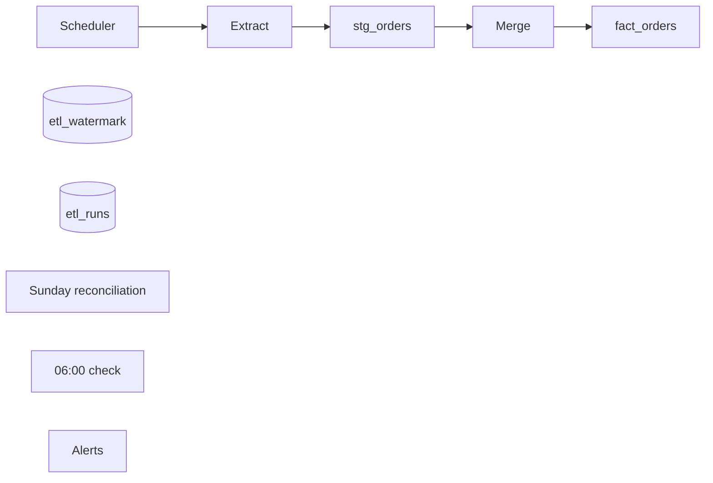

## Nightly orders ETL

Scheduled at 02:00 UTC. Copies `orders` from the app replica to the warehouse.

- Incremental on `updated_at`, with a 2h lookback for late rows.
- Merge on `order_id`, latest version wins.
- Soft deletes become `is_deleted`.
- Retries on failure, then pages.
- Reconciliation covers the last 30 days.
- Deadline check at 06:00.
