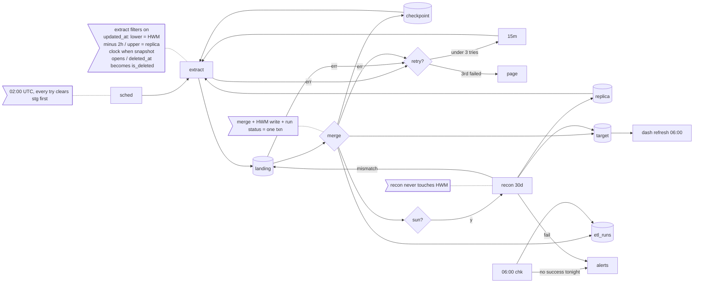

## Orders ETL: how it works

On Sundays, once the normal nightly load has gone through, there's also the recon job, which goes back 30 days by order creation day and for each day compares a row count plus a checksum over order_id + updated_at between the replica and the warehouse orders table, and wherever a day doesn't match it pulls every order created that day again into the landing table (stg_orders, cleared first) and pushes them through the same merge the nightly uses (in its own transaction) so an older copy can't win, and recon never moves the checkpoint, and if recon fails it just posts to #data-alerts and whatever the nightly committed stays committed. The merge itself is keyed on order_id into fact_orders: ids not there yet get inserted, ids already there only get overwritten when the staged updated_at is strictly newer than the one in the target, otherwise the row is skipped, which is what makes the 2h overlap and the retries do no harm since they keep bringing back copies we already have, and it's also how an order that's edited after we exported it gets fixed up, because the app bumps updated_at on every write so the row just comes back the next night and replaces the old version. Soft deletes (the app sets deleted_at, which is a write too, and never hard-deletes) come through the same way and turn into is_deleted = true on the warehouse row; nothing ever gets deleted from fact_orders.

Other stuff: the HWM is in the warehouse (etl_watermark, a single row) because we can't write to the app DB; etl_runs, also in the warehouse, gets one row per try with its status. Kicks off at 02:00 UTC from the scheduler and reads the read replica only. Every try, the first one included, starts by clearing stg, then reads the watermark and pulls the orders whose updated_at is after the lower bound and up to the upper bound; the lower bound is watermark minus 2 hours and the upper bound is the replica's clock when the snapshot opens, and that upper bound is what gets written into etl_watermark, inside the same transaction as the merge and the run's success status, so the dashboards (they only read fact_orders, never the landing table, and they refresh at 06:00 UTC no matter what) see either the whole night or none of it. When a try fails that transaction never commits, so the target and the HWM are untouched, and the next try (3 tries per night max, 15 min apart, then on-call gets paged) clears staging again, reads the same checkpoint and takes a fresh upper bound. The 2 hours exists because bulk imports in the app hold transactions open for up to 90 min and updated_at is stamped when the row is written, not at commit, so bulk-imported rows can turn up on the replica up to 90 min late; a row that turns up even later than the lookback can catch (say the replica falls behind) never gets picked up by a nightly extract unless the order is written again, and that's what the Sunday recon is for, though recon only looks at orders created in the last 30 days and only happens if Sunday's nightly actually succeeded. There's also a 06:00 check: if etl_runs has no successful try for tonight it posts a staleness alert to #data-alerts, and the dashboards simply show the last committed data; a load that finishes after 06:00 isn't undone.
