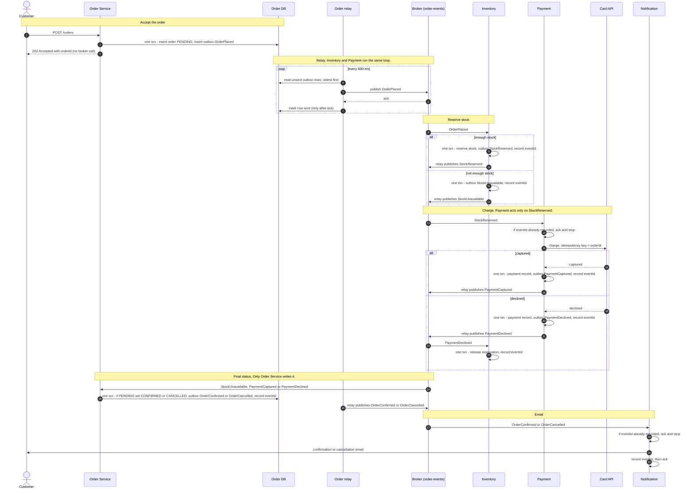

**Order fulfilment: event flow**

Shared rules (they hold at every step below):

- **One topic.** Every event goes on `order-events`, keyed by `orderId`, so each consumer group receives one order's events in publish order. Each event carries `eventId`, `orderId` and `type`. A group ignores types it does not handle.
- **Outbox in every producer.** Order, Inventory and Payment never publish directly, and the order request handler never calls the broker. Each service writes its outgoing event to an `outbox` table in its own DB, in the same transaction as its state change. Each runs the same relay: every 500 ms it reads unsent rows oldest first, publishes each one, waits for the broker ack, then marks the row sent. A crash between ack and mark republishes the row, so delivery is at-least-once.
- **Dedupe in every consumer.** Order Service, Inventory, Payment and Notification each have their own consumer group and a `processed_events` table (primary key `eventId`) in their own DB. On each message a consumer first looks up the eventId. If it is already recorded, the consumer acks and does nothing. Otherwise it records the eventId in the same transaction as its state change and any outbox row, commits, then acks the broker. The primary key also stops two copies racing through. Two steps sit outside that transaction: Payment's card call (covered by the idempotency key) and Notification's email (sent before the eventId is recorded).

The diagram draws the relay once, for Order Service. The Inventory and Payment relays work the same way and appear as 'relay publishes'.

Failures:

- **A consumer throws** (a bug, its DB is down, or the card API times out or returns 5xx). It does not ack. The message is retried after 1 s, 10 s and 60 s, which makes 4 attempts in all. If the 4th attempt fails, the message goes to that group's dead-letter queue, on-call is paged and the group moves on to its next message. Nothing is undone: the order keeps its current status. For example, if Payment's message is dead-lettered, the order stays PENDING and the stock stays reserved.
- **Card declined versus card API down.** A decline is a result: PaymentDeclined is published, Inventory releases the reservation and Order Service sets CANCELLED. A timeout or 5xx is an error and follows the retry rule above.
- **A producer crashes after its commit but before the relay publishes.** The outbox row is committed and still unsent, so the relay publishes it on its first poll after restart. Nothing is lost. If the transaction rolled back, there is no outbox row and no event.
- **Payment crashes after the charge but before its commit.** It never acked, so StockReserved is redelivered. The eventId is not recorded yet, so Payment calls the card API again with the same key (orderId), gets the original capture back without a second charge, and commits its record, PaymentCaptured and the eventId.
- **Duplicate event** (relay republish or broker redelivery). The eventId is already in `processed_events`, so the consumer acks and does nothing. Order Service also changes an order only while it is PENDING, so a repeated or late outcome cannot change a final status.
- **Email fails.** It is retried and dead-lettered like any other message. Notification cannot write order status, so the status never changes. A crash between sending and recording can send a second email. That is acceptable because email is best-effort.
