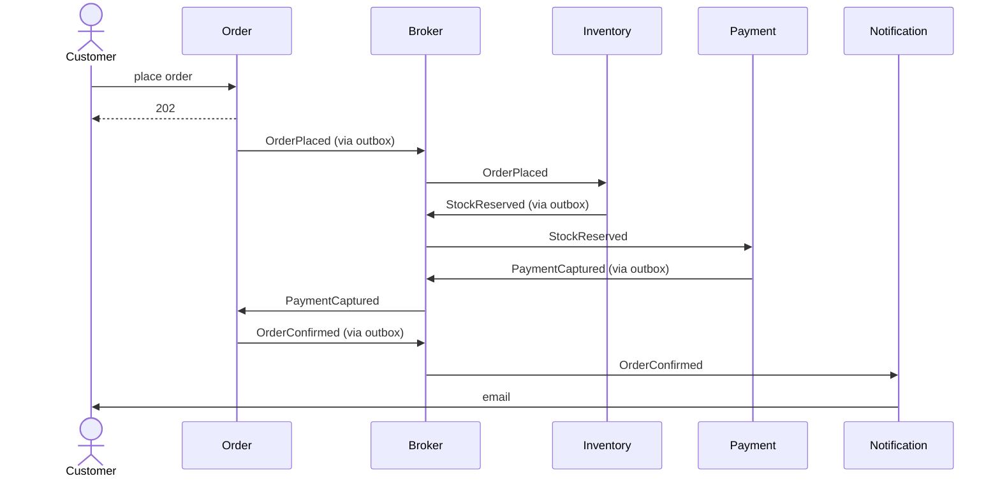

## Order fulfilment (event-driven)

Parts: Order Service, a broker topic (order-events), Inventory, Payment (talks to the card provider) and Notification. Producers publish through an outbox and relay. Consumers are idempotent. Usual retries and a DLQ.

Unhappy paths: StockUnavailable and PaymentDeclined, both ending in OrderCancelled and a cancellation email. Payment uses an idempotency key with the card provider.
