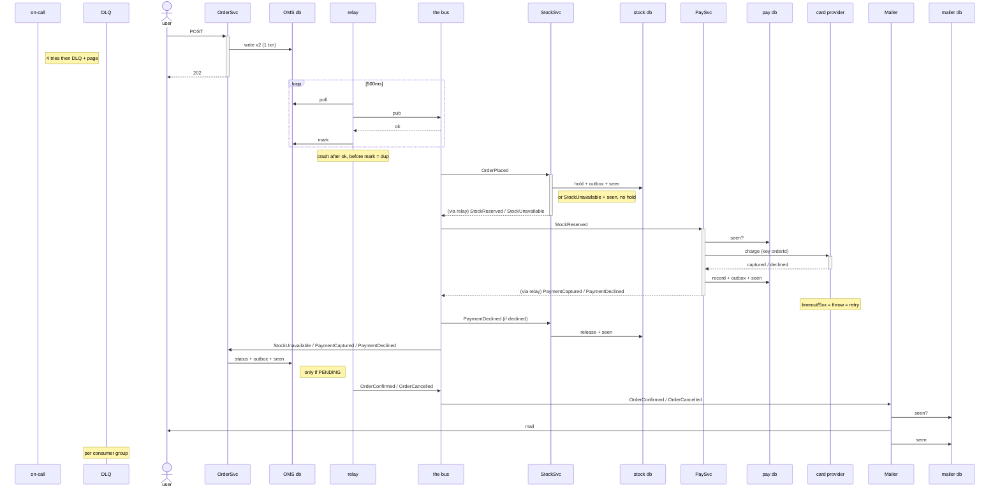

Fulfilment flow v2 (diagram + notes, important stuff is mostly in the notes)

The Mailer just sends whatever OrderConfirmed/OrderCancelled it gets off the bus and writes the eventId into its seen-ids table after the send (it checks that table first), so in theory a crash between send and write can mail twice, which is fine since email is best-effort, and a failed send is just a throw like any other so it goes through the normal retries and the DLQ, and it never touches order status anyway, nothing does except OMS, which flips an order to CONFIRMED or CANCELLED only while it is still PENDING, when it consumes StockUnavailable or PaymentCaptured or PaymentDeclined, all in one transaction with its outbox row (OrderConfirmed/OrderCancelled) and its dedupe insert. Retries are 1 s, 10 s, 60 s, so four tries total, then the DLQ for that consumer group plus a page to on-call and the consumer carries on with the next message, and nothing gets rolled back, the order just stays in whatever status it had (e.g. PENDING with the stock hold still in place if it was PaySvc that dead-lettered). Card declines are not errors (that's the PaymentDeclined path: StockSvc drops the hold and OMS cancels) but card provider timeouts and 5xx are, so they go through the retry thing, and because PaySvc always sends orderId as the idempotency key a retry gets the first result back instead of double charging, which also covers PaySvc dying after the charge but before its commit: it never acked, so the StockReserved comes back, its eventId isn't in the seen table yet, the second charge call with the same key just returns the original capture, and then the commit goes through.

Also: everything is on the order-events topic, keyed by orderId (so per-order ordering within each consumer group), each event has eventId/orderId/type and groups ignore types they don't care about. The relay (every 500 ms, oldest first, marks a row sent only after the broker's ack, so a crash between ack and mark means a republish, i.e. at-least-once) is the same in OrderSvc, StockSvc and PaySvc, each of which has its own outbox in its own DB written in the same txn as the state change, which is also why a service dying after its commit but before the relay got the row out loses nothing (the row is still unsent and goes out on the first poll after restart) and why a rolled-back txn never produces an event (there is no row); the request handler in the orders API publishes nothing itself, it just does the one-transaction insert of order (PENDING) + OrderPlaced outbox row and answers 202 with the orderId. Every consumer (OMS, inventory, payments, mailer) has its own consumer group and a dedupe table keyed on eventId in its own DB: it looks the eventId up first and if it's already there it acks and skips, otherwise it inserts it in the same transaction as the side effect and the outbox row, commits, then acks (the PK catches two copies racing), with the card call and the email being the two things that happen outside that txn. Payments only acts on StockReserved and ignores OrderPlaced, and the stock service only emits StockReserved after the hold commits, which is how 'no charge without stock' works.
