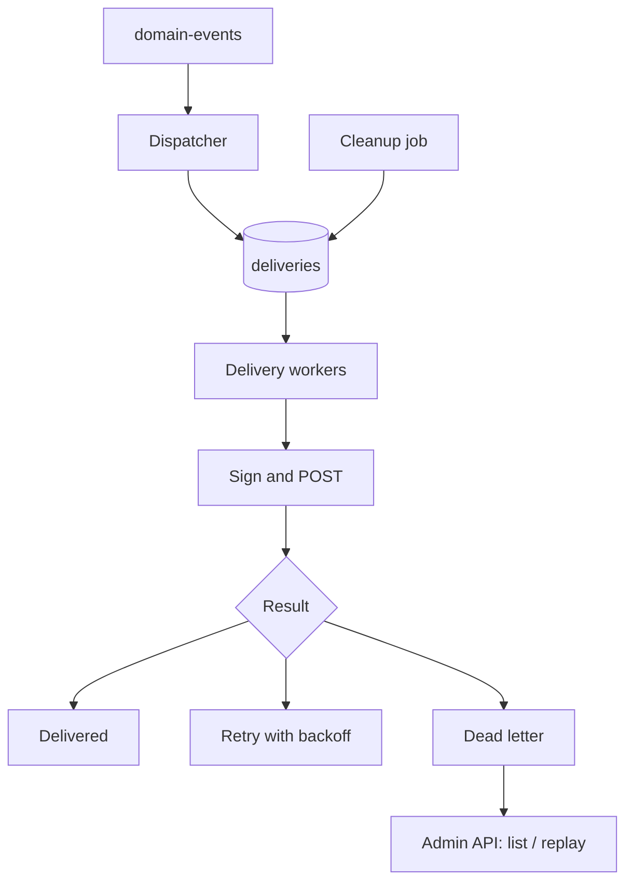

# Webhook delivery plan

Components: Dispatcher, `deliveries` table, delivery workers, admin API, cleanup job.

Notes:
- Dispatcher fans out to matching subscriptions, deduped on (event_id, subscription_id).
- Workers use leases, so a crash doesn't lose work.
- HMAC-SHA256 signature header, plus a webhook id header so receivers can dedupe.
- Up to 8 attempts on the agreed schedule. Permanent failures go straight to dead letter; a 410 also disables the subscription.
- Dead deliveries are kept 14 days and can be replayed.
- Disabled subscriptions are handled.
