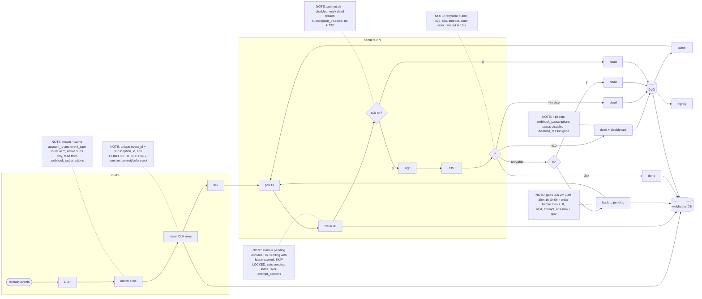

# webhooks plan (DSP / senders / DLQ)

Notes (important, read with the diagram): the nightly cleanup purges DLQ entries 14 days after dead_at, and delivered rows after 7 days (same job), and support can list a subscription's dead ones through the admin API with last status code, last error and reason, or replay one, which flips the delivery record back to pending with attempt_count reset to 0 and next_attempt_at = now under the same id, and keeping the same id matters because that id is what goes out as X-Webhook-Id and it never changes across attempts or replays, which receivers need for dedupe since we're at-least-once anyway, e.g. when a sender dies halfway through a POST its job row just sits in `sending` until lease_until (claim time + 60 s, deliberately longer than the 10 s HTTP timeout) runs out and then whichever worker polls next re-claims it, and because the counter was already bumped at claim time the lost try still counts toward the 8, and the receiver might see it twice. Replay into a disabled subscription gets a 409.

Other stuff: the DLV store (the `deliveries` table, in the webhook service's own Postgres; nothing gets added to the core DB, we only read webhook_subscriptions there and write its status/disabled_reason when a 410 comes back) is where all of the state is, i.e. status pending/sending/delivered/dead, attempt_count, next_attempt_at, lease_until, last_status_code, last_error, dead_reason, dead_at, plus the body bytes, and we don't use queue delays at all because the queue caps them at 15 min and its dead-letter topic can't be queried, so 'DLQ' above is just the job rows with status=dead and not a separate queue, and a retry simply waits as a pending row until next_attempt_at is due and a poll grabs it. Signing is X-Webhook-Signature t=<unix seconds>,v1=<hex>, HMAC-SHA256 keyed with the subscription's decrypted secret over t + '.' + the stored body bytes (written once by the consumer at insert), and it's redone with a fresh t at every attempt, replays too, since receivers drop anything with t older than 5 min. A sender that outlives its lease only gets to write its outcome if attempt_count still equals what it claimed. The consumer (DSP) is fed by the existing outbox relay off the domain-events topic; if it dies before acking, the queue redelivers after the visibility timeout and the unique key makes the re-insert a no-op, same for relay duplicates, and events matching no subscription are just acked. No ordering between events, retries reorder things. Reasons: 8th failure gives retries_exhausted, 410 gives gone, other 4xx gives client_error, disabled sub gives subscription_disabled.
