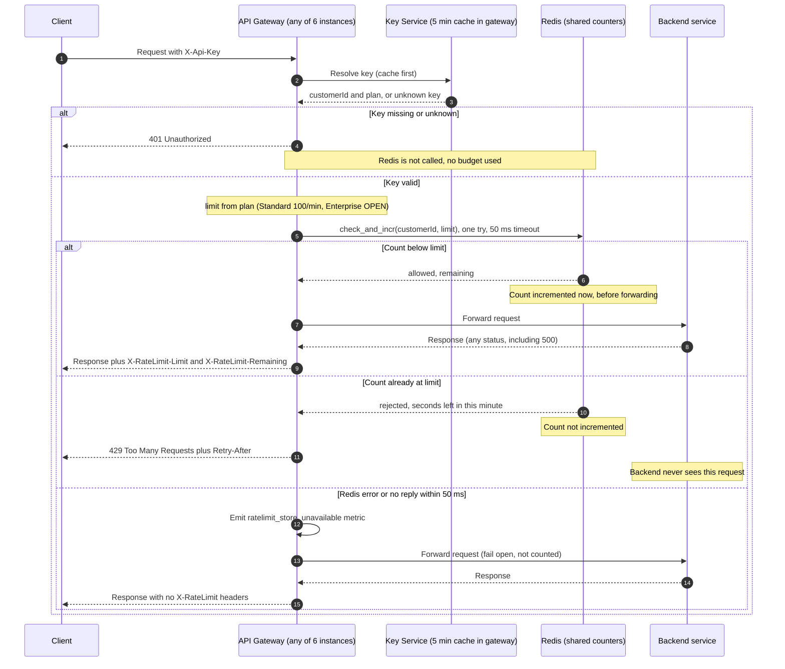

## Per-customer rate limiting: request flow

**Where the state lives**
- **Counters:** one shared Redis, used by all 6 gateway instances. There is one counter per customer per minute, with the key `rl:{customerId}:{minute}`. Counters are keyed by customer ID, not API key, so all of a customer's keys share one budget.
- **Customer ID and plan:** come from the Key Service, cached in each gateway instance for 5 minutes (existing behaviour).
- **Limits:** a plan-to-limit table in gateway config. Standard = 100 requests/minute. Enterprise = **OPEN QUESTION: Product has not decided the limit, so this design does not set one.**

**Notes**
1. **Window.** Windows are fixed one-minute periods aligned to the UTC clock minute. The script reads the minute from Redis's own clock, so all gateway instances agree on it. Each new minute uses a new key, so the count starts again at 0.
2. **check_and_incr** is a single Lua script that Redis runs atomically. It reads the customer's count for the current minute. If the count is below the limit, it increments it (creating the key with a 120 s TTL if the key is new) and returns `allowed` and `remaining = limit - new count`. Otherwise it returns `rejected` and the seconds left in the minute, and does not increment. Redis runs one script at a time, so two gateway instances can never both take a customer's last slot.
3. **Cleanup.** Redis deletes each counter key when its 120 s TTL runs out. Nothing else removes them.
4. **Retry-After** = seconds left until the current minute is over, rounded up, minimum 1.
5. **Counting happens inside check_and_incr, before forwarding**, so a request still counts if the backend then returns 500.
6. **Fail open.** The gateway makes one attempt with a 50 ms timeout and does not retry. The request is not counted, and the response carries no X-RateLimit headers because the count is unknown.
