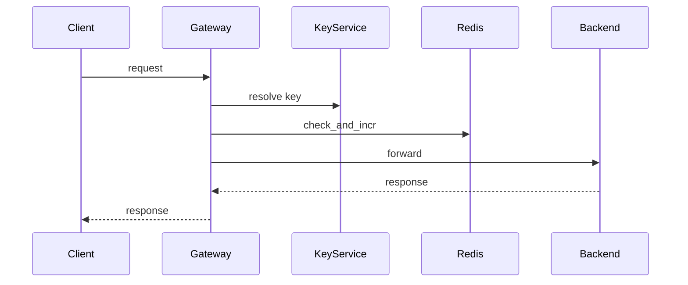

## Rate limiting

Per-customer rate limiting in the API Gateway, backed by Redis.

Notes:
- check_and_incr is a Lua script. Counters are per minute.
- Counter keys have a TTL.
- Limits: Standard 100/min, Enterprise TBD (Product).
- Over limit: 429 + Retry-After.
- Bad key: 401.
- Redis slow/down (50 ms): fail open, ratelimit_store_unavailable metric.
- X-RateLimit-Limit / X-RateLimit-Remaining headers.
