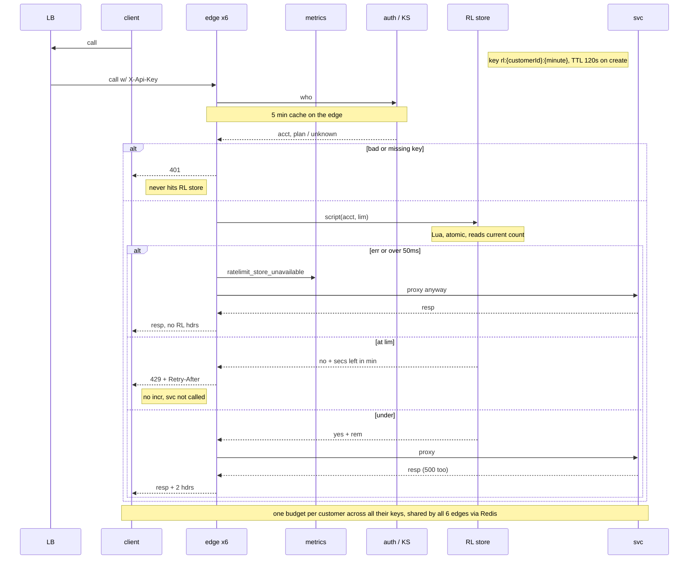

## RL design

Re the store: if the counter DB errors or is slow (anything over 50ms) the proxy just lets the call through to svc and bumps ratelimit_store_unavailable (one shot, no retry, and the call isn't counted), and those responses don't get any X-RateLimit-* headers since remaining isn't known, whereas everything that actually passed the check gets X-RateLimit-Limit + X-RateLimit-Remaining stuck on by the GW, including when svc 500s, because the incr already happened inside the script before we proxied it, so a backend failure still costs the tenant a slot, which is intended. Limits are per plan (the plan comes back from the key lookup, which the edge already caches for 5 min): Standard 100/min, Enterprise = open question, Product hasn't decided, no number in this doc. The plan-to-limit map lives in GW config.

Window semantics: fixed windows on the UTC minute boundary, and the minute comes from Redis TIME inside the script (not the GW box clock), so all the instances agree. Each new minute is a new key, so the account's count is 0 again, and old keys just die off via the TTL (Redis removes them, nothing else does). Retry-After is the seconds left in the current minute, rounded up, min 1. The script: if count is below limit, INCR (a new key gets EXPIRE 120) and return allowed + remaining = limit - new count; else return rejected + secs left and do NOT INCR, so 429s are free. Redis runs one script at a time, so two edges can't both grab the last slot for the same tenant.
