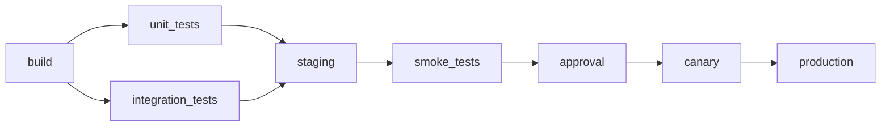

## shop-api CI/CD

- PR checks stay as they are.
- One image per run, tagged with the SHA.
- Integration tests have a retry.
- Staging and production go through deploy.sh (staging, canary, production, canary-off and rollback modes).
- Staging and production locks.
- Approval by release-approvers, 72h timeout.
- Production window as in environments.md.
- Canary is watched for 15 min on the Prometheus 5xx rate, 1% threshold.
- Rollout failures use kubectl rollout undo.
- Older runs get superseded.
- Notifications go to #deploys.
