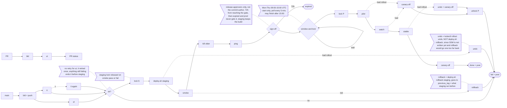

## shop-api pipeline notes

Production goes through the pilot first. The pilot is shop-api-canary, which takes 10% of traffic once its 2 pods are ready, and the canary-check job asks Prometheus for the pilot's 5xx share once a minute for a quarter of an hour, and if it is over 1% even once, or Prometheus returns nothing at all, we pull the pilot with canary-off and the run is dead; the main deployment was never touched in that case so the parameter store still says the old tag, and the database keeps whatever the canary step migrated, because `deploy.sh canary` migrates before the pilot starts and nothing in the system migrates down (the old image has to cope with it). Before any of that there is the sign-off, and before that staging, and PRs by the way only do build plus unit tests and never deploy anything, only merges to main run the whole thing. The image is built one time per run and pushed as registry.internal/shop-api:<sha>, and that sha goes around as IMAGE_TAG to the later jobs, so staging and prod get the very same image and nothing gets rebuilt.

Misc (no particular order):
- Tags live in Parameter Store: `/deploy/<env>/current_tag` and `/deploy/<env>/previous_tag`. deploy.sh <env> <tag> writes both but only once the main rollout went fine; deploy.sh rollback flips current back to previous; the pilot never gets written. Who approved and when sits in the CI run record.
- The ping (the approval message, in #deploys) carries IMAGE_TAG, a link to the smoke results and the commit list between prod's current_tag and this tag; people approve in the CI UI.
- kill older = when a run's staging smoke goes green, older runs that haven't begun their prod deploy (still waiting on sign-off, on the window, or on lock P) are cancelled as superseded, so approvers only see the newest staging-verified build.
- An approval given on a Thursday evening just sits there until Monday 09:00 and doesn't lapse once given. Lock P is held by one prod deploy at a time; if it's busy the run waits the same way.
- On the stable step: deploy.sh production (migrate is a no-op by then) writes the SSM tags, then canary-off, the lock is released, and a post in the deploys channel names the approver. A bad rollout there gets kubectl rollout undo, then canary-off.
- Posts go to Slack #deploys for: waiting on approval, superseded, expired, failed (with which step), prod done.
