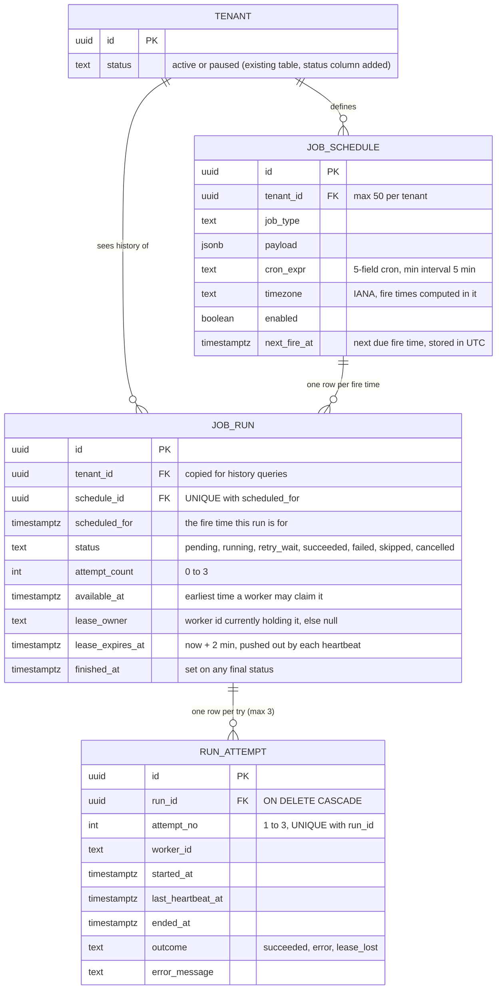

## How it works

**State.** All state is in Postgres. Workers are identical and keep no state between ticks. Every worker runs the same loop every 10 seconds, and all times come from the database's `now()`, not from worker clocks.

**1. Create runs (every worker, every tick).** In one transaction:
- Lock the due schedules: `enabled = true`, tenant `active`, `next_fire_at <= now()`, selected `FOR UPDATE SKIP LOCKED`. Only one worker handles a given schedule at a time. Other workers skip it.
- For each schedule, compute F, the latest fire time `<= now()` in the schedule's timezone. Fire times between `next_fire_at` and F were missed during an outage and are dropped.
- Overlap check: if the schedule already has a run that is `pending`, `running` or `retry_wait`, insert F as `skipped` (with `finished_at = now()`). Otherwise insert F as `pending` with `available_at = F`.
- The insert uses `ON CONFLICT (schedule_id, scheduled_for) DO NOTHING`. The unique key is the final guarantee of at most one run per fire time.
- Set `next_fire_at` to the first fire time after F, then commit. The new run and the advanced `next_fire_at` commit together.

**2. Claim (every worker that has a free slot).** In one transaction, pick the oldest `JOB_RUN` that is `pending` or `retry_wait` with `available_at <= now()`, using `FOR UPDATE SKIP LOCKED`. Set `status = running`, `attempt_count + 1`, `lease_owner = <worker id>` and `lease_expires_at = now() + 2 min`, and insert a `RUN_ATTEMPT`. Commit, then call the handler.

**3. Heartbeat (every 30 s while the handler runs).** `UPDATE job_run SET lease_expires_at = now() + 2 min WHERE id = ? AND lease_owner = me AND status = 'running'`, and set the attempt's `last_heartbeat_at`. If no row is updated, this worker has lost the run, so it stops and discards its work.

**4. Finish.** One transaction, guarded by `lease_owner = me AND status = 'running'`:
- Success: the run becomes `succeeded` with `finished_at` set and the lease cleared. The attempt gets `outcome = succeeded` and `ended_at`.
- Error: the attempt gets `outcome = error` and `error_message`. If `attempt_count < 3`, the run becomes `retry_wait` with `available_at = now() + 1 min` (after attempt 1) or `+ 5 min` (after attempt 2), and step 2 picks it up again later. After attempt 3 the run is `failed`. If the schedule is now disabled or the tenant paused, the run becomes `cancelled` instead of waiting for a retry.
- If the guard matches no row, the lease was taken over. Nothing is written, so a stale worker cannot overwrite the newer outcome.

**5. Crash recovery (every worker, every tick).** Find runs with `status = running AND lease_expires_at < now()`, locked with `SKIP LOCKED`. Mark the current attempt `lease_lost` with `ended_at`, then apply the same retry rule as for an error. The crashed try counts as one of the 3 attempts.

**6. Disable or pause, and turning back on.** The API call that sets `JOB_SCHEDULE.enabled = false` or `TENANT.status = paused` also, in the same transaction, sets that schedule's (or that tenant's) `pending` and `retry_wait` runs to `cancelled`. Running runs continue and finish through step 4. Step 1 ignores disabled schedules and paused tenants, so no runs are created meanwhile. Re-enabling a schedule recomputes its `next_fire_at` as the first fire time after `now()`. Un-pausing a tenant (setting `TENANT.status` back to `active`) likewise recomputes `next_fire_at` from `now()` for all of that tenant's enabled schedules, in the same transaction. Either way, fire times missed while disabled or paused are not caught up. Editing the cron expression or the timezone recomputes `next_fire_at` the same way.

**7. History and cleanup.** Tenants read `JOB_RUN` by `tenant_id`, newest `scheduled_for` first, together with its `RUN_ATTEMPT` rows. Once a day, whichever worker takes a Postgres advisory lock deletes runs whose `finished_at` is more than 90 days old. Their attempts are deleted by cascade.
