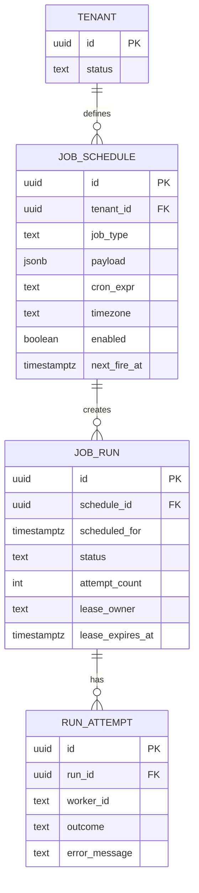

Notes:
- Workers poll for due schedules and create runs. Uses SKIP LOCKED.
- Workers claim runs and execute them, with a lease.
- Heartbeats keep the lease alive.
- Failures retry with backoff, up to the limit.
- A reaper handles dead workers.
- Overlapping and missed runs are handled per the spec.
- Pausing a tenant or disabling a schedule cancels its pending work.
- History is purged after 90 days.
