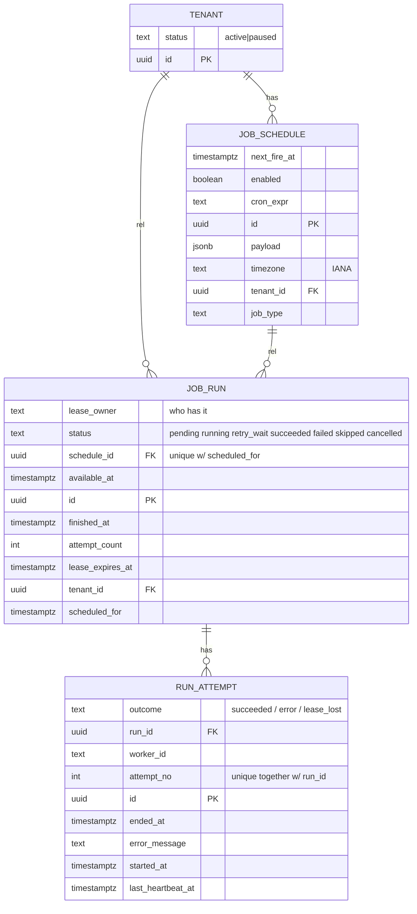

Notes (in no particular order):

Cleanup: once a day whichever worker gets the advisory lock deletes executions where finished_at is more than 90 days old, and attempts go by cascade. Tenants view history by reading job runs by tenant_id with their attempt rows. Skipped rows get finished_at = now() when they're inserted so the purge treats them the same. A schedule can have at most 50 per tenant and the min interval is 5 min. Fire times are in the schedule's IANA timezone and next_fire_at is stored in UTC.

The heartbeat is every 30s: it updates job_run set lease_expires_at = now()+2min where id = ? and lease_owner = me and status = running, and also last_heartbeat_at on the attempt. If 0 rows come back the worker lost it, so it stops and throws the work away. That same lease_owner = me / status = running guard is on the finishing transaction too, so a worker that was presumed dead and then reports late writes nothing, and the outcome recorded by the worker that took over stays. Also on finishing, success means succeeded + finished_at + lease cleared, and the attempt outcome is succeeded with ended_at. Error means the attempt is error with error_message, and then if attempt_count < 3 the job instance goes to retry_wait with available_at = now()+1min after the first try or +5min after the second, otherwise failed. But if meanwhile the schedule got disabled or the tenant paused it goes to cancelled instead of retry_wait.

Workers (all identical, no leader, Postgres only, every 10 s, using db now() not their own clocks) lock schedules where enabled and tenant active and next_fire_at <= now() FOR UPDATE SKIP LOCKED. They compute the latest fire time F <= now() and drop anything older between next_fire_at and F (outage catch-up only does the latest). If the cron job already has an execution in pending/running/retry_wait, F goes in as skipped, otherwise pending with available_at = F, insert ON CONFLICT (schedule_id, scheduled_for) DO NOTHING (that unique key is the real backstop for one run per fire time). Then next_fire_at := first fire after F, commit. It is all one transaction, so the run row and the next_fire_at move commit together.

Pause/disable: the API sets enabled=false or tenant status=paused and in the same tx flips pending and retry_wait jobs for it to cancelled. In-flight ones keep going and finish normally. Disabled schedules and paused tenants are skipped by the run-creating query so nothing new gets made. On re-enable next_fire_at = first fire after now(), so there's no catch-up, and un-pausing a tenant (status back to active) does the same recompute of next_fire_at from now() for every enabled schedule of that tenant in the same tx, so a resumed tenant doesn't catch up missed fire times either. Cron or timezone edits recompute it the same way.

Reaper, also every tick on every worker: status = running and lease_expires_at < now(), SKIP LOCKED. Mark the attempt lease_lost + ended_at, then the same retry rule as an error. It counts toward the 3.

Picking up work: oldest pending-or-retry_wait task with available_at <= now() FOR UPDATE SKIP LOCKED, then status running, attempt_count+1, lease_owner = worker id, lease_expires_at = now()+2min, and insert the RUN_ATTEMPT, all in one tx. Commit, then run the handler. A retry uses the same run row and gets a new attempt row (attempt_no 1-3). The job run row is one per fire time and the attempt row is one per try.
