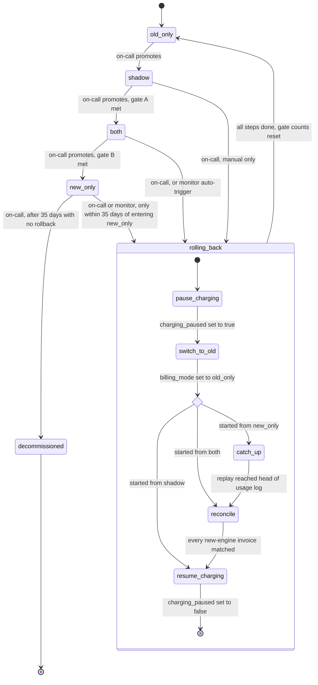

# Billing engine rollout: state machine

**Where the rollout state lives.** The config service holds four things:
- `billing_mode`: the current mode.
- `charging_paused`: true or false.
- The rollback record: the mode the rollback started from and the last step completed.
- The flag change log: who changed what, when and why.

Only the rollout tool writes these. On-call makes every manual change through the rollout tool. The billing monitor uses it to start an automatic rollback.

**How workers follow the flag.** Billing workers read `billing_mode` at the start of each invoice, so an invoice already in progress finishes under the mode it started in. Workers read `charging_paused` immediately before every call to the payment provider, so a pause takes effect at the next charge, even partway through an invoice.

**What each mode does**

| Mode | Old engine | New engine | Charges and writes the ledger |
|---|---|---|---|
| `old_only` | computes invoices | off | old |
| `shadow` | computes invoices | computes into shadow store | old |
| `both` | computes into shadow store | computes invoices | new |
| `new_only` | stopped | computes invoices | new |

Both engines read the same usage event log. The engine that is not charging never calls the payment provider.

**Promotion gates.** Each night the comparison job writes one row to `comparison_results` with the number of invoices compared, the number of mismatches (totals more than one cent apart) and how many mismatches are still unresolved. Before writing `billing_mode`, the rollout tool checks these rows. It refuses any promotion that skips a mode or fails its gate.
- Gate A (`shadow` -> `both`): each of the last 7 consecutive days has a mismatch rate under 0.1%, and together those days compared at least 5,000 invoices.
- Gate B (`both` -> `new_only`): at least 14 days in `both`, zero unresolved mismatches, and a Finance sign-off recorded in the rollout tool.
- Only rows dated after the latest entry into `shadow` count for gate A, and only rows after the latest entry into `both` count for gate B. This is how a rollback resets the gates.

**Rollback triggers**
- Manual: on-call can start a rollback at any time from `shadow` or `both`, and from `new_only` within 35 days of entering it.
- Automatic: the billing monitor tracks the results of the new engine's payment-provider calls over a sliding 10-minute window. If the failure rate goes above 2% while the mode is `both` or `new_only`, the monitor starts a rollback through the rollout tool and pages on-call. In `shadow` the new engine makes no payment calls. Its errors are written to `comparison_results` and never trigger a rollback.

**Rollback steps** (progress is kept in the rollback record in the config service)
1. `pause_charging`: write the rollback record and set `charging_paused` to true. From this point, invoices that fall due are written to the ledger as pending instead of being charged. A payment call already in flight finishes, and its result is recorded in the ledger.
2. `switch_to_old`: set `billing_mode` to `old_only`. The new engine stops.
3. `catch_up` (only when starting from `new_only`): the old engine replays the usage event log from the moment `new_only` began, a timestamp it reads from the flag change log, until it reaches the head of the log.
4. `reconcile` (when starting from `both` or `new_only`): each ledger invoice the new engine wrote is matched with the old engine's invoice for the same customer and billing period. If the invoice was already charged and the totals agree, it is marked settled and never charged again. If the totals differ, it goes to the Finance review queue and is not re-charged automatically. Uncharged invoices stay pending.
5. `resume_charging`: set `charging_paused` to false. The old engine charges the pending invoices, and the rollout is now in `old_only`.

**If a rollback step fails.** Each step records its progress in the rollback record and is safe to repeat. When a step fails, the rollout stays in `rolling_back`: charging stays paused, and the new engine never gets charging back. On-call is paged, and the step is retried from the rollback record. Charges are delayed, never dropped or doubled.

**After a rollback.** The rollout is in `old_only`. To move forward again, on-call promotes to `shadow` and gate A must be met from scratch.

**Point of no return.** Usage events are kept for 35 days, so catch-up works only while every event since `new_only` began is still in the log. The rollout tool reads the time `new_only` began from the flag change log and, once 35 days have passed, rejects every rollback, manual or automatic. From then on the monitor only pages on-call, and problems are fixed in the new engine. After those 35 days on-call may decommission the old engine.
