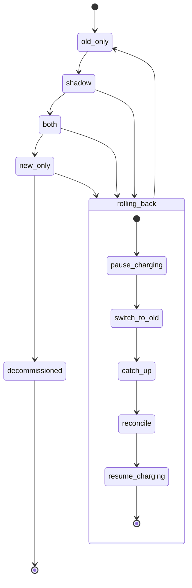

## Billing engine rollout

Flag: `billing_mode` in the config service. Pieces involved: rollout tool, billing monitor, nightly comparison job, `comparison_results`, shadow store, ledger, usage event log, rollback record.

Notes:
- shadow and both run both engines. new_only drops the old one.
- Gates: shadow to both after 7 days of comparison. both to new_only after 14 days, plus Finance.
- Rollback is manual or via the monitor.
- Rollback steps are skipped where not needed. Reconcile is by customer and billing period.
- Steps are retryable.
- The old engine can be decommissioned after 35 days.
- Gates reset after a rollback.
