Notes on the v2 billing cutover (diagram below, more notes after it)

Rollback (RB in the diagram) can come from SH, DUAL or V2 (V2 only until day 35, see the V2 note) and on-call can do it by hand from the flag console, and the watchdog (that's the billing monitor) does it by itself if the failure rate of v2's payment-provider calls over a sliding 10-minute window goes above 2% but only when the mode flag is both or new_only, because in shadow v2 doesn't call the payment provider at all and its errors only go to the diff table and never trigger anything, and when the watchdog fires it goes through the rollout tool and also pages on-call. Gates are checked by the controller against the diff table, which the nightly comparison job fills, and the controller refuses promotions that skip a mode or fail the gate.

```mermaid
stateDiagram-v2
    S0 : old_only (legacy does everything, v2 off)
    SH : shadow
    DUAL : both
    V2 : new_only
    X : decommissioned
    [*] --> S0
    S0 --> SH : promote
    SH --> DUAL : promote (gate)
    DUAL --> V2 : promote (gate 2)
    V2 --> X : decommission
    X --> [*]
    SH --> RB
    DUAL --> RB : manual/auto
    V2 --> RB : manual/auto
    RB --> S0
    state RB {
        state c <<choice>>
        [*] --> p
        p --> sw
        sw --> c
        c --> cu : V2
        c --> rec : DUAL
        c --> res : SH
        cu --> rec
        rec --> res
        res --> [*]
    }
    note right of S0
        gate A is the last 7 consecutive days each under 0.1% mismatch
        and at least 5,000 compared in total, gate 2 is 14 days in dual
        plus zero unresolved plus Finance sign-off in the rollout tool
    end note
    note left of V2
        legacy stopped here, v2 charges and writes ledger.
        35 days here w/o rollback means legacy can be decommissioned,
        and from day 35 the flag console rejects any rollback from V2,
        manual or watchdog, so the watchdog just pages and v2 gets fixed forward
    end note
    note right of SH
        legacy charges and writes ledger, v2 to side store only
    end note
    note left of DUAL
        v2 charges and writes ledger, legacy computes into side store, no charging
    end note
```

More notes. Where things live: the BM key (billing_mode), charging_paused, the rollback record (from-mode, last step done) and the change log are all in the config service, and only the flag console writes them. Workers check charging_paused right before every payment-provider call and pick up the mode at the start of each invoice, so one already going finishes in the mode it started in. In RB: p = pause (charging_paused true, rollback record written, anything that falls due goes into the ledger as pending, an in-flight call finishes and gets recorded), sw = flag to old_only and v2 stops, cu = legacy replays the usage log from when new_only started (timestamp from the change log) up to the head, only from V2, rec = for every ledger invoice v2 wrote, match legacy's by customer + billing period, and already charged and equal means settled and not charged again, different totals go to the Finance review queue and aren't re-charged automatically, uncharged ones stay pending (rec runs from DUAL or V2), and res = charging_paused false and legacy charges the pending ones. Each step is safe to repeat and records progress in the rollback record. If one fails we stay in RB with charging paused, v2 never gets charging back, on-call gets paged and the step is retried, so charges are only ever delayed. Both engines read the same usage event log, which is kept 35 days, which is why the 35-day thing exists (catch-up needs the events since new_only began, and the console reads when new_only began from the change log to enforce the cutoff). The diff table (comparison_results) has one row per day: compared, mismatches (more than one cent apart), unresolved. Only rows after the latest entry into shadow count for gate A (after entry into both for gate 2), which is how a rollback resets the gates, and after RB lands in S0 you have to promote to shadow again and earn gate A from scratch. Promotions are always done by on-call, never automatically. SH to RB is manual only.
