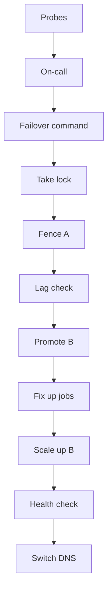

# Failover plan

Pieces: health probes, on-call, failover command, control store, Postgres (A primary, B replica), job workers, Redis, global traffic manager.

Notes:
- Lag check against the RPO, with an override available.
- Fencing goes through the control store, and the apps respect it.
- Jobs need to be idempotent.
- The command logs its progress and can be resumed or aborted.
- Sessions don't carry over.
- Failback is a separate planned job; A's DB gets rebuilt.
