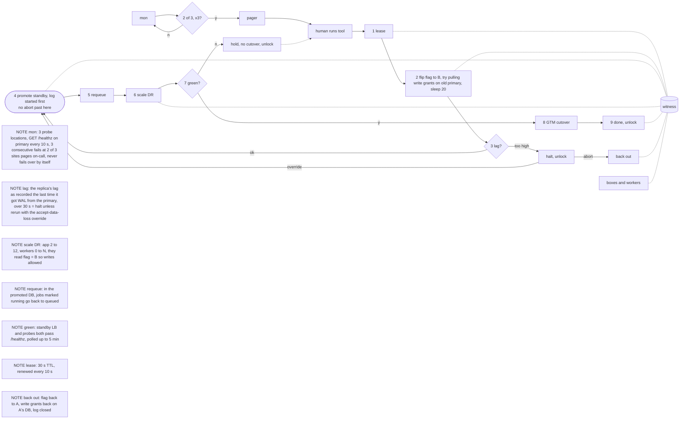

# DR / failover notes (A to B, standby takeover)

So the way this works, and starting from the end because that's what people ask about most, is that there's no auto failback: the old primary's Postgres, when it comes back, gets snapshotted (so someone can look at the writes we lost) and then wiped and rebuilt as a replica of the DR site from a base backup of it, and going back to A is its own planned switchover some other day, and A's app tier just stays read-only meanwhile since the flag says B, and on that note the flag (active_region) lives in the witness, which is a 3-node strongly consistent KV cluster with one node in A, one in B and one in Region C where every read and write needs 2 of the 3, so a region cut off from the other two can't read it or change it, and the runbook tool (including its abort) is the only thing that ever writes to it, while every app box and every worker in both A and B polls it every 5 s and is only allowed to start a DB write if it got a good read in the last 15 s (counted from when the read was sent) naming its own region, with write transactions capped at 5 s, otherwise it flips to read-only (reads OK, writes get a 503 "read-only, retry shortly", workers stop claiming), so a region is done committing 20 s after the flag names the other region or after it loses the witness, which yes means that if A can't see B or C it goes read-only even with no failover happening, that's the price, and that rule is the thing that actually fences a partitioned primary we can't reach, the grant-pulling in step 2 is only best effort for when we can reach it.

NB sessions: Redis is per region and not replicated, so everyone logs in again on the standby. Accepted.

The tool keeps failover_log in the witness too, next to the flag and the lease. Each numbered step kicks off when the one before it has a "done" line; the tool writes a "started" line before a step and a "done" line after it, and the lock is really a lease (30 s TTL, the running tool renews it every 10 s, and if it can't renew it stops before the next step), so if the tool dies the lease just runs out within 30 s and you run failover --to B again, it grabs the lease in the coordination store and picks up at the first step without a "done", redoing a half-done one, which is fine since every step is safe to repeat (an already promoted DB, already requeued jobs, an already scaled site and DNS already pointed at B are left alone), and whenever it stops on purpose (lag halt, DR not green after 5 min) it gives the lease back and the log keeps its place; before the promote has a "started" line you can still back out with failover --abort, which takes the lease, sets the flag back to A, gives the app role on A's database its write grants back if step 2 managed to pull them and closes the log so a later failover starts from step 1, and the A boxes that are still running start writing again on their next good poll, within 5 s, but once the promote has a "started" line abort gets refused, even if the tool died halfway through promoting, and it's forward only, no going back to A in that incident, and if the DR site doesn't go green you don't cut DNS, you page, fix, rerun.

Re jobs: they're rows in the jobs table, so they come over with the DB; step 5 runs before any DR worker exists, so everything marked running was claimed by the old site's workers, it gets set back to queued and the DR workers rerun it after step 6 starts them, plus whatever A finished in its last few unreplicated seconds runs again too, which is fine as long as jobs are idempotent (keyed by job id), and they have to be.

Clients with stale DNS: from step 2 until their cached DNS runs out (up to the 60 s TTL after the GTM cutover) they still land on A. The fence doesn't stop A's boxes, so if A is up they get reads from its stale DB and a 503 on writes; if A is down those requests just fail. Then they show up on B. Between 2 and 4 nobody can write at all (A fenced, standby still a read-only replica), so if the lag check halts, decide fast: override or abort.

Lost data = whatever A committed that the replica never received (async WAL streaming; it replays everything it did get before it's promoted). If A just died, that's at most the replica's recorded lag, max 30 s unless someone used the override. If A was partitioned rather than dead and kept going after the replica lost the stream, its commits from then until it stopped writing (at the latest 20 s after step 2) are missing too; the lag check can't see them, and they only exist in that snapshot of the old primary. The lag check sits after the fence sleep on purpose: by then A can't send more WAL, so the number is final.

Timing vs the 15 min RTO (clock starts at step 1): seconds for the lease (up to 30 s more if a dead run still holds it), the fence sleep is 20 s, the lag check takes seconds, about 1 min to promote, about 5 min to scale and pass health checks, 60 s for DNS, about 8 min total.
