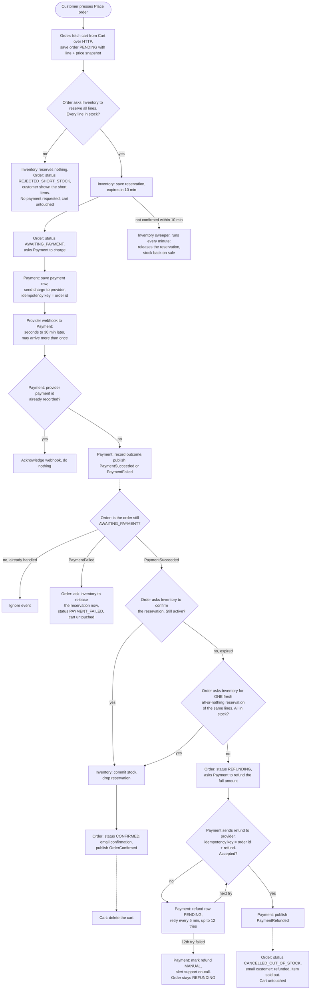

## Checkout design: the Order service orchestrates

Each service keeps its own state. No service reads another's database.

| Service | What it stores in its own DB |
|---|---|
| Cart | the customer's cart lines |
| Order | the order: line and price snapshot taken at *Place order*, plus its **status**. The status is the only record of how far a checkout has got. |
| Inventory | stock levels; reservations with `expires_at` = created + 10 min |
| Payment | one payment row per order (provider payment id is unique); refund rows with status and attempt count |

Order statuses: `PENDING` -> `AWAITING_PAYMENT` -> `CONFIRMED`, or one of `REJECTED_SHORT_STOCK`, `PAYMENT_FAILED`, `REFUNDING` -> `CANCELLED_OUT_OF_STOCK`.

Arrows: a solid arrow is the next step or a synchronous HTTP call. A dotted arrow is an event on the message broker.

### Notes

- **Retries without double charging.** If the call from Order to Payment, or from Payment to the provider, times out, it is retried with the same key: the order id for a charge, and order id + "refund" for a refund. The provider returns the original charge or refund instead of making a new one.
- **Duplicates.** Payment drops a webhook whose provider payment id is already in its DB. Broker events can also repeat. Order acts on a payment event only while the order is `AWAITING_PAYMENT`, so a repeat finds the order already moved on and is ignored.
- **Expiry.** The Order service doesn't run the 10-minute timer; Inventory's sweeper does. Order only learns that the hold lapsed when confirm returns "expired". A declined payment releases stock at once instead of waiting for the sweeper.
- **Late success.** It gets exactly one fresh reservation attempt, and an order is never fulfilled partially. If that attempt fails, the customer gets a full refund, the order becomes `CANCELLED_OUT_OF_STOCK`, and the customer is emailed.
- **Refund failure.** The retry state lives in Payment's refund row (status, attempt count). After 12 failed tries (about 1 hour) the refund becomes `MANUAL` and support is alerted. The order stays `REFUNDING` until `PaymentRefunded` arrives.
- **Cart.** Only the Cart service deletes a cart, and only when it receives `OrderConfirmed`. Every failure path leaves the cart as it was.
