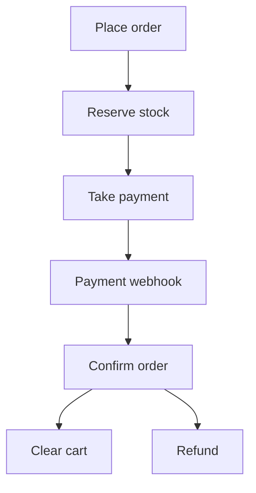

## Checkout plan

Services: Cart, Inventory, Payment, Order, plus the payment provider. Each service has its own DB.

Notes:
- Reservations expire after 10 min.
- Idempotency keys on provider calls.
- Webhooks can be late or duplicated, so dedupe.
- Late payment when the stock is gone: re-reserve, otherwise refund and cancel.
- Refunds are retried.
- Order statuses are tracked.
- Cart cleared via event.
