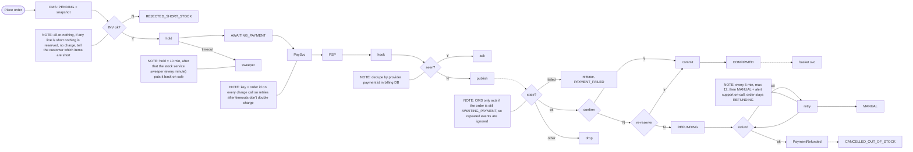

## Checkout notes

ok so the main thing here is the late-payment case, which is where the PSP webhook comes in after the hold is already gone (it can be up to 30 min late and sometimes there are dupes). In that case OMS tries once more to grab stock from INV, all-or-nothing, for the same lines. If that works it commits and we're CONFIRMED like normal. Otherwise it goes REFUNDING and billing refunds the full amount (key = order id + refund), and when PaymentRefunded comes back the order svc sets CANCELLED_OUT_OF_STOCK and emails the customer. We never ship part of an order. Their basket is left alone, which is also true for every other failure: the basket only gets deleted, by the cart service, when it sees OrderConfirmed on the broker. Each service has its own DB and nobody reads anyone else's tables. Statuses are PENDING, AWAITING_PAYMENT, CONFIRMED, REJECTED_SHORT_STOCK, PAYMENT_FAILED, REFUNDING and CANCELLED_OUT_OF_STOCK, all kept on the order row in the OMS database, which is how you tell where a checkout has got to. The checkout orchestrator is the order service.

Also: the warehouse service keeps reservations with expires_at in its own DB along with stock levels. Payments keeps one row per order with the provider payment id unique, plus refund rows with attempt counts, and the retry logic for refunds lives there, not in the OMS. On a decline the orchestrator tells INV to release right away instead of waiting out the hold. At the start the order svc pulls the cart lines over HTTP from the basket service and snapshots the prices. A confirm call that comes back expired is how OMS finds out about the lapse; it doesn't run its own timer. PaySvc saves a payment row before calling the PSP, records the outcome when the webhook arrives (usually seconds, up to 30 min), and publishes PaymentSucceeded or PaymentFailed onto the broker. Dotted arrows are broker events and solid ones are steps or HTTP calls. The re-reserve is a single try at a fresh all-or-nothing reservation of the same lines. Commit means the stock is committed and the reservation is dropped. After commit the order goes CONFIRMED, the confirmation email goes out, and OrderConfirmed is published. Timeouts between billing and the PSP are retried with the same key, so the PSP returns the original charge.
