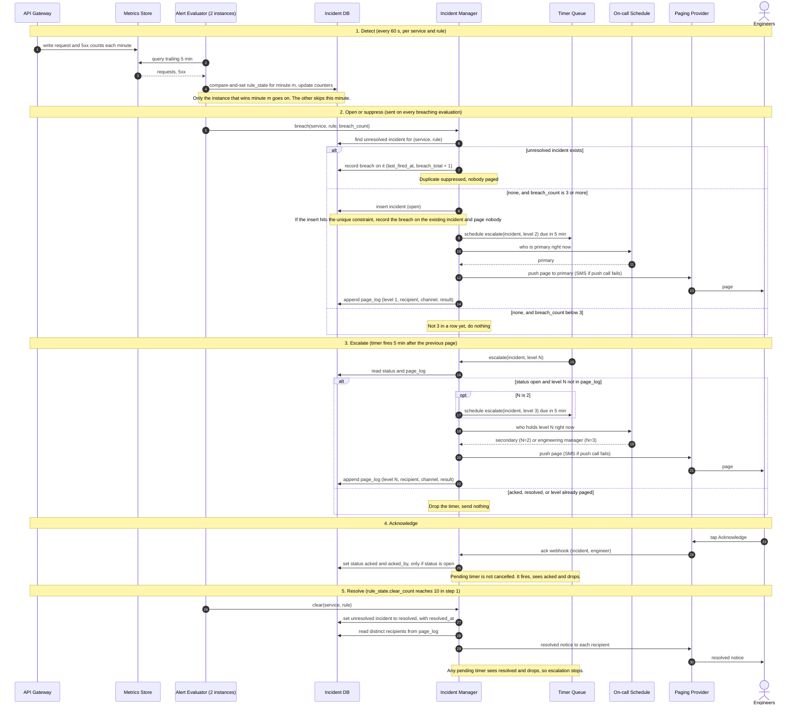

### API error-rate paging: design

**Components**
- *Existing:* API Gateway, Metrics Store (time-series), On-call Schedule, Paging Provider (push, SMS, Acknowledge webhook).
- *New:* Alert Evaluator (2 instances, each runs every 60 s), Incident Manager (service), Incident DB (Postgres), Timer Queue (delayed messages, at-least-once delivery).

**State, all kept in the Incident DB**
- `rule_state(service, rule, last_minute, breach_count, clear_count)`: the counters for consecutive evaluations.
  - Breaching evaluation (rate above 2% and at least 500 requests in the 5-min window): `breach_count += 1`, `clear_count = 0`.
  - Rate below 1%: `clear_count += 1`, `breach_count = 0`.
  - Anything else: both reset to 0.
- `incidents(id, service, rule, status open|acked|resolved, opened_at, last_fired_at, breach_total, acked_by, resolved_at)`, with a **unique constraint on (service, rule) where status is not resolved**. This constraint is the deduplication key.
- `page_log(incident_id, level, recipient, channel, result)`: one row per page sent.

**Who calls whom:** the evaluator reports *every* breaching evaluation to the Incident Manager, with the current `breach_count`. The Incident Manager decides: record it on an unresolved incident, open a new one (count 3 or more), or do nothing yet (count below 3).

**Failure and edge behaviour**
- **The clock never waits on delivery.** The next escalation timer is put on the Timer Queue *before* the page is sent. If push fails, the page goes by SMS. If SMS also fails, `page_log.result = failed` and the next level is still paged when its timer fires.
- **Timers are at-least-once.** A repeated `escalate` whose level is already in `page_log` is skipped. If the Incident Manager is down when a timer is due, the queue redelivers it once the manager is back. That page is late but not lost.
- **Level 3 (engineering manager) is the last level.** No timer is scheduled after it. The incident stays open until someone acknowledges it or it resolves.
- **Who to page is looked up at send time for each level**, so a 09:00 handover during an incident pages whoever holds the role at that moment.
- **Two evaluator instances.** The compare-and-set on `last_minute` lets only one instance process each minute. The unique constraint is the backstop: if two inserts race, one fails and that breach is recorded on the existing incident.
- **Every breach while unresolved is recorded**, including the first one or two after the counters were reset, because the evaluator reports each breaching evaluation and the Incident Manager checks for an unresolved incident first.
- **After resolution** the old row no longer falls under the unique constraint. The next 3 consecutive breaching evaluations open a new incident and page the primary again.
