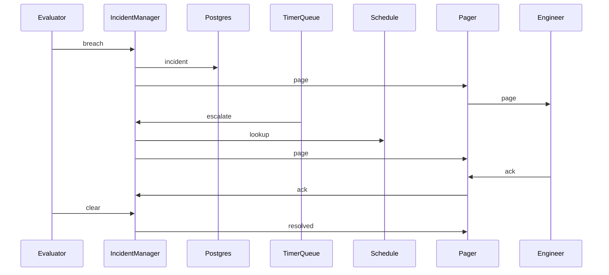

### Error-rate paging

Components: evaluator (x2), incident manager, Postgres, timer queue, schedule service, paging provider.

Notes:
- The evaluator checks the error rate every minute and opens an incident after 3 breaches (above 2%, 500 request minimum).
- Dedup on service + rule.
- Escalation: primary, secondary, EM, 5 min apart. Ack stops it.
- Auto-resolves after 10 min below 1%. Resolved notice goes out.
- Push with SMS fallback. Failures don't block escalation.
- Two evaluators are coordinated through Postgres.
- page_log table.
