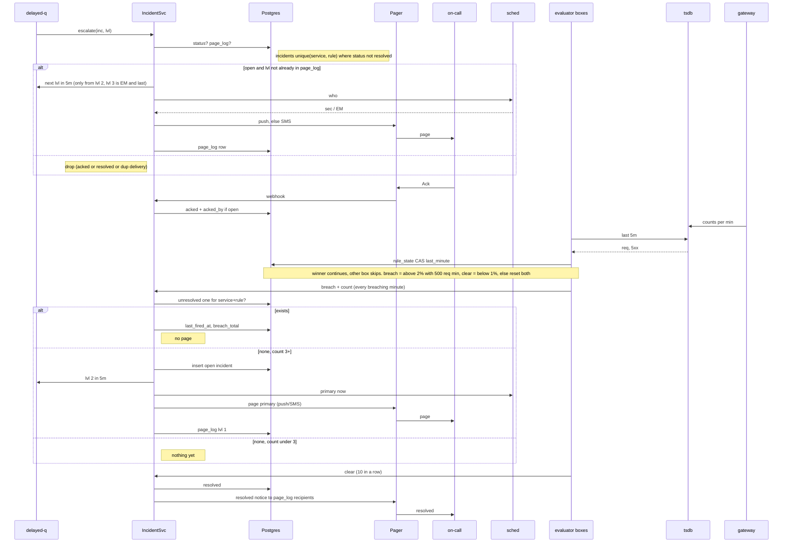

### Paging thing

So the paging provider has an Acknowledge button. When the engineer taps it, the provider hits our webhook and the IncidentSvc sets the row to acked (acked_by too), but only if it is still open. We do not cancel the timer: the timer just sees acked when it fires and drops, which is also what happens when it's resolved. Resolved happens when the evaluator's clear_count hits 10, which is ten evaluations in a row below 1% (rate below 1% bumps clear_count and zeroes breach_count, above 2% with 500+ requests bumps breach_count and zeroes clear_count, anything else zeroes both). At that point the incident manager marks it resolved and reads the page log to send the resolved notice to everybody who got paged, and since pending timers then drop, escalation stops there. Tables in pg: rule_state (service, rule, last_minute, breach_count, clear_count); incidents (id, service, rule, status open/acked/resolved, opened_at, last_fired_at, breach_total, acked_by, resolved_at) with a unique index on service+rule where status isn't resolved, which is the dedup, so a second insert from the other evaluator box fails and gets recorded as a firing on the one that exists, no page; and page_log(incident_id, level, recipient, channel, result).

Also, the timer for the next level is enqueued BEFORE we call the pager, so a failed page never stops the clock. Push fails, then SMS. If both fail, page_log result = failed and we keep going, and the next level still gets paged on time. The evaluator (both instances, every 60 s) calls breach on every breaching minute and passes breach_count along, and the IncidentSvc is the one that decides: if there's an unresolved incident it just records the breach on it, otherwise it opens one only when breach_count is 3 or more, i.e. 3 consecutive breaching minutes on the trailing 5-min window that the gateway's per-minute counts in the metrics store feed. The delayed queue (Timer Queue) is at-least-once, so if a level is already in page_log it is skipped. If the manager service is down, the message is redelivered later, so the page is late but not lost. The schedule service is asked at send time on every level, since rotations hand over at 09:00. Primary goes out immediately, secondary +5 min, engineering manager +5 more. After resolution the unique index doesn't cover the old row, so 3 fresh breaches = new incident and the primary is paged again.
