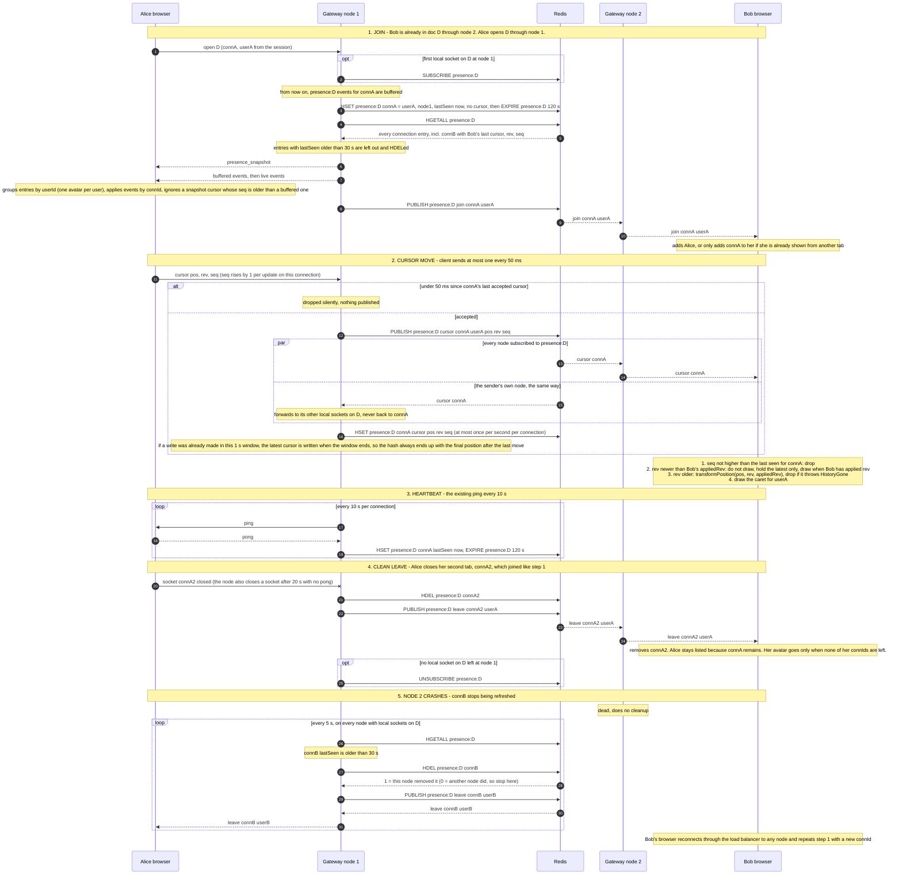

## Live cursors and presence across gateway nodes

**Where state lives**

| State | Where | Written by | Removed by |
|---|---|---|---|
| Presence entry per connection: `userId, nodeId, lastSeen, cursor {pos, rev, seq}` | Redis hash `presence:{docId}`, field = `connId` | Only the node that owns the connection | The owning node on close, or any node's sweep once stale. The whole key has a 120 s EXPIRE, refreshed on every write. |
| `join` / `leave` / `cursor` events | Redis pub/sub channel `presence:{docId}` (stores nothing, separate from `ops:{docId}`) | The node that owns the connection, or the sweeping node for a `leave` | n/a |
| Latest cursor, last accepted time, last seq and pending hash write per local connection | Gateway node memory | That node | When the socket closes |
| `userId -> {connIds, cursor, seq}` and held cursors | Client memory | The client | When the client leaves |

Cursors never reach the document service or Postgres. The edit path (`op` -> node -> document service -> Postgres -> `ops:{docId}`) is unchanged. Any node can serve any document because all fan-out goes through Redis, so there's no sticky routing.

**Timings and failure rules**

- **Clean close.** The node sends HDEL and PUBLISH `leave` straight away, so others see it well within 2 s. If the node has to close a socket after 20 s without a pong, it follows the same path.
- **Node crash.** A dead node stops refreshing, so connB's `lastSeen` is no later than the moment of the crash. The entry counts as stale at most 30 s after the crash (three missed 10 s refreshes), and the next sweep runs within 5 s, so the worst case is about 30 + 5 = 35 s, inside the 45 s limit with 10 s to spare. Only the node whose HDEL returns 1 publishes `leave`, so the leave is announced exactly once. If no node has local sockets on the document, nobody sweeps. The next joiner's snapshot skips and deletes stale entries, and the 120 s EXPIRE removes the key once no one is refreshing it.
- **Reconnect to another node.** The browser gets a new connId. If the old entry is still there, it lingers until it is swept, but the client groups entries by userId, so the user is still shown once.
- **Ordering.** Every cursor carries a per-connection `seq`. Receivers keep the highest seq they have seen per connId and drop anything at or below it, whether it comes from pub/sub, from the buffer or from the snapshot.
