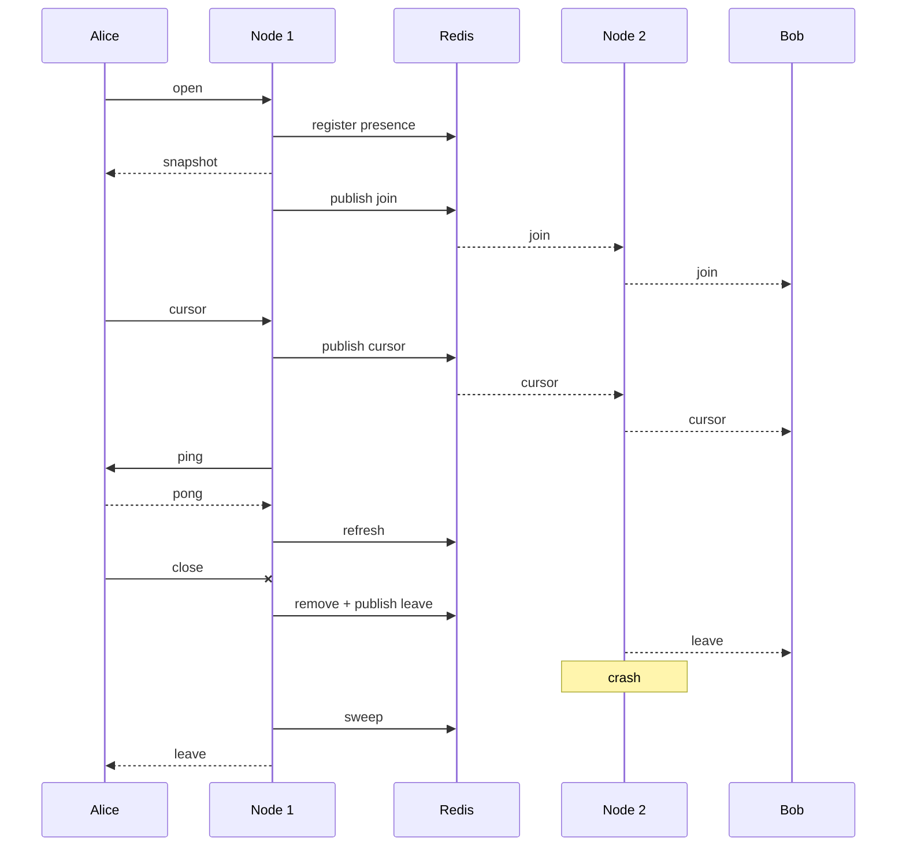

## Presence and cursors plan

Uses Redis for presence and pub/sub. Clients keep a presence store. Heartbeats keep things fresh, and a sweeper cleans up.

Notes:
- Cursors are throttled.
- Handle revisions with transformPosition.
- Dedupe tabs on the client.
- Seq numbers on cursors.
- Entries have a TTL.
- Edits are unchanged.
