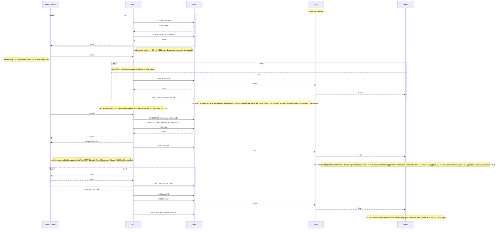

Notes (read these first, or after, either way): so the main thing is the presence map in redis (the room hash / presence:{docId}, one field per conn, with userId nodeId lastSeen and the cursor stuff pos rev seq in it) and the WS boxes write their own fields, though the sweeper on any server can delete other people's, and there's also the pub/sub topic with the same name presence:{docId} which is NOT ops:{docId}, that one is edits, and edits keep going op -> node -> doc service -> Postgres -> ops:{docId} like now, and cursors never go to the doc service or Postgres. Also the client keeps userId -> connIds so two tabs is one avatar, and the avatar goes when the last connId goes. Timing for crash is 30 + 5 = 35 worst case, under the 45: lastSeen can't be later than the crash since nobody refreshes after it, then the 30 s stale threshold, then up to 5 s to the next sweep. Key EXPIRE 120 s is refreshed on every write so nothing sticks around. No sticky LB needed because everything fans out through redis.

Also, the gateway closes sockets after 20 s without a pong and then does the same HDEL plus leave. A clean close is immediate, so under 2 s. If nobody is on the doc to sweep, the next open's snapshot cleans stale entries, and the EXPIRE handles the rest. Events are applied by connId so replaying a buffered join is harmless. Bob's old entry, if he reconnected, lingers until swept, but he's grouped by userId so he isn't shown twice.
