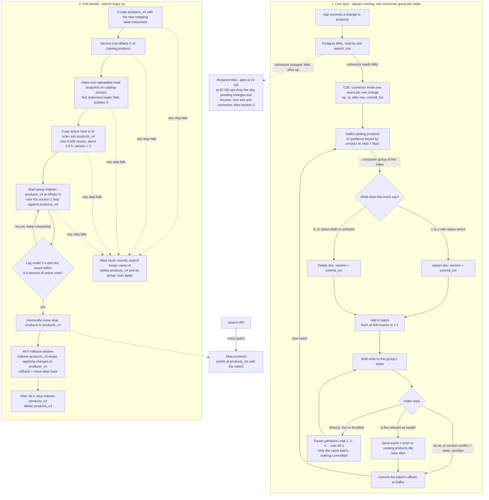

## Product search sync: CDC live path and zero-downtime rebuild

**Read first**
1. Source of truth is `products` on catalog-primary. The index is a derived copy that holds only rows with `status = active`. A delete, or a change to `draft` or `archived`, removes the document.
2. Every write to the index carries a version. For a change it is the change's `commit_lsn`. For a document copied during a rebuild it is the snapshot position S. The index applies a write only if its version is at least the stored one. An older change that arrives late is therefore rejected as stale (counted, not an error), and applying any event twice is harmless.
3. Progress lives only in Kafka. Each physical index has its own consumer group (`indexer-products_v3`, `indexer-products_v4`), and that group's committed offsets record how far the index has been brought up to date. The indexer keeps no other state.

**Notes**
- **Why the rebuild loses nothing:** O is recorded *before* the snapshot opens. Any change the snapshot does not contain was committed after it, so its event is in Kafka after O and gets replayed. Some replayed changes are already in the snapshot. Their commit_lsn is no later than S, so they are either rejected as stale or rewrite the same data. Replay starts only after the copy has finished, so a later delete always lands after the copied document and cannot be overwritten by it. The copy takes about 2.5 h, well inside Kafka's 7-day retention.
- **Indexer crash:** the indexer restarts from its group's last committed offsets and writes the uncommitted batch again with the same versions. This leaves the index unchanged or brings it to the same state.
- **Connector lag or outage:** search goes stale but never wrong. When the connector returns, it catches up from the slot, unless the slot was dropped at 50 GB. In that case a new slot and connector are set up first, and then the section 2 rebuild runs.
