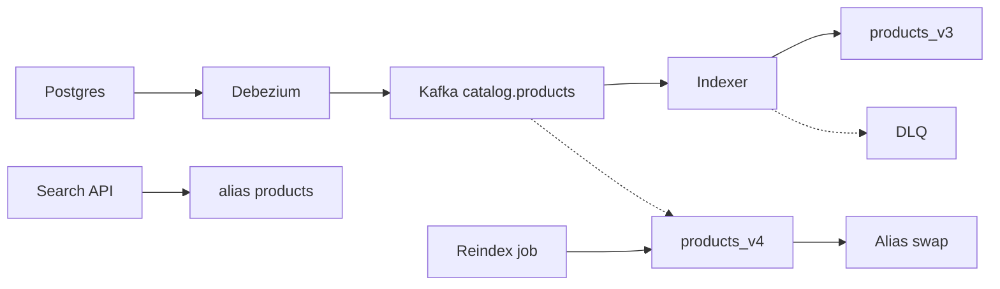

## Plan: move search to CDC

Components: Postgres (catalog-primary), Debezium, Kafka topic catalog.products, an indexer service, the search index (products_v3), the alias products, a DLQ topic and a reindex job.

Notes:
- The indexer batches and bulk-writes. Versions come from commit_lsn.
- Retries with backoff on errors; bad docs go to the DLQ.
- Only active products are indexed.
- Watch WAL growth on the slot.
- Reindex: snapshot backfill, catch up from Kafka, swap the alias when ready, keep v3 for 48 h.
