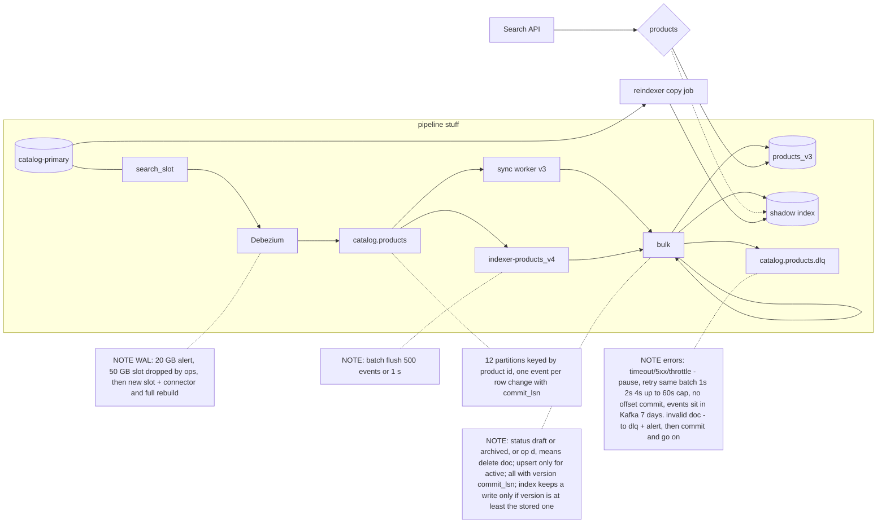

## Plan notes

So the main thing is the alias `products`. The Search API always reads it, and we flip it (atomic) from products_v3 to the new one once that is caught up, meaning lag < 5 s AND count within 0.5 percent of active rows. Before that, the reindexer has to fill the new index (v4, or "shadow index", or "the rebuild target") from a repeatable-read snapshot on catalog-primary, max 5,000 rows/s, ~2.5 h. Each copied doc gets version S, the WAL position read as the first statement of the snapshot. The sync worker for v4 (its own consumer group, indexer-products_v4) starts only after the copy is done, consuming from offsets O. O has to be grabbed (end offsets of catalog.products) BEFORE the snapshot opens, otherwise changes slip through. Anything replayed that the snapshot already had is no later than S, so it either bounces as a version conflict (stale, just counted) or rewrites the same thing, and because replay only starts after the copy, a delete can't get overwritten by the copied doc. If any of that fails, the alias was never touched, so just drop v4 and the group and redo it. Indexer = consumer = sync worker, same thing. It's stateless: its position is the committed offsets in Kafka for its group, committed after the bulk ack, so after a crash it restarts from there and redoes a batch, which is harmless because the versions are the same. v3 stays fed by indexer-products_v3 for 48 h after the flip, so flipping back loses nothing; then stop that group and delete v3.

Also, the copy reads active rows in id order.
