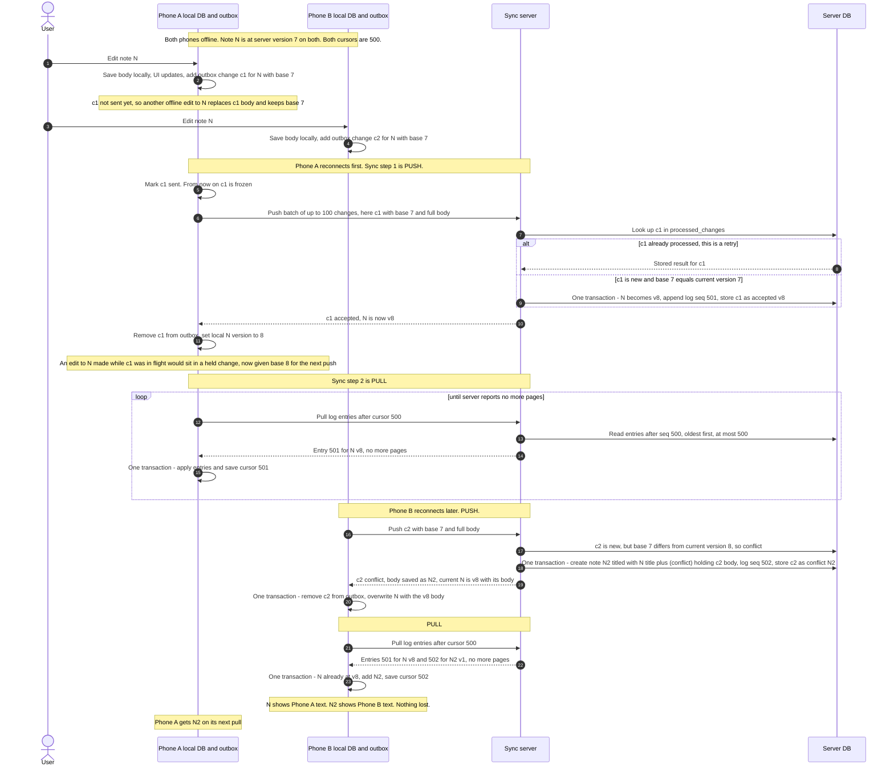

## Notes sync: sequence

**Where state lives**
- **Phone (local SQLite):** `notes` (title, body, `version` = the server version this copy is based on); `outbox` of pending changes (`change_id` UUID, `note_id`, `base_version`, full body, `sent` flag); `cursor` = the highest change-log sequence number applied.
- **Server DB:** `notes` (current body and version); `change_log` (seq, note_id, version, body); `processed_changes` (change_id → result).

**Outbox rules**
- An edit writes `notes` and the outbox in one local transaction, and the UI updates at once.
- While a note's change has not been sent, further edits replace its body. Its `change_id` and `base_version` stay the same.
- Once a change has been sent it is **frozen**: its body and `change_id` never change. A later edit to that note goes into a **new change that is held** until the sent one is confirmed. If the sent one was accepted, the held change takes the confirmed new version as its base. If it was a conflict, the held change keeps the old base, so it also becomes a conflict copy. Either way it goes out in the next push.
- A change leaves the outbox only when the server confirms it (accepted or conflict).

**When a sync runs:** on reconnect, when the app comes to the foreground, and every 60 s while online. A phone runs one sync at a time, and each sync is a **push, then a pull**.

**Failure and retry**
- **Push drops before the response arrives:** the changes stay in the outbox, because a change leaves only when the server confirms it. The next sync resends them unchanged, with the same `change_id`s (sent changes are frozen). The server finds them in `processed_changes` and returns the stored result, so nothing is applied twice. For a conflict it also returns the note's current body and version, read fresh.
- **Pull drops partway through:** the cursor is saved in the same local transaction as the page it covers. A page that did not commit is rolled back and fetched again from the last saved cursor on the next sync, and a committed page is never lost.
- **Server unreachable or erroring:** the sync stops and nothing local changes. The next trigger tries again.
- **Pulled entry for a note that still has an unconfirmed outbox change** (for example, edited during the sync): the phone leaves that note's local body alone, but the cursor still moves past the entry. When the change is pushed it conflicts. The server saves the local body as a conflict copy, and the conflict response carries the note's current body and version, which the phone writes into the note. If a held change for that note is still waiting, the phone keeps the local body for it, and that change's own conflict response brings the server body. Either way the phone ends with the winning version plus the copy.
- The server never merges text. The first write to arrive wins.
